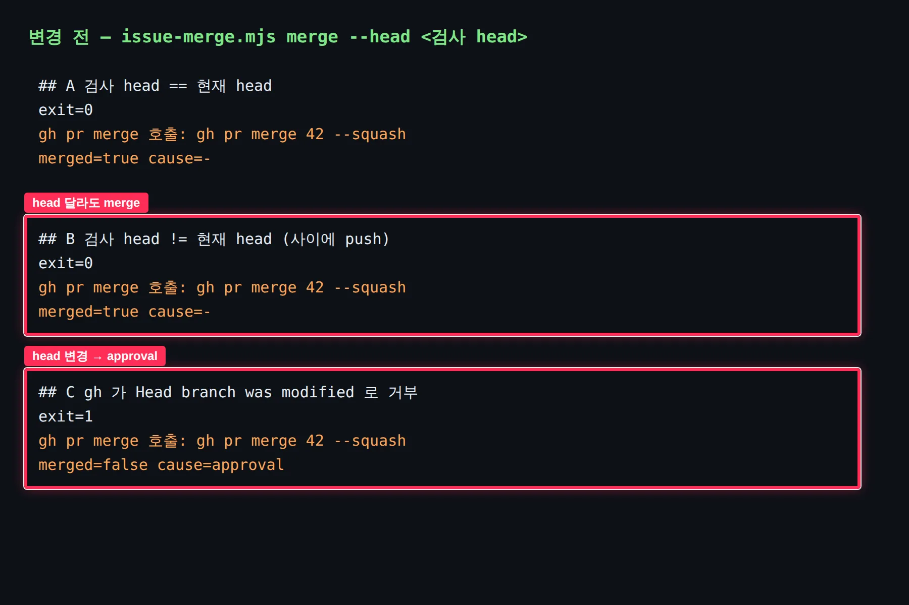
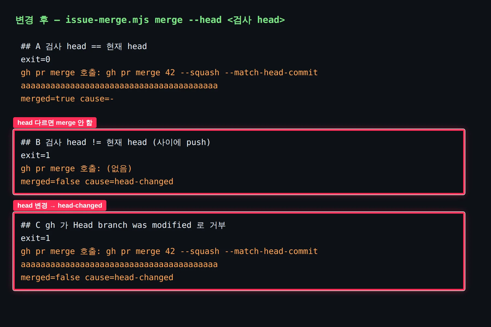

## 작업 요약

`issue-merge.mjs merge` 가 검사·승인한 PR head 로만 merge 하도록 고쳤습니다. 이제 `--head <sha>` 가 필수이고, 현재 PR head 가 다르면 `gh` 를 부르지 않고 실패합니다. head 가 같아도 `gh pr merge --match-head-commit` 으로 한 번 더 고정합니다. gh 의 `Head branch was modified` 는 `approval` 이 아니라 새 분류 `head-changed` 로 나옵니다.

화면이 없는 스크립트라, 임시 저장소와 argv 를 기록하는 가짜 `gh` 로 같은 세 시나리오를 수정 전후 코드에 돌린 출력을 증거로 남깁니다.

## 변경 전후

| 전 | 후 |
| --- | --- |
|  |  |

빨간 박스가 바뀐 시나리오입니다.

| 시나리오 | 전 | 후 |
| --- | --- | --- |
| A. 검사 head == 현재 head | `gh pr merge 42 --squash` | `gh pr merge 42 --squash --match-head-commit <sha>` |
| B. 검사 뒤 push 로 head 가 바뀜 | **merge 됨** (exit 0) | gh 호출 없음, `cause: head-changed` (exit 1) |
| C. gh 가 `Head branch was modified` 로 거부 | `cause: approval` | `cause: head-changed`, 재검사·재승인 안내 |

원본: `.issue/144/evidence/before/merge-probe.txt`, `.issue/144/evidence/after/merge-probe.txt`

## 변경 파일

- `skills/*/scripts/issue-tracker.mjs` (4벌 동일 사본). `prMerge` 에 `matchHead` 옵션 → `--match-head-commit`.
- `skills/issue-merge/scripts/issue-merge.mjs`. `merge --head` 필수, 현재 head 비교, `head-changed` 분류를 `approval` 보다 먼저, 힌트에 직접 `gh pr merge` 금지.
- `skills/issue-merge/scripts/issue-merge-phase.mjs`. merge 효과 argv 에 `--head <headSha>` 포함.
- `skills/issue-merge/SKILL.md`, `references/verify-and-close.md`, `references/merge-plan.md`. head 고정 명령, `head-changed` 행, "스크립트 merge 실패 시 `gh pr merge` 직접 호출 금지 · 재검사 · PR 별 재승인" 규칙.
- `skills/issue-merge/scripts/issue-merge-head.test.mjs`. 새 테스트 5건.

## 검증

- `node --test skills/issue-merge/scripts/*.test.mjs scripts/*.test.mjs` 18건 통과 (기존 13 + 신규 5).
- `sh scripts/check-shared.sh` 통과, `issue-tracker.mjs` 4벌 해시 일치.

## 남은 이슈

- 완료 기준 4번 "PR 2개 이상 회차에서 PR 마다 승인 질문" 은 실제 회차 실행 기록이 필요해 이 작업에서 만들 수 없습니다. 다음 다중 PR 통합 회차에서 확인합니다.
- `contracts/issue-phase-capability-bundle-v1.json` 의 closure 해시는 이번 변경 전부터 여러 파일이 실제와 어긋나 있습니다. 이번 범위 밖이라 그대로 두었습니다.
