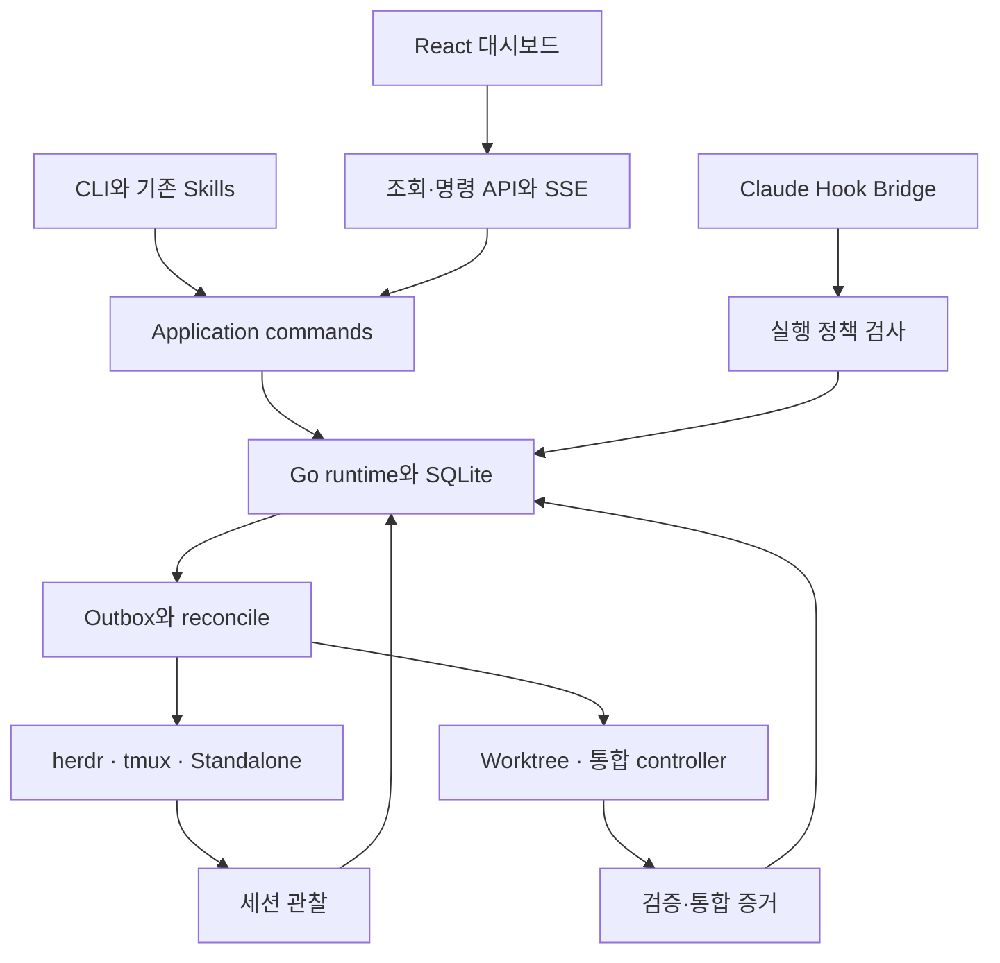

# 00. 삼사라 상세 구현 계획 — 전체 안내와 결정 기록

- 버전: 1.0
- 작성일: 2026-10-28, Asia/Seoul
- 문서 성격: 사용자와 합의한 요구사항을 실행 가능한 설계·계약·작업·검증 기준으로 정리한 구현 계획
- 현재 단계: **계획 문서 작성·공식 인터페이스 확인·문서 정합성 검토**
- 대상 독자: 프로젝트 책임자, Go 개발자, Claude Code 플러그인 개발자, React 개발자, 검증 담당자

## 1. 이번 구현의 목표

삼사라는 한 장비에서 여러 프로젝트의 Claude Code 작업을 관리하는 Go 런타임과 React 대시보드다. 프로젝트별 활성화, 의존성에 따른 병렬 실행, 승인, 세션 생존 관찰, Git Worktree, 안전한 통합, 과거 이력을 하나의 모델로 연결한다.

사용자가 확정한 다음 요구를 같은 구현 범위에 포함한다.

- 신규 worker 실행 환경은 **herdr → tmux → Standalone** 순으로 선택한다.
- 실제 사용 가능한 기능을 확인하고, 사용자가 명시한 backend 선택을 존중한다.
- 프로젝트가 삼사라를 쓰기로 한 경우에만 runtime 연결·자동 시작·backend 탐색을 수행한다.
- 런타임은 OS 사용자당 호스트 하나로 여러 프로젝트를 관리한다.
- 실행 중인 프로젝트와 과거에 실행한 프로젝트를 왼쪽 목록에서 선택한다.
- 중앙 이슈 그래프는 **왼쪽에서 오른쪽으로** 펼치고 Worktree 묶음 보기로 전환한다.
- 병렬 작업의 분기·합류, 막힘의 이유, 통합 게이트, Merge Queue를 표시한다.
- GitHub 이슈·PR·commit과 로컬 실행의 연결 이력을 목록으로 제공한다.
- 독립 작업의 구현은 병렬로 진행하되 같은 통합 target의 최종 반영은 하나의 권위가 관리한다.
- 브라우저를 닫아도 런타임과 worker는 계속 동작한다.

React UI는 별도 후속 프로젝트로 미루지 않는다. 이번 계획 안에서 공통 계약과 fixture를 바탕으로 병행 개발하고, 읽기 전용 화면을 먼저 연결한 뒤 승인·중단·재개·통합 제어를 추가한다.

## 2. 문서 구성과 읽는 순서

| 문서 | 포함 내용 | 주 독자 |
|---|---|---|
| [01. 런타임 구현 계획](01-runtime-implementation-plan.md) | Go 구조, 활성화, daemon, backend, Hooks, lease, 상태 조정, 복구, CLI | 런타임·플러그인 개발자 |
| [02. UI 구현 계획](02-ui-implementation-plan.md) | 정보 구조, 전체 화면, DAG·Worktree·Merge Queue, React 구조, 실시간 상태, 접근성 | 프런트엔드 개발자 |
| [03. 공통 계약·데이터 모델](03-contracts-and-data-model.md) | ID, 상태, dependency, SQLite, HTTP, IPC, SSE, 보안·버전 | 모든 개발자 |
| [04. Git·Worktree·Merge 계획](04-git-worktree-and-merge-plan.md) | 브랜치, 산출물 고정, 승인, 최신 base 검증, 통합 권위, 장애 복구 | Git·CI·런타임 담당 |
| [05. 테스트·개발 순서](05-testing-and-delivery-plan.md) | M0~M7, 테스트 행렬, 일정 가정, release gate, 파일럿 | 책임자·개발·검증 담당 |

처음 읽을 때는 이 문서 → 03 → 담당 분야 01 또는 02 → 04 → 05 순서를 권한다. 구현 이슈를 만들 때는 05의 milestone 아래 01의 R 작업, 02의 UI-W 작업, 04의 G 작업을 연결한다.

각 문서는 독립적으로 읽을 수 있도록 필요한 설명을 포함한다. 같은 계약이 다르게 표현될 때는 **03의 정확한 ID·필드·enum·URL을 기준**으로 수정한다. 상대 경로 링크는 전체 파일을 같은 디렉터리에 두면 유지된다.

## 3. 무엇을 확인했고 무엇을 새로 설계했는가

| 구분 | 이번 문서의 처리 |
|---|---|
| 사용자 합의 | 제공된 대화의 runtime·backend·activation·UI·Git 요구 반영 |
| 기반 제품의 동작 | herdr·Claude Code Hooks·Git·GitHub·SQLite·UI 라이브러리 공식 자료 확인 |
| 삼사라의 API·DB·상태 | 새로 제안한 구현 계약 |
| 성능·용량·시간 설정 | 측정 전 목표 또는 초기 제안값으로 표기 |
| 기존 코드·이전 시안 | 현재 제공된 실제 파일이 없어 직접 검토한 것으로 주장하지 않음 |
| 과거 SQLite 10개 테이블 검증 | 대화에 있었던 기록이며 이번 명세의 실행 검증으로 재사용하지 않음 |
| 실제 worker·Merge 테스트 | 앞으로 수행할 항목. 이번 문서 작성에서 실행하지 않음 |
| 오늘의 검증 범위 | 문서 구조·교차 링크·계약 정합성·출처 확인 |

공식 문서의 현재 기능과 설치된 바이너리의 실제 지원은 다를 수 있다. M0에서 compatibility manifest와 실제 protocol fixture를 고정한 뒤 강제 실행 기능을 활성화한다.

## 4. 전체 구조

### 4.1 각 계층의 책임

| 계층 | 최종 책임 |
|---|---|
| 기존 삼사라 Skills | 사용자 의도·계획·명령을 runtime 작업으로 연결 |
| Hook Bridge | 현재 도구 호출이 삼사라 정책상 가능한지 확인·관찰 전달 |
| Go runtime | desired state, dependency, approval, lease, completion 판정 |
| herdr·tmux·Standalone | 실제 세션 실행·연결·지원 가능한 관찰과 입력 |
| Git integration controller | 불변 결과의 검증·후보·target 반영 요청·증거 |
| GitHub native queue | 선택된 모드에서 원격 통합 순서와 보호 규칙 집행 |
| React UI | 현재 사실·원인·이력 표시와 조건부 사용자 명령 제출 |

UI나 terminal multiplexer의 상태가 runtime의 업무 완료 판정을 대신하지 않는다.

## 5. 핵심 결정 기록

| ADR | 결정 | 이유와 변경 조건 |
|---|---|---|
| 01 | OS 사용자당 호스트 하나의 daemon | 장비당 runtime 요구를 사용자 권한 경계에 맞춤 |
| 02 | 프로젝트별 명시적 opt-in | 설치만으로 모든 Claude 세션에 간섭하지 않음 |
| 03 | 저장소 config와 로컬 trust를 분리 | clone한 설정만으로 실행을 승인하지 않음 |
| 04 | 신규 생성 resolver와 기존 session binding을 분리 | 현재 tmux 세션을 herdr 설치 때문에 옮기지 않음 |
| 05 | 자동 선택은 herdr→tmux→Standalone | 명시적 선택·실제 capability가 우선 |
| 06 | 장애 난 기존 worker를 즉시 다른 backend에 복제하지 않음 | 생존 불명과 중복 실행 방지 |
| 07 | Standalone은 현재 세션·Hook·수동 재개를 지원 | 자동 PTY·headless driver는 별도 후속 범위 |
| 08 | Domain·Adapter·reconcile·outbox 구조 | 외부 API 차이와 불확실한 결과를 경계 밖에서 처리 |
| 09 | SQLite 단일 writer와 영속 이벤트 | 상태 변경과 알림·외부 intent의 원자적 기록 |
| 10 | 실행권 검사와 native permission 분리 | 삼사라 PASS가 Claude 권한 승인을 우회하지 않음 |
| 11 | Hook deny와 프로세스 종료를 구분 | 진행 중인 도구는 다음 PreToolUse로 취소할 수 없음 |
| 12 | immutable output 이후 integration 권한 인계 | worker가 끝나도 Merge가 계속 가능해야 함 |
| 13 | dependency 기본은 INTEGRATED+EXECUTION | 실제 코드가 필요한 후속 작업의 기반 보장 |
| 14 | Integration Gate는 조건 집계 | 가짜 worker·가짜 이슈를 만들지 않음 |
| 15 | 짧은 작업 브랜치와 target별 queue | 기존 main/develop 규칙은 프로젝트 설정으로 존중 |
| 16 | target별 통합 authority 하나 | GitHub queue와 로컬 direct merge 이중 수행 금지, native 모드는 현재 group 승인에 대한 필수 check 검증 |
| 17 | 자동 통합은 초기 기본 비활성 | explicit manual/github_queue/samsara_local 선택 |
| 18 | React는 API·SSE만 사용 | SQLite·Hook secret·직접 backend 입력 접근 금지 |
| 19 | snapshot+영속 cursor replay | reconnect·누락·중복을 명시적으로 처리 |
| 20 | 전체 프로젝트 목록과 LR issue DAG 기본 | 과거 프로젝트·병렬 작업·합류를 함께 이해 |
| 21 | 읽기 전용 UI 후 제어 UI | 데이터 정합성을 먼저 검증하고 같은 범위 안에서 확장 |
| 22 | backend 관찰·실행·승인·통합 상태 분리 | done/blocked/closed의 의미 혼동 방지 |
| 23 | remote multi-host·OS sandbox는 이후 범위 | 초기 단일 호스트 보장을 과장하지 않음 |
| 24 | 대시보드와 실행 생명주기 분리 | 브라우저 종료가 worker 중단이 되지 않음 |

이 표의 결정은 요청한 구현을 진행하기 위한 기본안이다. 버전 선택·실측 성능처럼 환경 확인이 필요한 항목은 M0와 해당 검증 gate에서 확정하며, 문서 작성 완료를 다시 승인받아야만 다음 내용을 읽을 수 있는 구조로 만들지 않는다.

## 6. 사용 흐름

### 6.1 설치 후 일반 프로젝트

플러그인이 설치되어 있어도 UNCONFIGURED·DISABLED 프로젝트의 일반 세션에서는 daemon을 띄우거나 backend를 탐색하지 않는다. 사용자가 삼사라 작업을 요청하고 프로젝트를 활성화하면 로컬 trust와 설정을 등록한다.

프로젝트를 켰다고 모든 기존 Claude 세션을 자동 worker로 편입하지 않는다. 관찰용 세션 등록과 작업 lease를 부여하는 managed attach를 구분한다.

### 6.2 병렬 실행 시작

런타임은 계획의 cycle·dependency·승인·자원 한도를 검사한다. 실행 가능한 이슈에 대해 관리 Worktree와 launch intent를 만들고, 실제 기능을 충족하는 backend를 선택한다. SessionStart의 등록과 guard readiness를 확인한 뒤 실행권을 발급한다.

이미 열린 tmux·herdr·Standalone 세션을 연결하는 경우에는 해당 환경에 그대로 bind한다.

### 6.3 A 승인 대기, B 의존, C 독립

- 처음부터 B가 A의 승인을 필요로 하면 B는 시작하지 않는다.
- C는 별도 권한·Worktree로 계속 진행한다.
- 이전 승인에 따라 이미 B가 실행 중이었는데 그 승인이 취소되면 B의 다음 도구 실행을 막는다.
- 현재 진행 중인 도구가 남으면 PAUSING으로 표시하고 종료·정지 증거를 기다린다.
- A 승인이 완료돼도 B의 backend·lease·native permission·입력권을 다시 확인한다.
- Standalone에서는 실행 가능 상태와 사용자가 터미널에서 재개해야 한다는 안내를 함께 표시한다.

이 두 경우를 구분해야 테스트가 논리적으로 성립한다. “처음부터 실행 불가능한 B가 이미 작업 중이었다”는 잘못된 fixture를 만들지 않는다.

### 6.4 병렬 작업의 합류와 Merge

서로 독립인 A와 C는 병렬 구현할 수 있다. A가 먼저 적격해지면 A를 통합할 수 있으며, C가 끝날 때까지 프로젝트 전체를 멈추지 않는다.

같은 target에 C를 반영할 때는 A가 포함된 최신 base에서 C의 결합 결과를 다시 검증한다. 후속 D가 A와 C의 INTEGRATED 결과를 모두 요구하면 두 통합 증거가 모인 뒤 실행한다.

GitHub native queue를 선택한 target에서는 GitHub가 실제 통합 순서를 관리한다. 삼사라는 적격 후보 전달·관찰·설명에 집중한다. 로컬 모드에서는 소유권과 checkout 조건을 충족한 target만 CAS로 갱신한다.

### 6.5 프로젝트를 나중에 다시 확인

왼쪽 목록에는 실행 중·중지·비활성·과거·보관 프로젝트가 남는다. 프로젝트를 클릭하면 최신 또는 과거 run을 선택하고 DAG·worktree·session·approval·integration history를 볼 수 있다.

이력 조회 자체가 runtime worker를 다시 띄우거나 project를 활성화하지 않는다. 경로가 사라졌으면 MISSING으로 표시하고 과거 기록은 유지한다.

## 7. UI 기본 구성

| 영역 | 주요 내용 | 중요한 상호작용 |
|---|---|---|
| 왼쪽 sidebar | 전체 프로젝트, 검색, 실행·대기 수, 마지막 활동 | 과거 프로젝트도 선택, 현재 선택 보존 |
| 상단 header | 프로젝트·run·target·연결 최신성 | run 전환, 필터, capability 확인 |
| 중앙 canvas | 좌→우 이슈 DAG·Worktree 묶음·통합 게이트 | 선택, 접기, 확대·축소, minimap, 자동 정렬 |
| 오른쪽 inspector | 선택 이슈·세션·승인·Merge 근거 | 이유 조회, 해당 terminal/PR 연결 |
| Merge Queue 영역 | target별 순서·candidate·검사·승인·충돌 | readiness 설명, 명시적 enqueue |
| 하단 탭 | 세션·이벤트·GitHub 이력·Worktree 목록 | 페이지화, 상세 연결, 시간 필터 |
| 좁은 화면 | 목록 우선·drawer·단일 패널 | 모든 정보를 억지로 한 canvas에 축소하지 않음 |

그래프 배치는 구조 변경 때만 재계산한다. 매 상태 이벤트마다 노드가 움직이지 않게 한다. Worktree 그룹 접기는 실제 이슈 dependency를 수정하지 않으며, 시각상 순환처럼 보이는 묶음은 펼침·레인으로 해결한다.

상태는 색뿐 아니라 텍스트·아이콘·이유를 함께 표시한다. 키보드와 보조 기술을 위해 그래프와 같은 데이터를 제공하는 목록 보기를 둔다.

## 8. 구현 순서와 병행 개발

| 단계 | 결과물 | 다음 단계로 가는 기준 |
|---|---|---|
| M0 | 공식 지원 범위·version pin·공통 계약·fixture | 불변조건·계약 검토, 실제 도구 spike |
| M1 | activation·DB·IPC·Standalone 수직 흐름 | 비관리 무동작, 등록·저장·권한 경계 |
| M2 | Fake backend 정책·lease·승인·복구 | A/B/C·crash·stale fence·중복 방지 |
| M3 | 조회 API·snapshot·영속 SSE | atomic snapshot/replay·재연결 계약 |
| M4 | 읽기 전용 React 대시보드 | 프로젝트·LR DAG·상태·이력·접근성 |
| M5 | 실제 herdr/tmux·Git 후보·GitHub 조회 | backend conformance·실제 Git 검증 |
| M6 | 승인·중단·재개·통합 제어 | 조건부 명령·실제 queue·실패 복구 |
| M7 | 배포·backup·성능·파일럿 | P0 해소·운영 runbook·사용자 시나리오 |

M4 화면 개발은 M3 완성까지 기다리지 않는다. M0의 schema·fixture로 시작하고 M3 fake event server와 연결한다. 실제 backend·Git·제어 단계의 수용시험을 생략해 UI만 먼저 “완료”로 발표하지 않는다.

세부 공수·인력 가정·critical path·테스트 ID는 05에 있다. 일정은 기존 코드의 재사용 가능성과 설치 환경을 아직 조사하지 않은 상태의 추정이며 M0 후 재산정한다.

## 9. 요구사항 추적표

| 요구사항 | 설계 위치 | 수용 근거 |
|---|---|---|
| 장비당 runtime 하나 | 01 §1·15, 03 §2 | single instance·startup race |
| 프로젝트별 사용 결정 | 01 §4, 02 §18 | opt-in·disabled 무동작 |
| herdr 우선 fallback | 01 §5~9 | capability별 conformance |
| 일반 Claude 세션 지원 | 01 §9·10 | Standalone attach·manual resume |
| 기존 Skills 유지 | 01 §10 | 관리 hook 추가·기존 설정 보존 |
| 승인·의존성 제어 | 01 §11~12, 03 §4 | A/B/C 및 승인 revision |
| runtime 재시작 | 01 §15, 03 §10 | stale fence·old process quarantine |
| 전체·과거 프로젝트 | 02 §3~6 | archived·disabled·missing fixture |
| 좌→우 그래프 | 02 §7~9 | LR 배치·긴 라벨·대형 그래프 |
| Worktree 병렬 표시 | 02 §7·12, 04 §6 | issue/attempt/worktree 관계 |
| 언제 Merge하는지 | 02 §11, 04 §8~11 | 적격 조건·검증 증거 |
| 통합 게이트 | 03 §4, 04 §4 | membership 변경·ALL 조건 |
| GitHub 이력 | 02 §12, 04 §10·15 | issue/PR/commit provenance |
| 실시간 관찰 | 02 §15, 03 §8~9 | cursor gap·replay·stale |
| UI 닫아도 실행 지속 | 01 §1, 03 §13 | 브라우저 종료 시나리오 |
| 병렬 구현·직렬 통합 | 04 §9~14 | target별 단일 authority |
| native 권한 구분 | 01 §10, 02 §13 | 삼사라 PASS·native prompt |
| 위험한 자동 복구 방지 | 01 §11·15, 04 §13 | 응답 유실·dirty worktree |
| 접근성과 큰 그래프 | 02 §19~22 | 키보드·색·리스트·성능 fixture |
| 검증 후 단계적 배포 | 05 전체 | milestone별 release gate |

## 10. 구현 착수 시 만들 첫 작업 묶음

1. 계약을 OpenAPI·JSON Schema로 옮기고 Go·TypeScript 타입을 생성한다.
2. 현재 플러그인·Go 코드·기존 migration이 있다면 제공된 저장소에서 inventory를 만들고 재사용 여부를 결정한다.
3. 설치된 Claude·herdr·tmux·Git·SQLite 버전을 기록한다.
4. 비활성 프로젝트의 완전 무동작과 관리 Hook의 실패 차단을 실제 client에서 확인한다.
5. Fake backend와 clock으로 A/B/C·revoke·crash·unknown delivery를 재현한다.
6. 동일 fixture로 sidebar·LR DAG·inspector·timeline을 병행 개발한다.
7. snapshot/SSE를 연결하고 화면과 도메인 version이 일치하는지 확인한다.
8. 실제 backend와 Git 통합은 격리된 테스트 환경에서 검증한 뒤 프로젝트에 적용한다.

첫 작업의 목표는 모든 화면이나 모든 adapter를 한 번에 완성하는 것이 아니다. 활성화→등록→실행권→관찰→정확한 표시가 이어지는 수직 흐름을 만들고, 실패했을 때의 동작까지 확인하는 것이다.

## 11. 공식 자료

세부 문서의 출처 표가 각 사실의 직접 근거다. 전체 문서에서 주로 참고한 공식 자료는 다음과 같다.

- [Claude Code Hooks](https://code.claude.com/docs/en/hooks)
- [herdr Agent automation](https://herdr.dev/docs/agent-automation/) · [Socket API](https://herdr.dev/docs/socket-api/)
- [Git Worktree](https://git-scm.com/docs/git-worktree) · [update-ref](https://git-scm.com/docs/git-update-ref)
- [GitHub Merge Queue](https://docs.github.com/en/repositories/configuring-branches-and-merges-in-your-repository/configuring-pull-request-merges/managing-a-merge-queue)
- [SQLite transactions](https://www.sqlite.org/lang_transaction.html) · [WAL](https://www.sqlite.org/wal.html)
- [React Flow](https://reactflow.dev/learn) · [ELK](https://eclipse.dev/elk/)
- [WHATWG SSE](https://html.spec.whatwg.org/multipage/server-sent-events.html)
- [WCAG 2.2](https://www.w3.org/TR/WCAG22/)

이 문서 묶음은 구현 계획의 기준선이다. 실제 개발에서는 계약·코드·테스트·운영 증거를 같은 변경 단위로 갱신한다.

