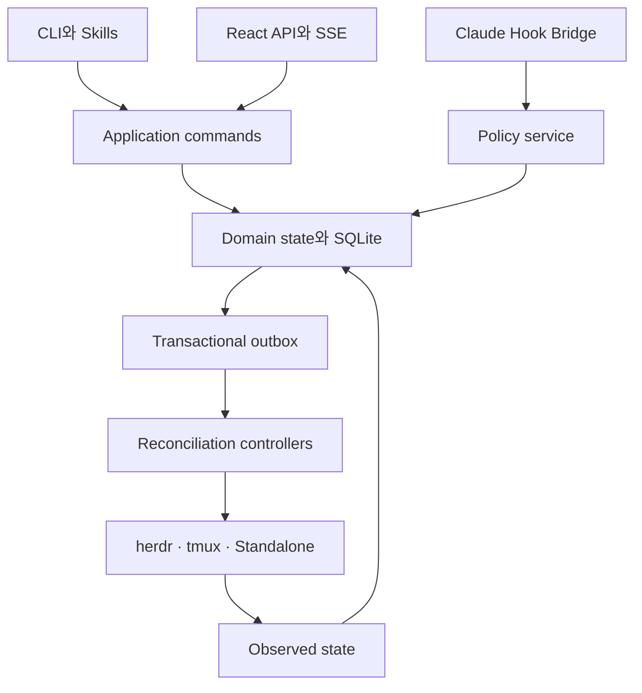
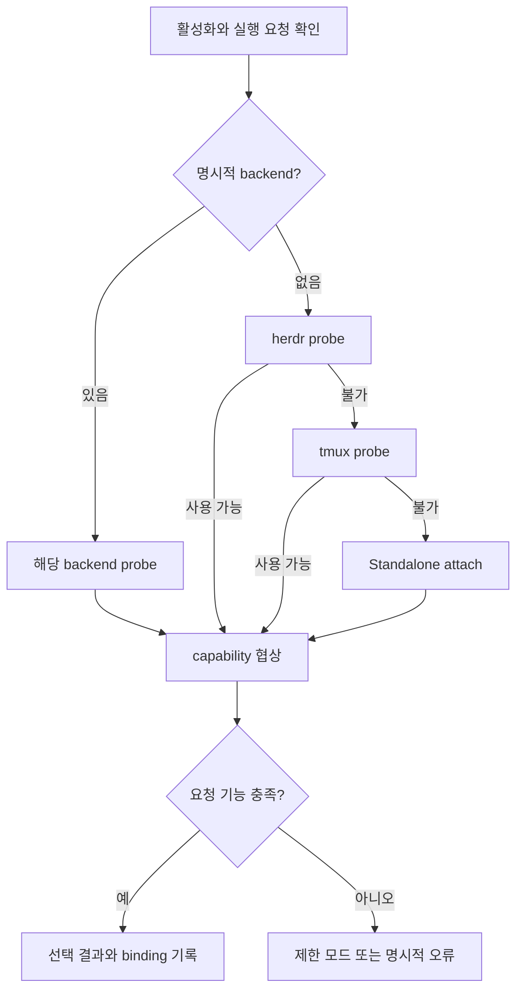

# 01. Samsara Go 런타임 구현 계획서

- 문서 기준일: 2026-10-28, Asia/Seoul
- 문서 상태: 구현을 위한 제안 명세. 본 문서는 실제 구현 완료나 통합 테스트 통과를 의미하지 않는다.
- 대상: Go 런타임, Claude Code 플러그인·Hook Bridge, herdr·tmux·Standalone Adapter 개발자
- 계약 우선순위: 식별자·JSON·상태·API의 정확한 정의는 [공통 계약 및 데이터 모델](03-contracts-and-data-model.md)을 기준으로 한다.
- 범위: 한 호스트에서 여러 프로젝트와 여러 Claude Code 세션을 관리하는 로컬 오케스트레이션 시스템

## 1. 목표와 설계 전제

삼사라는 이슈의 의존성, 작업 권한, 승인, 병렬 실행, Git 통합을 관리한다.
herdr와 tmux는 세션을 실행하고 관찰하는 수단이며, 작업 완료를 판정하는 주체는 삼사라 런타임이다.
일반 터미널 사용자도 같은 프로젝트 정책과 승인·의존성 규칙을 사용할 수 있어야 한다.

사용자와 합의한 제품 원칙은 다음과 같다.

1. 장비당 하나의 Go 런타임이 여러 프로젝트를 관리한다.
2. 이 원칙의 실제 보안 범위는 **호스트의 OS 사용자당 하나의 데몬**이다. 다른 OS 사용자의 프로젝트와 권한을 공유하지 않는다.
3. 프로젝트가 명시적으로 활성화되었을 때만 런타임 연결과 실행 환경 탐색을 시작한다.
4. 새로운 워커를 만들 때의 기본 우선순위는 herdr → tmux → Standalone이다.
5. 사용자가 backend를 명시하면 그 선택을 존중한다.
6. 이미 실행 중인 세션은 실제로 속한 backend에 연결한다. 신규 워커 우선순위를 이유로 옮기지 않는다.
7. herdr 장애가 나도 기존 워커를 즉시 tmux로 재실행하지 않는다.
8. Standalone MVP는 현재 Claude 세션 연결, 정책 검사, 관찰, 수동 재개를 지원한다.
9. UI를 닫아도 런타임, 워커, 승인 상태와 작업 이력은 유지된다.
10. 구현 완료와 통합 완료는 별도의 상태로 관리한다.

### 1.1 이번 문서에서 정한 구현 기본값

| 항목 | 기본값 | 이유 |
| --- | --- | --- |
| 주 플랫폼 | macOS·Linux의 로컬 단일 사용자 | IPC·프로세스·worktree 복구를 먼저 검증 |
| Windows | 호환성 조사 및 별도 수용 기준 | named pipe, 프로세스 트리, Hook 실행 환경 차이 |
| 원격 호스트 실행 | 후속 범위 | host identity와 원격 생존 확인을 추가해야 함 |
| 실행 주체 | Claude Code | 에이전트 일반화보다 한 종류의 정책 검증을 우선 |
| DB | 로컬 SQLite | 단일 장비의 durable state와 transactional outbox |
| IPC | Unix domain socket | CLI·Hook과 daemon 사이의 로컬 통신 |
| UI API | loopback HTTP + SSE | React 관찰·명령과 재연결 지원 |
| 자동 워커 생성 | herdr·tmux | Standalone은 기존 세션 연결만 제공 |
| 자동 승격·통합 | 명시적 프로젝트 정책 아래에서만 | 실행 권한과 저장소 반영 권한을 구분 |
| 비관리 프로젝트 | 무동작 | 설치만으로 기존 Claude 작업을 방해하지 않음 |

Windows와 원격 호스트 지원을 배제하는 최종 제품 결정은 아니다.
1차 개발·배포 검증 범위를 좁히기 위한 제안이며, CLI와 domain package는 플랫폼 분리가 가능하도록 설계한다.

### 1.2 이번에 확인한 사실과 아직 확인하지 않은 것

공식 문서에서 herdr의 agent 제어, socket schema·이벤트 구독, Claude Code의 Hook 지점을 확인했다.
실제 설치된 herdr·tmux·Claude Code 버전의 조합, 현재 프로젝트 코드, 기존 SQLite 마이그레이션 파일은 이 문서 작성에서 실행 검증하지 않았다.
앞선 대화의 “10개 테이블 생성 통과” 기록은 이번 구현의 근거 테스트로 재사용하지 않는다.

설정 예제와 Go 인터페이스는 **삼사라가 구현할 계약 예시**이다.
herdr와 Claude Code의 공식 명령·설정은 출처를 붙인 범위에서만 외부 사실로 취급한다.
구현 첫 단계에서 설치 바이너리의 버전과 schema를 고정한다.

## 2. 반드시 지켜야 하는 불변 조건

| ID | 조건 | 위반 시 영향 |
| --- | --- | --- |
| R-01 | 비활성·미관리 프로젝트에서는 daemon autostart, backend probe, 자동 입력을 하지 않는다. | 기존 작업에 간섭 |
| R-02 | 하나의 실행 attempt에 유효한 mutation authority를 하나만 부여한다. | 중복 구현 |
| R-03 | lease 만료만으로 이전 프로세스가 종료되었다고 판단하지 않는다. | split brain |
| R-04 | 같은 worktree를 쓰는 이전 실행의 생존이 불명확하면 새 실행을 할당하지 않는다. | 파일 손상·경쟁 |
| R-05 | backend의 idle·done·blocked를 이슈 완료·승인으로 직접 변환하지 않는다. | 잘못된 후속 실행 |
| R-06 | 외부 실행·입력은 DB transaction 밖에서 수행한다. | 장기 lock·장애 전파 |
| R-07 | 상태 변경과 해당 domain event·outbox 기록은 하나의 transaction이다. | 상태와 알림 불일치 |
| R-08 | 자동 재시도 전에 이전 외부 작업의 실제 결과를 확인한다. | 중복 워커·중복 프롬프트 |
| R-09 | Claude 권한 승인은 삼사라의 작업 승인과 별개이다. | 권한 우회 |
| R-10 | 승인·검증 근거는 대상 revision과 정책 version에 묶는다. | 오래된 승인의 재사용 |
| R-11 | backend 선택은 신규 생성 시, 복구는 기존 binding을 기준으로 한다. | 세션 identity 혼동 |
| R-12 | 실제 Git 반영은 target에 지정한 단일 통합 authority가 맡고 controller가 결과를 확인한다. | 여러 워커의 동시 push |
| R-13 | UI와 Hook은 SQLite 파일을 직접 수정하지 않는다. | 정책 우회·경합 |
| R-14 | 사용자 취소, daemon 장애, backend 장애는 서로 다른 원인 코드로 남긴다. | 복구 판단 실패 |
| R-15 | 관찰의 최신성·출처·불확실성을 상태와 함께 보관한다. | 오래된 정보의 권한화 |

이 조건들은 악의적 로컬 사용자나 임의 코드를 OS 수준에서 격리한다는 보장이 아니다.
Hook을 따르는 관리 세션에 대한 협력적 오케스트레이션을 기본 경계로 한다.
강한 파일·네트워크·프로세스 격리가 필요하면 별도 sandbox/container 계층과 배포 자격증명 분리가 필요하다.

## 3. 책임을 나누는 구조



### 3.1 핵심 모듈

| 모듈 | 책임 | 맡기지 않는 책임 |
| --- | --- | --- |
| Activation manager | 프로젝트 활성화, 설정 검증, 관리 범위 결정 | 모든 폴더의 자동 스캔 |
| Project registry | 경로·저장소 identity·최근 실행 이력 | 경로만으로 프로젝트 동일성 단정 |
| Backend resolver | 요청 capability와 설정에 맞는 backend 선택 | 기존 세션 강제 이주 |
| Session controller | 생성 intent, 등록, 생존, 복구, 종료 관찰 | 이슈 최종 완료 판정 |
| Scheduler | 의존성, 승인, quota, 작업 가능 여부 평가 | 터미널 출력으로 이슈 완료 추정 |
| Lease service | 실행 권한, 갱신, revoke, fencing | 임의 OS 쓰기 강제 취소 |
| Hook policy service | 개별 도구 호출 직전 관리 권한 판정 | Claude 고유 permission 승인 |
| Approval service | 대상 revision별 승인 요구·결정·실효 | herdr blocked 자동 해제 |
| Git controller | worktree, 후보 revision, 검증, 직렬 통합 | 활성 작업 파일 자동 파기 |
| Outbox dispatcher | 외부 동작 intent 전달과 결과 수집 | 무조건적인 at-least-once 입력 재전송 |
| Observation projector | UI에 필요한 조회 모델 생성 | command authority 소유 |
| HTTP/SSE server | 인증된 snapshot·조회·명령·event 전달 | 브라우저에 DB 접근 허용 |

### 3.2 권장 Go package 구성

| 경로 | 주요 타입과 책임 |
| --- | --- |
| `cmd/samsara` | CLI, daemon 시작, doctor, hook 명령 진입점 |
| `internal/domain` | ID, 상태 전이, 정책 오류, domain event |
| `internal/app` | command handlers, transaction 경계 |
| `internal/project` | root 정규화, registry, opt-in trust |
| `internal/activation` | 활성화·disable drain |
| `internal/scheduler` | dependency evaluation, ready queue, quota |
| `internal/lease` | 발급·갱신·철회·fencing |
| `internal/approval` | approval revisions, stale 결정 |
| `internal/session` | bindings, attempts, generations, liveness |
| `internal/backend` | ports, capabilities, resolver, 오류 분류 |
| `internal/backend/herdr` | CLI·socket adapter, event invalidation |
| `internal/backend/tmux` | 명시적 socket·pane 식별, Hook 기반 상태 |
| `internal/backend/standalone` | attach, observation, manual resume |
| `internal/hooks` | 입력 schema, 정책 IPC, 출력 직렬화 |
| `internal/gitops` | worktree와 통합 command orchestration |
| `internal/store/sqlite` | migrations, repositories, writer |
| `internal/outbox` | dispatch, retry, ambiguous outcome |
| `internal/transport/ipc` | 사용자 전용 Unix domain socket 위 HTTP/JSON |
| `internal/transport/http` | API, 인증, SSE, static assets |
| `internal/observability` | structured log, metrics, diagnostics |
| `internal/testkit` | fake clock, fake backend, crash injection |

도메인 package는 herdr JSON 구조나 HTTP framework 타입을 import하지 않는다.
Adapter가 외부 응답을 삼사라의 observed record로 변환한다.
생성된 API 타입은 계약 파일에서 만들며 frontend와 backend가 각각 손으로 같은 enum을 복제하지 않는다.

## 4. 프로젝트 identity와 활성화

### 4.1 프로젝트를 식별하는 방법

프로젝트의 영구 식별자는 `project_id`이며 절대 경로와 GitHub repository URL은 속성이다.
같은 Git 저장소의 여러 linked worktree는 기본적으로 하나의 프로젝트에 속한다.
root 정규화 시 Git common directory, 실제 경로, 등록 정보와 사용자 선택을 함께 사용한다.

경로가 바뀌거나 저장소를 clone한 경우 기존 프로젝트로 자동 합치지 않는다.
동일 remote를 가리키는 서로 다른 clone은 독립적인 로컬 checkout일 수 있다.
복원·이전은 CLI의 명시적 relink 명령에서 경로와 repository fingerprint를 비교한다.

Git 저장소가 아닌 디렉터리는 관찰용 등록까지 허용할 수 있지만, Git 통합 기능은 `unsupported`로 노출한다.
MVP의 자동 병렬 구현은 Git 저장소와 관리 worktree를 요구한다.

### 4.2 세 가지 활성화 상태

| 상태 | 의미 | 일반 세션의 SessionStart |
| --- | --- | --- |
| `UNCONFIGURED` | 사용 여부를 정하지 않음 | 즉시 통과, 안내 반복 없음 |
| `DISABLED` | 명시적으로 사용 안 함 | 즉시 통과 |
| `ENABLED` | 사용자가 등록·활성화함 | 설정 검사 → daemon 연결 → 등록 |

활성화 상태는 daemon의 `HEALTHY / DEGRADED / OFFLINE` 상태와 분리한다.
활성화된 프로젝트에서 daemon이 죽었다고 프로젝트를 비활성으로 바꾸지 않는다.
설정 파일 파싱 실패도 `DISABLED`로 조용히 취급하지 않는다.

저장소에 있는 `.samsara/config.yaml`만으로 로컬 실행을 자동 신뢰하지 않는다.
`samsara init` 또는 사용자의 명시적 활성화가 로컬 trust registry를 만든다.
clone한 저장소에 설정 파일이 들어 있어도 로컬 등록 전에는 자동 실행하지 않는다.

### 4.3 설정 예시

```yaml
version: 1

runtime:
  enabled: true
  autostart: true

backend:
  mode: auto
  order: [herdr, tmux, standalone]
  allow_fallback: true

execution:
  max_workers: 5
  max_workers_per_issue: 1
  managed_worktree_required: true
  unknown_worker_policy: quarantine

approval:
  implementation_start: manual
  integration: manual

git:
  target_ref: refs/heads/main
  integration_authority: manual
  merge_concurrency_per_target: 1

observation:
  collect_terminal_output: false
  event_retention_days: 7
```

이 숫자는 성능 검증 전의 제안 초기값이다.
설정 schema validation에서 알 수 없는 필드, 음수 worker 수, 잘못된 backend와 branch 값을 오류로 처리한다.
사용자 로컬 설정은 자격증명·개인 경로를 담고, 저장소 설정은 공유 가능한 정책만 담는다.

Git integration authority의 기본값 `manual`은 후보·검증·이력 관찰을 준비하되 자동 publication은 하지 않는다는 뜻이다.
자동화를 활성화할 때 `github_queue` 또는 `samsara_local` authority와 target eligibility를 명시적으로 선택한다.
`samsara_local`은 managed bare repository 또는 checkout되지 않은 명시적 integration ref를 사용한다.
사용자가 checkout한 `main`의 ref를 직접 바꾸는 경로는 허용하지 않는다. 자세한 조건은 [Git·worktree·통합 계획](04-git-worktree-and-merge-plan.md)을 따른다.

명시적인 `backend.mode: tmux`는 tmux가 불가능할 때 오류로 보여주는 것이 기본이다.
사용자가 명시적 mode에 fallback까지 허용한 경우에만 순서대로 대안을 선택한다.
자동 mode에서는 선택 사유와 각 실패 원인을 diagnostics에 남긴다.

### 4.4 실행 중 비활성화

설정 파일을 `enabled: false`로 바꿨다는 이유로 기존 managed worker의 정책 검사를 즉시 우회하면 안 된다.
이미 발급한 실행 권한을 관리해제하는 절차가 먼저 필요하다.

1. 신규 run과 신규 worker 할당을 멈춘다.
2. 실행 중인 attempt의 lease를 revoke한다.
3. managed binding이 남아 있는 세션은 다음 PreToolUse에서 계속 차단한다.
4. 진행 중 도구·자식 프로세스·Git 동작이 종료되었는지 관찰한다.
5. 작업 결과와 dirty worktree를 보존한다.
6. 관리해제 완료 후 project scope의 policy hook을 제거하거나 비활성화한다.
7. 프로젝트 이력은 삭제하지 않는다.

프로젝트의 desired activation과 disable operation의 진행 상태를 구분한다.
관리해제가 끝나지 않은 worker에는 `DISABLE_DRAINING` 같은 이유 코드를 표시한다.
비활성·미관리 일반 세션은 이 절차와 관계없이 daemon 탐색 없이 통과한다.

## 5. Backend resolver

### 5.1 생성과 연결을 분리한다

`ResolveForLaunch`는 새 worker를 어디에 만들지 결정한다.
`BindExistingSession`은 이미 열린 Claude 세션이 어디에서 실행 중인지 확인한다.

예를 들어 사용자가 tmux 안에서 Claude를 시작했는데 herdr도 설치되어 있다면, 해당 세션은 tmux에 연결한다.
herdr 우선순위는 이후 자동 생성하는 worker에만 적용한다.
환경 변수 하나만 믿지 말고 backend 조회와 현재 process·pane 관계를 확인한다.

### 5.2 탐색 절차



Probe는 설치 유무뿐 아니라 다음을 확인한다.

- 바이너리·서버 identity와 지원 version.
- 연결 가능한 로컬 endpoint와 해당 OS 사용자 소유권.
- 생성·조회·입력·종료·복구 capability.
- 작업 경로 접근 가능 여부.
- Claude 실행 파일과 관리 Hook 설치의 적합성.
- 요청한 작업에 필요한 기능의 가용성.

Probe는 기본적으로 읽기 전용이다.
실제 생성·종료 검증은 `samsara doctor --exercise` 같은 명시적 진단에서 수행한다.
설치 확인 때문에 herdr 서버를 자동으로 시작하거나 사용자 workspace를 만들지 않는다.

### 5.3 Capability 표현

boolean만으로는 “일부 지원”과 “안전하게 지원”을 구분하기 어렵다.
domain port는 기능별 support level과 이유를 반환한다.

```go
type SupportLevel string

const (
    Supported   SupportLevel = "SUPPORTED"
    Conditional SupportLevel = "CONDITIONAL"
    Unsupported SupportLevel = "UNSUPPORTED"
)

type Capability struct {
    Level       SupportLevel
    ReasonCode  string
    Constraints map[string]string
}

type Capabilities struct {
    CreateWorker      Capability
    AttachSession     Capability
    SubmitPrompt      Capability
    ObserveProcess    Capability
    ObserveAgent      Capability
    ReadOutput        Capability
    RequestInterrupt  Capability
    RestoreConversation Capability
}
```

이 코드는 인터페이스 초안이며, 실제 naming과 JSON 표기는 공통 계약에 맞춰 생성한다.
`RequestInterrupt`는 호출 가능 여부이지 실제 프로세스 종료의 보장이 아니다.

| 기능 | herdr | tmux | Standalone MVP |
| --- | --- | --- | --- |
| 기존 세션 연결 | 지원 가능한 binding 확인 후 | 명시적 socket·pane 확인 후 | 현재 Claude 세션 등록 |
| 새 worker 생성 | shell pane 생성 + agent start | 관리 pane + worker launcher | 미지원 |
| 자동 프롬프트 | agent API + 입력 소유권 확인 | Hook readiness + 전용 pane 조건부 | 미지원 |
| 에이전트 상태 | native 관찰 + Hook 보완 | Hook 중심 | Hook 중심 |
| 프로세스 생존 | backend + OS 정보 | pane + OS 정보 | 현재 연결·launcher 범위 |
| output 조회 | 제한적·선택 수집 | capture 범위 선택 | 기본 미지원 |
| 대화 복원 | 설치 버전·integration 조건부 | Claude resume를 별도 launcher가 수행 | 사용자가 resume |
| 자동 강제 이주 | 미지원 | 미지원 | 미지원 |

## 6. Backend Adapter port

공통 인터페이스에는 실제 지원할 수 없는 “모든 backend에서 항상 가능한 기능”을 넣지 않는다.
옵션 기능은 별도 port 또는 capability 검사 후 실행하며, `unsupported`는 정상적인 정책 결과이다.

```go
type Backend interface {
    Name() string
    Probe(ctx context.Context) (ProbeResult, error)
    Observe(ctx context.Context, ref BackendRef) (Observation, error)
}

type WorkerLauncher interface {
    Launch(ctx context.Context, spec LaunchSpec) (LaunchReceipt, error)
}

type PromptSubmitter interface {
    Submit(ctx context.Context, req PromptRequest) (PromptReceipt, error)
}

type SessionController interface {
    RequestInterrupt(ctx context.Context, ref BackendRef) (ActionReceipt, error)
    CloseOwnedSession(ctx context.Context, ref BackendRef) (ActionReceipt, error)
}
```

모든 외부 호출은 `operation_id`, deadline, context cancellation, 결과 분류를 받는다.
프롬프트 전달에는 개별 전송을 구분하는 `dispatch_id`를 추가하며 상위 사용자 명령의 `command_id`와 혼동하지 않는다.
`LaunchReceipt`와 `PromptReceipt`는 단순 boolean 대신 다음을 구분한다.

- 요청을 전달하지 않았음.
- 전달했으며 backend가 응답함.
- 전달 여부 또는 실행 결과가 불명확함.
- 정책상 실행하지 않음.
- 기능 미지원.

Timeout을 “실패했으니 재시도”로 단순 처리하지 않는다.
launcher가 성공한 뒤 응답을 잃은 경우 새 pane을 만들기 전에 기존 생성 흔적을 조회한다.

## 7. herdr Adapter

### 7.1 외부 인터페이스에서 확인한 부분

herdr는 layout·pane·agent를 구분하며, `agent start`는 이미 존재하는 shell pane에서 에이전트를 시작한다.
따라서 worker 생성은 layout 준비와 agent 실행의 두 단계이다.
명령 반환값에서 실제 ID를 읽고 삼사라 ID와 별도로 저장한다. [S1]

기본 구현은 CLI wrapper로 생성·입력·진단을 시작한다.
장기간 관찰에 필요한 socket subscription은 별도 client로 추가한다.
설치된 binary의 `herdr api schema --json` 결과를 contract fixture로 보관한다. [S2]

### 7.2 권장 생성 순서

1. DB에 attempt와 launch intent를 만들고 worktree 준비 상태를 기록한다.
2. herdr endpoint와 실행 경로를 확인한다.
3. 삼사라 소유 workspace 또는 tab에 shell pane을 생성한다.
4. 응답의 실제 workspace·tab·pane·terminal 식별자를 기록한다.
5. 관리 launcher를 통해 환경과 Hook 설정을 준비한다.
6. Claude agent를 시작한다.
7. SessionStart handshake가 같은 attempt와 새 process generation을 등록한다.
8. backend 관찰과 handshake가 일치할 때 lease를 활성화한다.
9. 명시적 초기 작업 command를 전달한다.
10. 결과를 관찰하고 issue projection을 갱신한다.

외부 명령 사이에서 중단될 수 있으므로 각 단계의 결과를 DB에 checkpoint한다.
pane 이름이나 화면 제목만 같다는 이유로 기존 pane을 삼사라 소유로 채택하지 않는다.

### 7.3 프롬프트 전달과 입력 소유권

herdr의 `agent.prompt` 응답은 삼사라 작업의 완료 영수증이 아니다.
대기 command의 timeout이나 stalled 결과 역시 미전달의 증거가 아니다. [S3]

삼사라는 다음 조건을 만족할 때만 자동 입력을 시도한다.

- backend binding과 현재 agent identity가 일치한다.
- managed session이며 활성 lease와 attempt가 일치한다.
- 입력 소유권이 automation에 있고 사람이 가져가지 않았다.
- Claude native permission·질문 화면으로 관찰되지 않는다.
- 사용 중인 Hook·backend version에서 readiness 증거가 충분하다.
- 같은 `dispatch_id`의 전달 결과가 이미 확정되거나 불명확한 상태가 아니다.

자동 입력 ownership은 삼사라 내부의 협조 규칙이다.
외부 herdr client나 실제 키보드의 입력까지 강제로 배제하는 lock이라고 설명하지 않는다.
사람의 개입이 감지되거나 소유권을 확인할 수 없으면 자동 전달을 중단하고 UI에 수동 재개를 표시한다.

herdr의 `idle`은 승인 권한을 뜻하지 않는다.
native 탐지가 낯선 권한 화면을 충분히 식별하지 못할 수 있으므로, UI 상태만 보고 “예/Enter”를 보내지 않는다. [S4]

### 7.4 이벤트 수신과 재동기화

herdr 이벤트를 삼사라의 durable event log로 오해하지 않는다.
구독의 history는 영속적이지 않으며 snapshot과 동일한 sequence 경계를 공유하지 않는다. [S2]

실제 구현은 다음과 같이 한다.

1. 구독 연결을 열고 정상 시작을 확인한다.
2. 별도 연결에서 authoritative snapshot을 읽는다.
3. 이벤트는 우선 cache invalidation 신호로 사용한다.
4. 읽기 중 이벤트가 도착하면 해당 자원을 한 번 더 조회한다.
5. ``events_lost``·연결 종료·schema mismatch가 나오면 cache를 stale로 표시한다.
6. 다시 구독하고 authoritative read를 수행한다.
7. 삼사라의 상태 변경만 자체 SQLite transaction과 event sequence로 확정한다.

backend 이벤트의 지연 payload를 새로운 snapshot에 무조건 덮어쓰지 않는다.
늦게 도착한 `idle` 관찰이 최신 `working` 관찰을 되돌리는 일을 막는다.

### 7.5 herdr 재시작과 native restore

herdr client detach, server restart, live handoff는 같은 상황이 아니다.
공식 문서는 server restart 후 layout 복구와 기존 process 지속을 구분하며, 대화 resume도 조건부 기능으로 설명한다. [S5]

삼사라는 pane ID가 다시 나타났다고 이전 process가 그대로 살아 있다고 판단하지 않는다.
복구된 대화가 같은 Claude session ID를 사용하더라도 process generation과 attempt binding을 새로 확인한다.
herdr가 자동으로 Claude 대화를 복원할 수 있으므로 삼사라가 동시에 새 worker를 띄우지 않도록 recovery ownership을 정한다.

## 8. tmux Adapter

tmux는 server·session·window·pane을 제공하며 별도 socket을 선택할 수 있다.
자동화에는 포맷 출력, 관리 pane, 제한적 출력 capture, 필요한 경우 control mode를 사용한다. [S6]

### 8.1 식별 규칙

- `server endpoint + session ID + window ID + pane ID`를 함께 저장한다.
- pane 번호나 화면 위치를 영구 식별자로 사용하지 않는다.
- 사용자 기본 tmux server에 임의로 연결해 기존 pane을 점유하지 않는다.
- 새로운 삼사라 관리 worker에는 명시적 socket과 ownership metadata를 사용한다.
- 사용자가 기존 tmux session 연결을 요청한 경우에는 기존 socket·pane을 읽고 별도 binding을 만든다.

### 8.2 생성·입력 규칙

tmux 프로세스가 존재한다고 Claude readiness가 보장되는 것은 아니다.
별도 worker launcher와 Hook 등록 성공을 확인한 후에만 입력을 허용한다.
긴 프롬프트는 argv·shell 문자열 합성을 피하고 안전한 파일/전송 경로와 literal input 방식을 사용한다.

명령 문자열에 issue 제목·branch 이름·사용자 prompt를 직접 끼워 넣지 않는다.
실제 실행은 인자 배열을 기본으로 하고, shell이 필요한 경계는 고정된 launcher가 처리한다.
terminal에서 가져온 escape sequence를 로그나 UI에 그대로 렌더링하지 않는다.

### 8.3 관찰과 복구

tmux 자체 상태는 프로세스와 pane의 관찰값이다.
Claude의 업무 상태는 Hook event, heartbeat, explicit result receipt를 통해 보완한다.
`capture-pane`에서 “완료”라는 단어를 찾는 방식으로 완료를 판정하지 않는다.

출력 capture는 명시적으로 연결한 managed binding에만 허용한다.
읽기 전의 occupant·generation·process identity를 확인하고, 읽기 중 pane 재사용·agent 교체가 확인되면 결과를 버린다.
capture를 통해 다른 사용 중 shell의 출력이나 원치 않은 terminal history를 수집하지 않는다.
현재 occupant를 확인할 수 없으면 terminal output 수집을 보류하고 metadata만 표시한다.

tmux server restart 후 기존 세션이 사라졌다면 대화 복원은 Claude resume 기능을 사용하는 별도 복구 작업이다.
tmux session이 persistent하다는 사실을 reboot 후 process 복원 보장으로 확장하지 않는다.
복구 전에는 worktree dirty 상태와 미완료 자식 프로세스 가능성을 확인한다.

## 9. Standalone Adapter

Standalone은 “아무 제어도 못 하는 실패 상태”가 아니라 capability가 제한된 정상적인 실행 mode이다.

### 9.1 MVP 지원 범위

- 현재 Claude session의 프로젝트 등록.
- Hook을 통한 도구 정책 검사.
- lease·approval·dependency 상태 조회.
- SessionStart·Stop·SessionEnd와 도구 event 관찰.
- 명시적 완료 제출과 검증 요청.
- 대시보드에서 현재 상태와 이력 보기.
- 사용자에게 필요한 다음 행동과 CLI 명령 안내.

### 9.2 MVP에서 지원하지 않는 범위

- 별도 터미널 창이나 PTY의 자동 생성.
- 실행 중인 일반 터미널에 외부 keystroke 주입.
- 사용자의 대화 입력 자동 재개.
- 일반 Claude process의 완전한 자동 복원.
- 세션이 닫힌 뒤 독립적으로 계속 실행되는 자동 worker pool.

후속으로 headless Claude runner나 Agent SDK 기반 process driver를 추가할 수 있지만, 그것은 `Standalone`에 숨긴 약속이 아니라 별도 capability와 실행 mode로 설계한다.

승인이 끝나면 UI는 “실행 가능”과 “사용자 재개 필요”를 함께 표시한다.
승인 완료 event를 받았다는 이유로 실제 work가 시작되었다고 상태를 바꾸지 않는다.
사용자가 원래 터미널에서 재개하면 다음 Hook 검사에서 갱신된 권한을 확인한다.

## 10. Claude Code Hook Bridge

### 10.1 설치 범위를 나누는 이유

관찰용 hook과 권한을 막는 policy hook의 실패 정책은 다르다.
전역 plugin hook의 실행 파일이 없다는 이유로 모든 비관리 프로젝트를 차단하면 opt-in 원칙을 위반한다.

권장 설치 구조는 다음과 같다.

- 전역 plugin에는 activation만 읽는 가벼운 observer 또는 명시적 등록 진입점을 둔다.
- 강제 정책을 위한 PreToolUse hook은 활성 프로젝트와 managed worker scope에 설치한다.
- `samsara init`은 기존 사용자 hook을 보존하며 필요한 관리 항목만 추가한다.
- 관리 worktree를 생성할 때 동일한 policy hook의 적용 여부를 검증한다.
- 설정 해제는 진행 중인 managed binding이 안전하게 drain된 뒤 수행한다.

기존 삼사라 Skills의 작업 설명과 프롬프트는 유지한다.
상태 변경·실행 승인은 Skills의 자연어 판단이 아니라 runtime command로 이동시킨다.

### 10.2 Hook 매핑

| Hook | 삼사라의 역할 | 금지할 해석 |
| --- | --- | --- |
| `SessionStart` | 활성화 확인, 세션 binding·context 복구 | 이슈 실행 자동 승인 |
| `UserPromptSubmit` | 입력 소유권·관리 context 갱신 | 모든 자연어를 runtime command로 해석 |
| `PreToolUse` | lease·fence·attempt·정책 검사 | 이미 실행한 도구 강제 취소 |
| `PostToolUse` | 결과 관찰, audit, 검증 근거 후보 | 변경된 파일의 안전성 자동 확정 |
| `PostToolUseFailure` | 실패 원인과 재시도 관찰 | 이슈 전체 실패 자동 확정 |
| `Notification` | native 권한·질문 대기 관찰 | 삼사라 approval 생성과 자동 승인 |
| `Stop` | 응답 종료 관찰, 명시적 결과와 대조 | 구현 완료·Git 통합 완료 |
| `SessionEnd` | binding 종료 신호, 후속 확인 | cleanup 또는 중단의 보장 |
| `SubagentStart / SubagentStop` | 하위 agent 관찰·authority 연결 | 별도 독립 lease 자동 발급 |

이 event와 제어 방식은 공식 Hook reference에서 확인했다.
`Stop`은 모든 중단 상황에서 발생하지 않고 `SessionEnd`는 종료를 차단하는 지점이 아니다.
따라서 누락된 종료 event도 reconciliation으로 복구해야 한다. [S7]

### 10.3 SessionStart 알고리즘

1. stdin JSON을 크기 제한과 schema로 검사한다.
2. cwd를 정규화하고 이미 관리되는 session binding 여부를 확인한다.
3. 비관리 프로젝트의 활성화를 로컬 registry와 설정에서 확인한다.
4. `UNCONFIGURED / DISABLED`면 즉시 정상 종료한다.
5. 활성 프로젝트이면 daemon endpoint를 확인한다.
6. autostart가 허용되고 daemon이 없으면 단일 인스턴스 시작을 시도한다.
7. startup lock 획득 경쟁자는 새 daemon을 추가로 만들지 않고 bounded wait한다.
8. 세션 ID, process identity, backend binding, schema version을 등록한다.
9. 설정 불일치·복구 상태·미확인 이전 attempt를 기록한다.
10. 최소 context만 Claude에 제공한다.

프로젝트 등록이나 daemon 시작이 실패한 경우 “삼사라 연결 실패”를 context와 diagnostics에 남긴다.
managed worker는 이후 policy gate가 정상임을 확인하기 전까지 실행 권한을 받지 않는다.
SessionStart 하나만으로 안전한 실행 경계를 완성했다고 판단하지 않는다.

### 10.4 PreToolUse 알고리즘

1. 입력 JSON을 파싱한다.
2. managed binding을 찾는다.
3. project·session·attempt·generation의 관계를 검증한다.
4. authoritative lease와 current fence를 읽는다.
5. activation·drain 상태를 검사한다.
6. prerequisite·approval revision을 검사한다.
7. tool policy를 검사한다.
8. 이유 코드를 포함한 PASS 또는 DENY를 반환한다.

삼사라 내부의 `PASS`는 Claude Code에 `permissionDecision: "allow"`를 보내는 의미가 아니다.
PASS일 때는 권한 override 없이 정상 종료하거나 결정 필드가 없는 허용된 출력만 보낸다.
DENY일 때는 유효한 structured deny 또는 blocking exit를 반환한다.

```json
{
  "hookSpecificOutput": {
    "hookEventName": "PreToolUse",
    "permissionDecision": "deny",
    "permissionDecisionReason": "SAMSARA_LEASE_REVOKED: 작업 실행권이 회수되었습니다."
  }
}
```

stdout에는 hook 계약의 JSON만 출력한다.
진단 로그는 stderr 또는 별도 로그 경로로 보낸다.
일반 log 한 줄과 JSON을 섞어 출력해 제어 응답이 무효가 되는 일을 테스트한다.

#### 판정의 원자성과 남는 시간 차이

lease 상태·deadline·fence·attempt binding·승인·정책은 하나의 authoritative DB snapshot에서 평가한다.
검사와 결과 audit을 기록하는 선형화 시점을 정의하고, revoke와 경합하는 요청의 순서를 테스트한다.
Hook 입력의 request deadline이 이미 지났거나 관리 권한을 확인할 수 없으면 PASS를 만들지 않는다.
단일 API 조회 때 얻은 lease 결과를 다음 도구의 실행권으로 cache하지 않는다.

특히 같은 `tool_use_id` 또는 같은 요청 식별자로 재시도하더라도 과거 PASS 응답을 그대로 재생하지 않는다.
domain command의 멱등성은 부수효과 중복을 막지만, Hook authorization은 매번 현재 권한을 재평가해야 한다.
도구 식별자는 중복 audit 연결에 사용하며 영구적인 실행 허가증으로 쓰지 않는다.

검사를 통과한 뒤 실제 도구가 시작되기 전에 revoke가 발생하는 시간 차이는 일반 Hook으로 제거할 수 없다.
이 경우 해당 호출을 이미 허용된 in-flight 작업으로 취급하고, interrupt·process 관찰·격리로 후속 처리한다.
따라서 보장 범위는 정책 판정 시점의 권한이며, revoke 직후 모든 파일 쓰기가 0이 된다는 보장은 하지 않는다.

### 10.5 실패 시 차단이 실제로 되도록 하기

현재 Claude Code 문서는 기본적인 hook timeout·실행 실패가 비차단 오류가 될 수 있고, `onFailure: "block"`을 별도로 지원한다고 설명한다.
따라서 “daemon이 없으면 bridge가 deny한다”만으로 fail-closed를 주장할 수 없다. [S7]

공통 계약의 초기 최소 기준은 해당 기능을 지원하는 Claude Code v2.1.295 이상이며, version 숫자 확인과 실제 실패 주입 검증을 모두 통과해야 한다.

관리 PreToolUse 설정은 지원 버전에서 다음 조건을 갖춰야 한다.

```json
{
  "hooks": {
    "PreToolUse": [
      {
        "matcher": ".*",
        "hooks": [
          {
            "type": "command",
            "command": "/absolute/path/to/samsara",
            "args": ["hook", "pre-tool-use"],
            "timeout": 3,
            "onFailure": "block"
          }
        ]
      }
    ]
  }
}
```

위 예제의 절대 경로는 설치 과정에서 실제 경로로 생성한다.
`command`에는 실행 파일 경로만 두고 `args` 배열을 사용하여 shell 재해석 없이 실행한다. [S7]
모든 버전에 이 설정이 동작한다고 가정하지 않는다.
bridge executable 누락, timeout, malformed JSON, permission denied, daemon 종료를 실제 Claude에서 주입하여 도구가 실행되지 않는지 검증한다.

지원하지 않는 Claude 버전은 자동 managed execution을 시작하지 않는다.
단순 관찰 mode를 제공할 수 있지만 UI와 CLI에 정책 강제 기능이 없는 상태를 명확히 표시한다.

권한 검사는 sync command hook을 사용한다.
background·async hook을 실행 gate로 쓰지 않는다.
내부 IPC deadline은 외부 hook timeout보다 짧게 두어 정상적인 deny 응답을 반환할 여유를 확보한다.

### 10.6 중단의 정확한 의미

lease revoke와 PreToolUse deny는 **그 이후의 도구 호출**을 막는다.
이미 시작한 Bash process, background job, 외부 side effect를 되돌리거나 즉시 종료하지 않는다.

따라서 UI와 API는 다음을 구분한다.

- 새 도구 호출 차단이 적용됨.
- interrupt를 요청함.
- 실행 중 도구가 끝남.
- 소유 process tree의 종료가 확인됨.
- worktree가 다시 할당 가능한 상태가 됨.

“중지” 버튼을 누르자마자 “안전하게 종료됨”으로 표시하지 않는다.
강제 종료는 소유권과 process identity를 확인한 범위에만 적용하며 dirty worktree는 보존한다.

### 10.7 하위 agent와 background task

Claude 내부 subagent는 삼사라의 독립 worker와 다르다.
parent attempt의 authority를 계승하더라도 session·agent ID는 별도로 기록한다.
하위 agent가 실행한 mutation도 동일한 정책 경계를 통과하는지 버전별 테스트가 필요하다.

MVP에서는 검증되지 않은 nested mutation worker와 분리된 background mutation을 허용하지 않는다.
지원하려면 child registration, 권한 전파, 취소 관찰, 결과 보고와 worktree 쓰기 소유권이 먼저 구현되어야 한다.
SubagentStart가 발생했다는 사실만으로 생성 자체를 차단할 수 있다고 가정하지 않는다. [S7]

## 11. Lease, fencing, heartbeat

### 11.1 Lease의 범위

lease는 특정 `attempt_id`가 특정 자원에서 허용된 작업을 수행할 수 있다는 runtime 권한이다.
세션이 살아 있다는 사실이나 사람이 보고 있다는 사실과는 다르다.
권한 발급은 DB transaction에서 attempt의 실행 가능 조건과 함께 검사한다.

fencing token은 durable한 단조 증가 값으로 관리한다.
재할당·권한 교체 후 이전 token으로 들어온 상태 변경, 결과 제출, 통합 요청은 거절한다.
SQLite에 저장된 current fence와 요청의 token을 비교하며 메모리 cache만 믿지 않는다.

### 11.2 갱신과 소유권

일시적인 화면 무응답 때문에 lease를 갱신하지 못하는 설계를 피한다.
장시간 도구 실행 동안에는 owned launcher heartbeat와 backend liveness를 함께 관찰한다.
Hook traffic만으로 heartbeat를 대체하면 긴 테스트 중 정상 worker를 잘못 만료시킬 수 있다.

반대로 heartbeat가 온다는 이유만으로 실행 가능성을 유지하지 않는다.
approval revoke, dependency revision 변경, 프로젝트 pause, policy version 변경은 lease 갱신을 거절할 수 있다.

초기 제안값은 lease TTL 30초, heartbeat 5초이며 실제 테스트 결과로 조정한다.
시간 변경에 취약하지 않도록 한 daemon 내 deadline은 monotonic time을 사용한다.
restart 후에는 durable 시간·runtime epoch·생존 재검증을 조합하며 시계 역행을 자동 재허가 근거로 삼지 않는다.

갱신은 `ACTIVE` 상태, 현재 fence, 같은 owner attempt·binding, 만료 전 deadline, 유효한 정책을 하나의 transaction에서 확인한다.
이미 `REVOKED / EXPIRED / RELEASED`인 lease를 heartbeat 하나로 ACTIVE로 되돌리지 않는다.
재개가 가능하면 기존 권한을 정리하고 새 `lease_id`와 증가한 fence를 발급한다.
`IMPLEMENTED` 이후 산출물 수정은 새 attempt를 만들며 기존 VERIFIED attempt를 RUNNING으로 되돌리지 않는다.
process generation이나 backend binding이 바뀐 경우에도 이전 credential·fence를 그대로 승계하지 않는다.

### 11.3 강한 보장과 제한

| 검증 위치 | fencing 효과 |
| --- | --- |
| Hook policy service | 오래된 attempt의 새 도구 호출 차단 |
| command API | 오래된 worker의 결과·상태 제출 거절 |
| outbox dispatcher | 오래된 intent 실행 방지 |
| Git integration controller | 오래된 candidate의 publication 거절 |
| OS 파일 쓰기 자체 | 별도 sandbox 없이는 차단하지 못함 |
| 이미 실행 중 외부 process | 자동 취소하지 못함 |
| 외부 사용자의 직접 Git push | 저장소 권한·보호 정책 필요 |

#### 실행권과 통합권의 수명 분리

산출물 제출을 접수할 때는 current execution lease·fence·attempt와 immutable source manifest를 검증한다.
접수된 output은 provenance·검증·승인 binding을 보존하므로 worker의 execution lease를 정상 release한 후에도 통합할 수 있다.
publication 시에는 실행 lease가 아직 ACTIVE인지 요구하지 않는다.
대신 accepted output provenance, current run generation, superseded 여부, candidate/base revision, 현재 승인과 정책, integration target controller의 현재 fence를 재검사한다.
실행이 끝난 worker의 lease 만료 때문에 정상 후보가 영원히 Merge 대기에 빠지는 일을 방지한다.

모든 외부 쓰기 경로를 runtime의 fence 검증으로 통과시키지 않으면 전체 시스템의 단일 작성자 보장이 성립하지 않는다.
MVP에서는 작업별 worktree를 격리하고 publication 권한을 runtime 또는 GitHub 정책에 집중한다.

### 11.4 UNKNOWN worker 처리

1. 새 도구 권한 갱신을 보류한다.
2. session의 observed liveness를 `UNKNOWN`으로 표시하고, attempt에는 reconciliation·quarantine 사유를 붙인다. 공통 계약에 없는 attempt 상태를 추가하지 않는다.
3. 원래 backend와 process identity를 재조회한다.
4. native restore 여부와 동일 대화의 새 process를 확인한다.
5. 이전 writer가 종료·격리되었는지 확인한다.
6. 불명확하면 quarantine 상태를 유지한다.
7. 확인된 뒤에만 새 attempt를 만들고 fence를 증가시킨다.

새 worktree에서 다시 실행하는 경우에도 이전 attempt의 publication은 계속 차단한다.
별도 worktree라는 이유만으로 중복 외부 작업이나 충돌 없는 Git 통합을 보장하지 않는다.

## 12. 의존성, 승인, 스케줄링

### 12.1 의존성의 종류

“선행 이슈가 끝났다”라는 한 개의 boolean으로 모든 관계를 표현하지 않는다.

- 실행 gate: 선행 결과가 준비되어야 후행 구현을 시작할 수 있음.
- artifact gate: 특정 revision의 산출물을 사용할 수 있어야 함.
- integration gate: 선행 변경이 통합 branch에 반영되어야 후행 단계가 시작됨.
- approval gate: 정의한 대상에 대한 사람 또는 정책의 승인 필요.

dependency에는 어떤 milestone과 revision이 필요한지 포함한다.
공통 계약의 dependency model을 따라 저장하고, UI는 원인 chain을 조회한다.
cycle을 생성하는 변경은 transaction에서 거절한다.

### 12.2 A·B·C 시나리오의 정확한 의미

A를 승인해야 B가 시작할 수 있고 C는 독립이라고 하자.
A의 approval이 pending이면 B를 ready queue에 넣지 않고, C는 resource quota가 허용하는 한 실행한다.

이미 실행 중인 B를 멈추는 시나리오는 별도의 사건이 필요하다.
예를 들어 B가 사용하던 A revision의 승인이 철회되거나 dependency 조건이 변경된 경우이다.
이때 B의 lease를 revoke하며 현재 실행 중 도구는 별도로 종료·관찰한다.

승인 대기 자체가 프로젝트 전체 pause가 되지는 않는다.
실행 gate를 가진 후행 closure만 재평가한다.
통합만 기다리는 edge라면 후행의 독립적인 준비 작업까지 불필요하게 차단하지 않는다.

### 12.3 Scheduler 정책

1. 활성 프로젝트와 운영 상태를 확인한다.
2. dependency milestone과 revision을 계산한다.
3. 필요한 approval이 현재 revision에 유효한지 확인한다.
4. 기존 attempt·worktree ownership·quarantine 상태를 확인한다.
5. project quota와 host 전체 quota를 확인한다.
6. backend capability가 요청 실행 mode에 충분한지 확인한다.
7. 공정성·priority·대기 시간을 고려해 다음 작업을 선택한다.
8. attempt 예약과 lease 준비 상태를 transaction으로 기록한다.
9. outbox에 launch intent를 추가한다.
10. 외부 worker가 등록된 후 권한 활성화를 확정한다.

특정 프로젝트가 전체 host slot을 독점하지 않도록 per-project 한도와 공정한 순회를 적용한다.
retry는 priority를 무조건 높이지 않는다.
사용자가 정한 우선순위와 blocked 이유를 조회 API에서 설명할 수 있어야 한다.

### 12.4 Skills에서 구조화된 실행 계획을 받는 경로

기존 삼사라 Skills는 사용자 요구를 분해하고 이슈·수용 기준·의존성을 정리하는 역할을 유지한다.
Skills의 자연어 응답을 runtime이 임의 해석해 바로 실행하거나 SQLite에 직접 쓰게 하지 않는다.
Skills는 합의된 계획을 [공통 계약 `4.6](03-contracts-and-data-model.md)의 structured plan으로 변환하여 CLI 또는 UDS IPC에 제출한다.
CLI와 IPC는 같은 application handler·schema validator·정책 검사를 사용한다.

#### 입력에 필요한 정보

| 범위 | 필드 | 처리 |
| --- | --- | --- |
| 계획 | `spec_version, project_id, expected_graph_version` | schema·등록 프로젝트·현재 그래프 revision 확인 |
| 이슈 | `client_key, title, acceptance_criteria` | 업무 범위와 완료 조건을 구조화 |
| 검사 | `check_profile` | 사용자가 trust 등록한 검증 profile 참조 |
| 실행 환경 | `required_capabilities` | scheduler의 capability 협상에 사용 |
| 의존성 | `predecessor_key, successor_key` | 이번 plan 내부의 issue 별칭을 연결 |
| gate | `required_milestone, downstream_phase` | 실행 대기와 통합 대기를 구분 |
| 통합 대상 | `target_repository_id, target_ref` | 등록 저장소·허용 target을 명시 |

`client_key`는 한 프로젝트 계획 안에서 안정적으로 사용하는 별칭이며 전역 issue ID가 아니다.
런타임이 실제 `issue_id`를 할당하고 접수 결과에 alias mapping을 반환한다.
제목이 같다는 이유로 기존 이슈와 합치지 않고, 미등록 별칭·중복 별칭·다른 프로젝트의 target 참조를 거절한다.
필수·선택 필드와 enum의 정확한 정의는 공통 schema를 기준으로 생성한다.

#### validate·apply·start를 분리한다

1. Skill이 `plan.json`을 준비하고 사용자 요청과 수용 기준을 연결한다.
2. `samsara plan validate --file plan.json --json`으로 구조·참조·cycle·capability 요구·check profile·target을 검증한다.
3. validate는 데이터 변경, worker 생성, 검사 명령 실행을 하지 않는다. offline schema 검사만 가능했다면 project 검증 미수행 상태를 명시한다.
4. `samsara plan apply --file plan.json --json`은 project trust와 `expected_graph_version`을 다시 확인한다.
5. 하나의 transaction에서 issue·edge·`PLANNED` run·plan digest·alias mapping·event·audit을 기록한다.
6. apply 결과는 `run_id`, 실제 issue mapping, graph version과 계획 접수 결과다. worker가 시작됐다는 뜻이 아니다.
7. 같은 멱등 키의 같은 입력은 동일한 접수 결과를 반환하며 다른 입력은 거절한다.
8. 사용자의 `samsara run start` 요청은 별도 command로 처리한다.
9. run start는 현재 PLAN 승인·프로젝트 정책·quota·capability·dependency를 다시 검사한 뒤 scheduler에 실행 의도를 전달한다.
10. backend 생성과 SessionStart 등록 이후에야 개별 attempt의 실행권을 부여한다.

계획을 validate하거나 apply한 사실은 실행·승인·Git publication 권한을 자동 부여하지 않는다.
승인이 필요한 정책에서는 plan digest와 현재 run generation에 대한 `PLAN` 승인을 먼저 충족한다.
브라우저의 MVP는 DAG 조회·선택·검토를 제공하며 자유로운 DAG 편집기를 포함하지 않는다.

#### 실행 중 계획을 바꾸는 경우

실행 중인 run의 의미를 바꾸는 일반 apply는 기본적으로 `409`로 거절한다.
명시적 pause·revise 절차에서 기존 작업의 quiescence와 영향 범위를 확인한 뒤 변경한다.
허용된 수정은 `run_generation`·`graph_version`을 증가시키고 변경된 prerequisite·승인 digest에 영향받는 attempt만 재평가한다.
이전 결과와 integration evidence는 삭제하지 않고 현재 계획에서 유효한지 또는 superseded인지 기록한다.
단순 제목·표시 메모 수정과 실행 의미 변경은 schema와 handler에서 구분한다.

#### 가져온 계획과 검사 명령의 신뢰

`check_profile`은 사전에 등록·검토한 검사 정의의 식별자다.
가져온 plan의 문자열을 임의 shell command로 실행하지 않는다.
존재하지 않는 profile은 validation 오류이며 profile 등록은 별도 trust 작업이다.
변경된 저장소의 test script 자체도 실행 가능한 코드이므로, profile에는 sandbox·네트워크·credential·timeout 정책을 함께 둔다.
profile을 참조했다는 사실만으로 untrusted commit의 테스트가 안전하다고 주장하지 않는다.

#### 수용 기준

- client_key가 다르면 제목이 같아도 독립 이슈로 등록된다.
- duplicate key·dangling edge·cycle·미등록 target·미등록 check_profile이 mutation 전에 거절된다.
- apply transaction 실패 시 일부 이슈만 남지 않는다.
- apply 후 run은 PLANNED이며 worker 수는 변하지 않는다.
- PLAN approval을 충족하지 않은 run start는 worker를 생성하지 않는다.
- pause·revise 후 영향받지 않은 독립 실행은 유지되고, 오래된 generation의 신규 명령은 거절된다.
- CLI와 IPC가 동일 입력에 같은 validation 오류와 plan digest를 반환한다.

## 13. Desired state와 reconciliation

Desired state는 “이 프로젝트를 관리하고, 이 attempt를 실행하며, 이 candidate를 검증하라”라는 runtime 의도이다.
Observed state는 “backend에서 agent가 보였고, 마지막 Hook이 왔고, process가 살아 있다”라는 증거이다.

Reconcile은 외부 event가 올 때와 주기적 resync 시 실행한다.
한 자원에 대한 동시 reconcile은 keyed queue로 합치며, 모든 프로젝트를 한 global lock으로 묶지 않는다.

1. desired·observed state와 version을 읽는다.
2. 불변 조건을 평가한다.
3. 다음 action 하나를 선택한다.
4. expected version을 확인하며 intent를 commit한다.
5. deadline을 둔 외부 action을 수행한다.
6. receipt 또는 결과 불명을 기록한다.
7. 증거가 바뀌면 다시 queue에 넣는다.

외부 action을 기다리는 동안 DB transaction을 잡지 않는다.
상태가 바뀐 뒤 오래된 action 결과가 오면 version을 비교하고 reconciliation으로 넘긴다.
메모리 queue가 사라져도 DB의 pending intent를 통해 재구성할 수 있어야 한다.

### 13.1 Reconcile 대상

| 대상 | 차이가 나는 예 | 조치 |
| --- | --- | --- |
| Project | disabled 요청인데 worker 실행 중 | drain 진행 |
| Session | 실행 의도인데 backend 미확인 | UNKNOWN, 생존 재조회 |
| Attempt | lease revoked인데 새 result 도착 | reject·audit |
| Approval | 승인 이후 candidate SHA 변경 | approval stale |
| Worktree | DB 소유인데 경로 없음 | 복구 필요 표시 |
| Merge candidate | 검증 base와 현재 target 다름 | 재검증 |
| GitHub history | sync cursor 지연 | backoff 후 증분 조회 |
| Outbox | 전송 intent만 있고 receipt 없음 | 외부 상태 확인 |

## 14. SQLite와 transaction

세부 테이블·제약조건·이벤트 schema는 [공통 계약 및 데이터 모델](03-contracts-and-data-model.md)에 둔다.
런타임 구현은 다음 저장 원칙을 따른다.

- DB는 로컬 파일시스템에 두고 network filesystem을 기본 지원하지 않는다.
- 단일 writer queue를 사용하고 read path와 writer의 지연을 측정한다.
- foreign key enforcement, busy timeout, transaction isolation을 connection 생성 시 적용한다.
- WAL과 checkpoint 전략은 선택할 SQLite driver·환경에서 검증한다.
- 최초 durability는 `synchronous=FULL`로 시작하고 성능 측정 없이 낮추지 않는다.
- 런타임에 연결된 SQLite engine은 `sqlite_version()`으로 확인하고 3.51.3 이상을 검증 기준으로 고정한다. 2026년 WAL-reset 결함과 공식 수정 안내를 반영한 기준이다. 특정 구버전 backport를 채택하려면 별도 근거와 회귀 테스트가 필요하다. [S9]
- migration은 version과 checksum을 기록하고 daemon 시작 경쟁과 분리한다.
- migration 실패 시 자동 downgrade나 빈 DB 재생성을 하지 않는다.
- event payload와 audit의 민감한 필드는 보존 범위를 제한한다.
- backup은 SQLite backup API 등 정합성을 보장하는 경로를 사용한다. 실행 중 DB 본체 파일만 복사하지 않는다.

### 14.1 Transaction 예시

“승인 완료 → B 실행 가능”은 다음을 같은 transaction에서 처리한다.

1. 승인 대상과 expected version을 비교한다.
2. approval 결정을 저장한다.
3. 영향받는 dependency projection을 변경한다.
4. 실행 가능성을 다시 평가할 대상 ID를 기록한다.
5. domain event를 append한다.
6. 필요한 outbox intent를 삽입한다.
7. commit한다.

실제 herdr prompt나 tmux 입력은 commit 후 dispatcher가 처리한다.
DB 승인만 성공하고 입력에 실패해도 승인을 되돌리지 않는다.
UI는 승인 상태와 실행 재개 상태를 따로 표시한다.

### 14.2 Outbox 전달 정책

| 외부 동작 | 재시도 원칙 |
| --- | --- |
| 조회·관찰 | bounded exponential backoff 가능 |
| 이미 idempotent한 내부 command | 같은 key로 재시도 |
| worker 생성 | 생성 흔적과 ownership 확인 후 |
| terminal prompt | 전달 불명확이면 자동 재전송 금지 |
| Git ref 변경·push | 원격 ref·candidate receipt 재확인 후 |
| 사용자 알림 | dedupe key로 중복 완화 |

outbox의 “전달 완료”는 외부 부수 효과가 정확히 한 번 발생했다는 일반적 보장이 아니다.
terminal 입력에 recipient-side deduplication이 없다면 ambiguous outcome을 보존한다.
worker가 명시적 `dispatch_id`와 `attempt_id` acknowledgement를 보낼 수 있는 경로에서만 그 근거를 사용한다.

## 15. Daemon lifecycle와 복구

### 15.1 시작

1. 사용자별 runtime directory를 만들고 접근 권한을 확인한다.
2. instance lock을 획득한다.
3. 기존 daemon의 endpoint와 protocol version을 확인한다.
4. 새 instance가 필요하면 DB migration과 corruption 검사를 수행한다.
5. runtime epoch를 기록하고 reconciliation 준비 상태로 시작한다.
6. UI 조회 endpoint를 열고 실행 command는 recovery 완료 전 제한한다.
7. unfinished outbox·attempt·merge operation을 읽는다.
8. backend 생존과 Git target 상태를 재동기화한다.
9. 재허가 가능한 lease를 명시적으로 갱신한다.
10. scheduler를 정상 운영 상태로 전환한다.

PID 파일만으로 단일 인스턴스를 보장하지 않는다.
PID 재사용과 stale socket을 구분하고 OS lock·process 시작 identity를 사용한다.

프로세스 관찰·signal은 PID 숫자만으로 대상화하지 않는다.
지원 플랫폼에서 host boot identity, PID, process start time, 소유 사용자, launcher·process group 관계를 기록하고 동작 직전에 다시 확인한다.
backend 소켓이나 pane이 존재해도 실제 occupant가 바뀌었다면 기존 binding의 권한을 사용하지 않는다.
생존·소유권을 확인할 수 없는 process를 진단 편의상 종료하지 않고 quarantine과 수동 점검으로 넘긴다.

### 15.2 정상 종료

새 할당을 중지하고, 처리 중 DB transaction을 마무리한다.
모든 worker를 종료하는 동작과 daemon만 종료하는 동작은 별도 command이다.
daemon만 종료하더라도 managed worker의 다음 policy check는 권한을 확인할 수 없으므로 차단되어야 한다.

사용자가 “계속 실행”을 원한다면 daemon을 유지한 채 UI만 종료한다.
daemon 종료를 worker 무관리 전환의 암묵적 승인으로 취급하지 않는다.

### 15.3 장애별 처리

| 장애 | 즉시 처리 | 복구 후 확인 |
| --- | --- | --- |
| daemon crash | managed policy gate 차단 | lease·process·outbox·Git 상태 |
| herdr 연결 단절 | observed stale/UNKNOWN | 원래 server·pane·agent identity |
| tmux server 종료 | worker loss 의심 | process tree·worktree·resume 필요 |
| Hook executable 누락 | onFailure 차단 | 설치 상태·버전·실패 주입 |
| SQLite busy | 제한된 retry | writer 지연·장기 reader |
| SQLite 손상 | 실행·통합 중지 | backup 복원과 외부 ref 비교 |
| filesystem full | 새 결과·intent commit 중지 | 여유 공간·미기록 외부 action |
| host sleep/reboot | 시간·생존 재평가 | 이전 process generation |
| GitHub unavailable | 원격 sync·publication 보류 | ref·approval·check 최신성 |
| UI SSE 단절 | runtime 계속 | UI snapshot부터 복구 |

## 16. 로컬 IPC, HTTP, 인증

Hook·CLI는 사용자별 local socket을 기본 경로로 사용한다.
브라우저는 loopback HTTP의 인증된 API에만 접근한다.
정확한 route, event envelope, idempotency와 cursor는 공통 계약을 따른다.

IPC envelope에는 protocol version, request ID, command type, deadline, identity를 둔다.
최대 payload 크기를 정하고 stdin·socket read를 무제한으로 기다리지 않는다.
Hook의 session ID나 fence는 인증 수단이 아니므로 소유 사용자와 등록 credential을 함께 확인한다.

UI 서버는 `127.0.0.1` 또는 명시적 loopback에 bind한다.
기본값을 `0.0.0.0`으로 두지 않는다.
origin·host allowlist와 CSRF 방어를 적용한다.
브라우저 초기 연결은 한 번만 교환할 수 있는 fragment 토큰을 사용하고, 교환 즉시 URL에서 제거한다.
UI API와 SSE는 메모리에만 보관하는 bearer credential로 인증한다. SSE는 native EventSource 대신 fetch streaming을 사용하여 Authorization header를 명시적으로 보낸다.
credential을 URL query·localStorage·SSE event payload에 저장하지 않는다. 정확한 bootstrap·갱신·재연결 계약은 공통 계약을 따른다.

단순 loopback 주소라는 이유로 모든 요청을 신뢰하지 않는다.
다른 웹페이지가 브라우저를 통해 localhost에 요청할 수 있는 상황을 테스트한다.
remote access가 필요하면 별도 인증·TLS·권한 모델을 갖춘 후 지원한다.

## 17. Git와 GitHub 연결 경계

worker는 자기 worktree의 구현과 검증 결과를 제출한다.
통합 controller는 정확한 candidate revision을 검증하고 지정 target에 직렬 반영한다.
하나의 target을 바꾸는 publication은 한 번에 하나만 수행한다.

`samsara_local`에서는 controller가 적격 target의 CAS publication을 소유한다.
`github_queue`에서는 GitHub native queue가 실제 반영 권위를 가지며 삼사라 controller는 요청·관찰·결과 검증을 맡는다.
`manual`에서는 사용자가 외부에서 반영한 증거를 확인한 뒤에만 integration 상태를 확정한다.

이 직렬화가 모든 이슈 작업을 직렬로 만드는 것은 아니다.
독립 issue는 서로 다른 worktree에서 계속 실행할 수 있고, dependency가 요구하는 milestone에서만 기다린다.
여러 저장소의 독립 target은 별도 queue를 사용할 수 있다.

GitHub sync는 이슈·PR·commit·check·review를 로컬 history projection에 연결한다.
로컬 작업 상태와 GitHub 상태는 각각 출처와 마지막 동기화 시간을 갖는다.
원격 check나 review의 최신성이 부족하면 통합 승인을 확정하지 않는다.

GitHub 인증은 사용자가 제공하거나 이미 설정한 적법한 credential provider를 사용한다.
토큰 값을 DB event나 terminal prompt에 저장하지 않는다.
정확한 merge algorithm·conflict repair·GitHub merge queue 조합은 Git 통합 계획을 따른다.

## 18. 관측, 로그, 보존

structured log의 공통 필드는 `trace_id, request_id, project_id, run_id, attempt_id, session_id, operation_id`이다.
`backend_ref`와 process identity는 필요한 diagnostics에만 노출한다.
단일 event로 주장하는 상태와 근거 source를 함께 기록한다.

기본 수집 대상은 metadata와 상태 변경이다.
전체 terminal output·prompt·transcript는 기본 수집하지 않는다.
문제 해결용 수집을 켜면 범위, 크기, 보존 기간, redact 규칙을 UI에 표시한다.

### 18.1 최소 metrics

| metric | 용도 |
| --- | --- |
| Hook decision latency | 사용자 도구 호출 지연 |
| Hook deny count by reason | 정책·설치 문제 구분 |
| active attempts / UNKNOWN sessions / quarantined bindings | 운영 안정성 |
| lease renewal failure | 연결·정책 문제 |
| outbox lag / ambiguous operations | 제어 지연·중복 위험 |
| backend observation age | 최신성 |
| SQLite writer latency | 저장소 병목 |
| scheduler ready-to-start latency | 할당 효율 |
| SSE replay gap / reconnect count | UI 동기화 |
| merge queue depth / revalidation count | 통합 병목 |

성능 목표 수치는 초기 가설로 관리한다.
예를 들어 local PreToolUse p95 100ms 이하, UI 상태 반영 p95 1초 이하는 측정 환경을 정한 뒤 검증한다.
합격 기준을 만들기 전에 실제 테스트 장비·프로젝트 크기·부하를 명시한다.

## 19. CLI 설계

| 명령군 | 역할 |
| --- | --- |
| `samsara init` | 프로젝트 등록·opt-in·설정 생성 |
| `samsara enable / disable` | 활성화·안전한 drain |
| `samsara status` | daemon·project·backend·권한 상태 |
| `samsara daemon start / stop` | 사용자별 daemon lifecycle |
| `samsara doctor` | 읽기 중심 환경·Hook·schema 진단 |
| `samsara doctor --exercise` | 명시적 최소 생성·종료 진단 |
| `samsara project list / relink` | 이력 조회·경로 복원 |
| `samsara plan validate` | structured plan의 schema·참조·cycle·profile·target 검사, mutation 없음 |
| `samsara plan apply` | issue·edge·PLANNED run·digest를 원자적으로 접수, 실행은 별도 |
| `samsara run start / pause / resume / cancel` | run 단위 제어 |
| `samsara session attach / inspect` | 기존 세션 등록·확인 |
| `samsara approval list / decide` | revision 기반 승인 |
| `samsara worktree list / inspect` | 작업 경로와 소유권 확인 |
| `samsara merge queue / inspect` | 통합 대기와 blocker 확인 |
| `samsara ui` | 인증된 로컬 dashboard 열기 |
| `samsara hook <event>` | Hook Bridge 전용 진입점 |

CLI의 최종 명칭은 공통 command 계약에 맞춘다.
machine-readable `--json`과 사람이 읽는 출력은 분리한다.
정상적 blocked 상태, 입력 오류, 연결 실패, 안전성 거절에 서로 다른 exit code를 정의한다.

## 20. 런타임 작업 분해와 전체 milestone 연결

이 절의 R0~R5는 런타임 내부 작업 묶음이며 전체 프로젝트 milestone과 같은 번호 체계가 아니다.
실제 진행 순서는 [검증·개발 순서](05-testing-and-delivery-plan.md)의 M0~M7을 따른다.
특히 UI·관찰 API를 실제 backend 구현이 끝날 때까지 미루지 않는다.

| 런타임 작업 묶음 | 전체 milestone 연결 |
| --- | --- |
| R0 계약·호환성 | M0 compatibility·계약·환경 기준선 |
| R1 프로젝트·저장소·daemon | M1 activation·DB·IPC·Standalone |
| R2 fake backend·권한 흐름 | M2 fake policy·복구·장애 주입 |
| R3 실제 backend 연결 | Standalone은 M1, herdr·tmux는 M5 |
| R4 통합·UI 실시간 기반 | REST·SSE는 M3, 읽기 UI 연결은 M4, Git candidate·GitHub 조회는 M5, 통합 제어는 M6 |
| R5 복구·배포 | 복구 핵심은 M2부터 반복 검증, packaging·pilot은 M7 |

도메인 승인·pause·resume의 CLI·fake 검증은 M2에서 할 수 있다.
이를 브라우저에서 조작하는 authenticated control UX의 제공 시점은 M6이다.

### 20.1 R0 — 계약·호환성 기준선

| 작업 | 산출물 | 수용 기준 |
| --- | --- | --- |
| 공식 문서와 설치 version 고정 | compatibility manifest | version·schema hash·확인일 포함 |
| 상태·ID·error code 확정 | 공통 schema | frontend와 Go에서 같은 fixture 사용 |
| 강제 Hook 실패 동작 검증 | 실제 Claude test fixture | missing/timeout/invalid JSON 차단 |
| 로컬 실행 범위 확정 | 플랫폼 지원표 | unsupported를 정상 출력 |

### 20.2 R1 — 프로젝트·저장소·daemon 뼈대

| 작업 | 산출물 | 수용 기준 |
| --- | --- | --- |
| SQLite migration | durable store | 재시작·migration 실패 데이터 보존 |
| 단일 daemon lock | lifecycle CLI | 동시 20회 시작해도 1개 instance |
| opt-in registry | activation service | 비활성 프로젝트 외부 호출 0 |
| project identity | root resolver | linked worktree 동일 project |
| IPC 기본 command | local server/client | schema mismatch 명시적 오류 |
| structured plan intake | validate·apply CLI/IPC | 원자적 PLANNED 접수, worker 실행 없음 |

### 20.3 R2 — Fake backend와 권한 수직 흐름

| 작업 | 산출물 | 수용 기준 |
| --- | --- | --- |
| Fake herdr/tmux/Standalone | deterministic adapters | capability 차이 재현 |
| SessionStart 등록 | hook bridge | 중복 등록 idempotent |
| PreToolUse 정책 | lease service | stale fence·revoke·offline 차단 |
| dependency scheduler | ready queue | A pending일 때 B만 대기, C 실행 |
| 승인 revision 처리 | approval service | 오래된 승인 재사용 거절 |
| Stop/SessionEnd 관찰 | event processing | task completion으로 오인하지 않음 |

### 20.4 R3 — 실제 backend 연결

| 작업 | 산출물 | 수용 기준 |
| --- | --- | --- |
| Standalone attach | 제한 모드 | 수동 재개 흐름 검증 |
| tmux launch·observe | real adapter | dedicated pane·identity·종료 검증 |
| herdr CLI adapter | real adapter | layout와 agent 생성 분리 |
| herdr subscription | observed cache | events_lost 후 authoritative recovery |
| input ownership | dispatch policy | human takeover와 중복 입력 차단 |
| version compatibility | fixture matrix | 지원 조합만 managed execution 허용 |

### 20.5 R4 — Git 통합·UI 실시간 기반

| 작업 | 산출물 | 수용 기준 |
| --- | --- | --- |
| worktree manager | lifecycle service | dirty·active worktree 보존 |
| merge controller 연결 | queue service | target별 직렬 publication |
| 조회 projection | HTTP API | cross-project·history 조회 |
| durable events | SSE feed | reconnect·gap·snapshot 일관성 |
| 운영 command | authenticated API | expected version과 idempotency |

### 20.6 R5 — 장애 복구·배포 준비

| 작업 | 산출물 | 수용 기준 |
| --- | --- | --- |
| crash injection | automated suite | commit 전후 장애 결과 일관 |
| worker quarantine | recovery controller | UNKNOWN 상태 재할당 금지 |
| daemon restart | recovery suite | 기존 worker 중복 생성 0 |
| disable drain | lifecycle UX | 신규 할당 중지·기존 guard 유지 |
| package/install | release artifact | hook 경로·upgrade·rollback 검증 |
| diagnostics export | redact report | token·prompt 기본 제외 |

UI는 M0의 공유 fixture로 project 목록·좌우 DAG·session inspector를 준비한다.
M3의 REST·SSE를 연결해 M4에서 읽기 전용 화면을 완성하고, M5의 실제 backend·Git 관찰을 같은 계약에 연결한다.
승인·pause·merge 같은 browser control은 M6의 권한·충돌·오류 수용 기준을 통과한 뒤 제공한다.

## 21. 필수 테스트와 완료 조건

### 21.1 Domain·transaction 테스트

- dependency cycle 생성 거절.
- structured plan의 alias mapping·check profile·target validation과 apply 원자성.
- approval 대상 revision 변경 시 stale 처리.
- lease 갱신과 revoke의 동시성.
- stale fence의 결과 제출 거절.
- disabled 프로젝트 신규 할당 거절.
- 상태·event·outbox의 원자적 commit.
- 동일 idempotency key의 다른 payload 거절.
- multi-project quota와 독립성.
- DB migration의 기존 데이터 보존.

### 21.2 Fault injection 테스트

- launch 성공 직후 receipt 저장 전 daemon 종료.
- prompt 전송 직후 응답 손실.
- 승인 commit 직후 daemon 종료.
- SQLite disk full.
- herdr subscription의 events_lost.
- session ID는 같고 process generation이 바뀐 복원.
- 사용자가 pane을 옮기거나 다른 agent로 교체.
- wall clock 역행과 host sleep.
- 이전 worker가 살아 있는데 lease만 만료.
- disable 도중 이미 실행한 Bash가 계속 동작.
- Hook executable 삭제·timeout·malformed output.
- UI가 닫힌 상태에서 작업 완료·승인 대기·이력 지속.

### 21.3 첫 수직 시나리오의 완료 정의

1. 비활성 프로젝트에서 plugin 설치 전과 같은 Claude 동작을 유지한다.
2. 활성화한 project에 하나의 run과 세 개의 issue를 등록한다.
3. herdr·tmux·Standalone fake adapter에서 같은 dependency 결과가 나온다.
4. A 승인 대기 때문에 B가 blocked이고 C는 실행된다.
5. A 승인 후 B는 실행 가능해지며 실제 시작 여부는 backend capability에 따라 구분된다.
6. B의 유효 lease를 revoke하면 다음 도구가 차단된다.
7. 이미 실행된 도구는 즉시 종료되었다고 표시하지 않는다.
8. daemon을 재시작해도 기존 worker가 중복 실행되지 않는다.
9. UI에서 desired·observed·approval·integration의 차이를 확인한다.
10. 실제 backend smoke test와 지원 version 기록이 남는다.

## 22. 남겨 두되 구현을 막지 않는 결정

| 결정 | 현재 기본안 | 확정 시점 |
| --- | --- | --- |
| SQLite Go driver | store interface 뒤에서 선택 | M0 benchmark, M1 적용 |
| herdr CLI와 raw API 비중 | command는 CLI, event는 socket | R3 |
| Windows 일반 지원 | 별도 compatibility gate | 최초 안정판 이후 |
| 원격 herdr | 로컬 MVP 이후 | host identity 설계 후 |
| 자동 승인 범위 | 프로젝트의 명시적 정책 | approval UI 연결 시 |
| terminal output 보존 | 기본 꺼짐 | privacy·diagnostics 구현 시 |
| 자동 headless Standalone | 별도 실행 driver | 기존 세션 MVP 이후 |
| nested mutation subagents | 기본 제한 | 권한 전파 테스트 이후 |

이 결정들은 현재 문서 작성을 멈추기 위한 질문이 아니다.
기본안으로 구현을 진행하되 해당 milestone의 수용 기준에서 근거를 남기고 결정한다.

## 23. 공식 근거와 적용 방식

외부 문서 확인일은 2026-10-28이다.
“최신 지원”을 영구 보장하지 않으며 실제 배포에는 검증한 version과 schema hash를 기록한다.
다음 링크는 외부 동작 확인의 근거이며, 나머지 모듈·상태·순서는 삼사라를 위한 설계 결정이다.

| ID | 공식 출처 | 이 문서에서 사용한 범위 |
| --- | --- | --- |
| S1 | [herdr Agent automation](https://herdr.dev/docs/agent-automation/) | layout·pane·agent 구분, agent start의 전제 |
| S2 | [herdr Socket API](https://herdr.dev/docs/socket-api/) | 설치 schema, subscription, snapshot 정합성, unknown field 처리 |
| S3 | [herdr CLI reference](https://herdr.dev/docs/cli-reference/) | agent prompt/wait와 불명확한 전달 결과 |
| S4 | [herdr Agents](https://herdr.dev/docs/agents/) | 상태 탐지와 blocked·idle 해석 한계 |
| S5 | [herdr Session state and restore](https://herdr.dev/docs/session-state/) | detach·restart·resume의 차이 |
| S6 | [tmux 공식 manual](https://github.com/tmux/tmux/blob/master/tmux.1) | server·socket·pane·control mode 개념 |
| S7 | [Claude Code Hooks reference](https://code.claude.com/docs/en/hooks) | Hook event·입출력·권한 판정·onFailure·종료 event 제약 |
| S8 | [herdr 공식 구현](https://github.com/herdrdev/herdr) | 배포 version·protocol fixture 확인 출발점 |
| S9 | [SQLite 공식 WAL 문서](https://www.sqlite.org/wal.html) | WAL-reset 결함 수정 버전·WAL 운용 전제 |

### 23.1 구현 시작 시 남길 compatibility manifest

```yaml
verified_at: "YYYY-MM-DD"
platform: "<os/arch>"
samsara_build: "<commit>"
claude_code_version: "<installed-version>"
policy_hook_failure_block_verified: false
herdr_cli_version: "<installed-version-or-absent>"
herdr_server_version: "<observed-version-or-absent>"
herdr_schema_sha256: "<actual-schema-hash>"
tmux_version: "<installed-version-or-absent>"
git_version: "<installed-version>"
test_suite_revision: "<commit>"
real_backend_smoke_passed: false
```

placeholder를 채우기 전에는 “실제 환경 검증 완료”로 발표하지 않는다.
문서·fake test·실제 backend test·복구 test의 결과를 별도로 기록한다.

