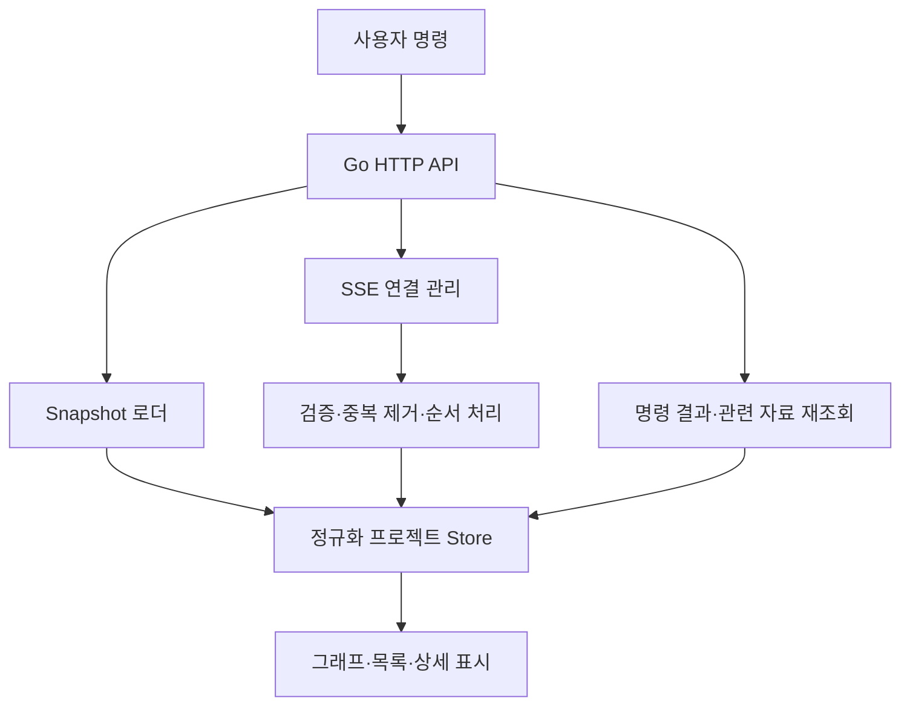

# 02. 삼사라 React UI 상세 구현 계획서

- 문서 버전: 1.0
- 작성 기준일: 2026-10-28, Asia/Seoul
- 문서 상태: 구현을 시작하기 위한 설계 기준안
- 대상 제품: 하나의 로컬 Go 런타임에서 여러 프로젝트와 Claude Code 작업을 관찰하고 제어하는 웹 대시보드
- 관련 문서: [런타임 구현 계획](01-runtime-implementation-plan.md), [공통 계약과 데이터 모델](03-contracts-and-data-model.md)

> 이 문서는 대화에서 합의한 요구사항을 구현 가능한 화면·컴포넌트·데이터 흐름·검증 기준으로 정리한다. 기존 시안 이미지의 원본이나 기존 React 저장소는 이번 작업에 제공되지 않았다. 따라서 이미지의 실제 픽셀이나 기존 코드가 검증되었다고 가정하지 않는다. 아래 화면 치수, 성능 수치, 단계 구분은 제안하는 구현 기준이며 측정 결과가 아니다.

## 1. 제품 목표와 우선 결정

삼사라 UI의 핵심은 여러 에이전트가 병렬로 작업하는 동안 **무엇이 실행 중인지, 무엇 때문에 기다리는지, 어떤 결과를 언제 통합할 수 있는지**를 프로젝트별로 설명하는 것이다.
사용자는 현재 실행 중인 프로젝트뿐 아니라 과거에 실행한 프로젝트도 왼쪽 목록에서 선택할 수 있어야 한다.
프로젝트를 선택하면 중앙에 왼쪽에서 오른쪽으로 펼쳐지는 이슈 의존성 그래프를 표시한다.
동일한 데이터를 Worktree별로 묶어 볼 수 있어야 하며, 오른쪽에는 선택한 대상의 상세 정보와 Merge Queue를 배치한다.
아래쪽에는 세션, 이벤트, GitHub 이력, Worktree 목록을 제공한다.

UI는 Go 런타임이 제공하는 상태를 설명하는 클라이언트다.
스케줄링, Lease 발급, 의존성 판단, 승인 확정, Merge 가능 여부 판단은 런타임이 담당한다.
브라우저를 닫거나 새로고침해도 런타임과 워커는 계속 동작한다.
브라우저가 SQLite, tmux, herdr Socket 또는 Git 저장소를 직접 조작하는 경로는 만들지 않는다.

### 1.1 구현 전반에 적용할 불변 규칙

| ID | 규칙 | 화면에 미치는 영향 |
|---|---|---|
| UI-INV-01 | 구현 결과 제출과 통합 완료를 구분한다. | 구현 완료 배지만으로 녹색 전체 완료를 표시하지 않는다. |
| UI-INV-02 | 의존성 DAG, Git 커밋 그래프, Worktree 연결 관계를 구분한다. | 화면마다 범례와 연결선의 의미를 명시한다. |
| UI-INV-03 | `UNKNOWN`은 종료 확인이 아니다. | 알 수 없는 세션을 실패·종료로 자동 변경하지 않는다. |
| UI-INV-04 | herdr의 에이전트 관찰 상태와 삼사라의 작업 차단 이유는 별개다. | 두 정보를 별도 필드에 표시한다. |
| UI-INV-05 | 동일 통합 대상의 확정 순서는 서버가 관리한다. | Queue 순서를 프런트엔드가 임의 재계산하지 않는다. |
| UI-INV-06 | 상태가 오래되면 제어 가능 여부를 다시 확인한다. | 마지막 갱신 시각과 재연결 상태를 표시한다. |
| UI-INV-07 | 프로젝트 활성화는 명시적 정책이다. | 프로젝트를 열거나 검색했다고 활성화하지 않는다. |
| UI-INV-08 | 세션의 실제 Backend는 세션 생성·등록 시 연결된 값이다. | herdr가 설치되어 있다는 이유로 tmux 세션을 herdr로 표시하지 않는다. |
| UI-INV-09 | 승인·중단·통합 요청에는 결과 확인 단계가 있다. | 버튼 클릭만으로 성공 배지를 붙이지 않는다. |
| UI-INV-10 | 공통 상태 enum과 API 필드는 계약 문서가 기준이다. | 이 문서의 한국어 표시명을 새로운 서버 상태로 만들지 않는다. |

### 1.2 첫 화면에서 답해야 할 질문

1. 어느 프로젝트에서 작업이 진행 중인가?
2. 내가 선택한 프로젝트에서 어떤 이슈가 어떤 Worktree·세션에 연결되어 있는가?
3. 어떤 이슈가 어떤 선행 조건 때문에 시작하지 못하거나 진행을 멈췄는가?
4. 승인 대기는 삼사라의 작업 승인인가, Claude Code의 자체 권한 요청인가?
5. 구현을 마친 결과 중 어떤 것이 통합 대기 중인가?
6. 현재 통합 대상 브랜치 기준으로 무엇을 다시 검증해야 하는가?
7. 내가 지금 수행할 수 있는 다음 행동은 무엇인가?

## 2. 범위와 단계

UI도 이번 구현 범위에 포함한다.
단, 읽기 전용 화면을 런타임 이벤트 계약과 함께 먼저 완성하고, 제어 기능은 해당 서버 정책의 검증이 끝난 뒤 연결한다.
이 구분은 UI를 나중으로 미루기 위한 것이 아니라 위험한 제어를 화면 개발 속도에 맞추어 먼저 노출하지 않기 위한 구현 순서다.

| 단계 | 제공 기능 | 완료 조건 |
|---|---|---|
| UI-0 | 정적 계약 샘플, 화면 골격, 프로젝트 목록, 상태 표현 | 실제 API와 같은 스키마로 화면 개발 가능 |
| UI-1 | Snapshot·SSE 연결, 프로젝트 대시보드, 이슈 DAG, 상세 패널 | Fake Backend 통합 시나리오가 화면에 반영됨 |
| UI-2 | Worktree 묶음, Merge Queue 읽기, 세션·GitHub·이벤트 이력 | 작업·코드·실행 환경을 왕복 탐색 가능 |
| UI-3 | 삼사라 승인, 일시 정지 요청, 재개 요청, 통합 요청 | 동시성·중복 요청·권한·장애 처리 검증 완료 |
| UI-4 | 큰 그래프, 접근성, 반응형, 배포·운영 진단 | 정해진 데이터 크기와 장애 시나리오 수용 |

위 UI 단계와 `UI-W` 작업 번호는 프런트엔드 내부 작업 단위다.
전체 프로젝트의 M0~M7 단계는 [테스트·개발 계획](05-testing-and-delivery-plan.md)을 기준으로 아래처럼 연결한다.

| 전체 단계 | UI 대응 | 제공 범위 |
|---|---|---|
| M0~M3 | UI-0 및 UI-1 준비, W01~W10 병행 | 계약·Fixture·Snapshot·이벤트 기반 화면 준비 |
| M4 | UI-1 읽기 전용 완료, UI-2 화면 일부 | 실제 런타임 관찰·Fake Backend 시나리오, 이력·catalog 연결 |
| M5 | UI-2 완료 | 실제 herdr·tmux·Git·GitHub 관찰, Worktree·Merge Queue 읽기 |
| M6 | UI-3 | 서버 검증을 통과한 승인·재개·통합 제어 |
| M7 | UI-4 최종 확인 | 실제 프로젝트 파일럿, 성능·접근성·복구·배포 검증 |

접근성과 성능의 기초 작업은 M7 이전에도 계속 수행한다.
M4에서 아직 실제 API가 제공되지 않은 M5 기능은 계약 Fixture로 검증하고, 제품 화면에서는 지원되지 않는 기능으로 표시한다.

### 2.1 첫 버전에 포함하지 않는 기능

- 브라우저 안에서 Claude Code 자체의 권한 요청을 대신 승인하는 기능.
- 임의 셸 명령을 입력하는 웹 터미널.
- 다른 장비의 여러 런타임을 한 서버로 통합하는 원격 제어.
- 다중 사용자 협업 편집, 조직 역할 관리, 클라우드 계정 시스템.
- 그래프에서 선을 그어 의존성을 변경하는 편집기.
- Git 브랜치를 드래그하여 Merge하거나 강제 Push하는 기능.
- 충분한 근거 없이 작업 완료 예상 시간을 계산하는 기능.
- 모든 과거 시점의 화면을 재현하는 완전한 시간 여행 UI.

과거 실행 기록은 첫 버전에 포함한다.
다만 이벤트를 보관한다는 사실만으로 임의 시점의 완전한 상태 복원이 가능하다고 약속하지 않는다.
이력 화면은 보관된 Run 결과, 이벤트, Commit·PR 연결, 당시 검증 증거를 표시한다. 종료 Run은 `GET /v1/runs/{run_id}/snapshot`의 HISTORICAL 데이터를 별도 읽기 모델로 사용하고, 현재 프로젝트 SSE로 과거 그래프·결과를 덮어쓰지 않는다. 현재 GitHub 상태를 추가로 보여 주면 당시 결과와 최신 관찰 시각을 분리한다.

## 3. 정보 구조와 URL

프로젝트 선택은 전체 애플리케이션의 최상위 맥락이다.
하나의 프로젝트 안에서 그래프, 실행 기록, 승인, 통합, 설정을 이동한다.
기본 대시보드는 이슈 그래프이며, Worktree 묶음은 같은 그래프 데이터에 적용하는 보기 방식이다.

| 경로 제안 | 용도 | URL에 보존할 값 |
|---|---|---|
| `/` | 전체 프로젝트 개요 | 검색어, 활성·과거 필터 |
| `/projects/:projectId` | 프로젝트 대시보드 | Run 선택, 보기 방식, 선택 엔터티 |
| `/projects/:projectId/runs` | 과거·현재 실행 목록 | 상태, 기간, 페이지 커서 |
| `/projects/:projectId/runs/:runId` | 특정 실행의 결과와 상세 | 선택 이슈·Attempt |
| `/projects/:projectId/approvals` | 삼사라 승인 목록 | 대기·처리 완료 필터 |
| `/projects/:projectId/integrations` | 통합 대상과 Queue | 저장소·대상 브랜치 |
| `/projects/:projectId/history` | GitHub·Git·이벤트 이력 | 종류, 기간, 이슈 ID |
| `/projects/:projectId/settings` | 프로젝트 설정·기능 확인 | 설정 탭 |
| `/runtime` | 런타임 연결과 Backend 진단 | 진단 탭 |

라우트는 UI 경로이며 서버 API 경로가 아니다.
실제 HTTP API는 [공통 계약](03-contracts-and-data-model.md)을 따른다.
처음 로드한 깊은 경로도 Go 정적 파일 서버가 SPA 진입 파일로 연결하도록 구성한다.
존재하지 않거나 등록 해제된 프로젝트는 다른 프로젝트로 조용히 이동하지 않고, 식별 가능한 오류와 목록 이동 버튼을 표시한다.

### 3.1 탐색 상태 보존

- URL: 프로젝트, 선택 Run, 이슈·Attempt 선택, 보기 방식, 공유 가능한 필터.
- 메모리: 열려 있는 툴팁, 현재 드래그, 요청 진행 상태.
- 브라우저 로컬 설정: 패널 너비·높이, 테마, 최소 지도 표시, 프로젝트별 확대율·뷰포트.
- 서버: 실제 프로젝트 정책, 작업·승인·통합 상태, 프로젝트 등록 이력.
- 로컬 저장소에 API 인증 토큰, 전체 이벤트 본문, 터미널 출력, 비밀정보를 저장하지 않는다.
- 오래된 로컬 설정은 스키마 버전으로 폐기할 수 있어야 한다.

## 4. 화면 골격과 공간 배분

데스크톱 기본 화면은 전역 상단 바, 프로젝트 사이드바, 프로젝트 본문으로 구성한다.
프로젝트 본문 안에 요약 헤더, 그래프 도구 모음, 그래프, 우측 패널, 하단 패널을 배치한다.
핵심 작업 공간은 그래프이며, 보조 패널이 그래프 전체를 지속적으로 덮지 않게 한다.

| 영역 | 초기 제안 | 주요 내용 |
|---|---|---|
| 전역 상단 바 | 높이 48px | 삼사라 이름, 런타임 연결, 전체 검색, 설정 |
| 프로젝트 사이드바 | 너비 248px, 접기 가능 | 프로젝트 검색·필터·목록·최근 활동 |
| 프로젝트 헤더 | 높이 64~88px | 프로젝트 이름, 활성화 상태, Run 선택, 주요 수치 |
| 그래프 도구 모음 | 높이 44px | 이슈·Worktree 보기, 필터, 레이아웃·확대 제어 |
| 중앙 그래프 | 남은 공간 | 왼쪽→오른쪽 DAG, Integration Gate |
| 우측 패널 | 너비 352px, 320~480px 조절 | 상세 또는 Merge Queue |
| 하단 패널 | 높이 232px, 160~420px 조절 | 세션·이벤트·GitHub·Worktree 탭 |

수치는 첫 구현의 시작점이다.
1440×900, 1280×800 화면에서 실제 한국어 제목과 긴 브랜치명으로 확인한 뒤 조정한다.
패널 크기는 전체 화면 너비 비율과 최소·최대 크기를 함께 적용한다.
키보드로 패널 크기를 변경할 수 있는 구분선을 제공하고, 전체 초기화 명령을 둔다.

### 4.1 패널 우선순위

1. 프로젝트 선택과 런타임 연결 상태는 항상 접근 가능하게 유지한다.
2. 노드를 선택하면 우측 패널에 상세를 표시한다.
3. 선택이 없으면 우측 패널에 현재 대상의 Merge Queue를 표시한다.
4. 상세 패널에도 해당 노드의 Queue 위치로 이동하는 링크를 둔다.
5. Merge Queue를 고정해 두고 싶은 사용자를 위해 고정 보기를 제공한다.
6. 하단 패널을 닫아도 활성 탭과 스크롤 위치를 기억한다.
7. 경고가 발생했다고 사용자의 선택이나 스크롤을 강제로 바꾸지 않는다.

## 5. 전체 프로젝트 목록과 과거 프로젝트

프로젝트 목록은 현재 실행 중인 프로세스 목록에서 만들지 않는다.
런타임에 등록된 프로젝트 카탈로그를 기준으로 하고, 현재 활성화·실행 여부와 과거 기록을 함께 표시한다.
프로젝트 경로가 사라져도 이력을 보유한 프로젝트 항목은 남겨 둔다.
같은 저장소를 다른 경로에 복제했을 때 어떤 프로젝트로 취급하는지는 런타임의 식별 규칙을 따른다.

### 5.1 프로젝트 행

| 필드 | 표시 규칙 |
|---|---|
| 표시 이름 | 사용자가 지정한 이름, 없으면 저장소 이름 |
| 경로 요약 | 홈 경로 축약 가능, 전체 경로는 상세에서 확인 |
| 활성화 | 미설정·사용 중·사용 안 함을 구분 |
| 현재 실행 | 현재 Run 수와 실제 실행 중 Attempt 수 |
| 사용자 조치 | 삼사라 승인 대기 수, 실패·관찰 불가 수 |
| 마지막 활동 | 상대 시간과 상세 절대 시간 |
| 연결 문제 | 저장소 경로 없음, 런타임 조회 오래됨 등 |

`사용 안 함`과 `실행 없음`은 별개다.
활성화되어 있지만 진행 중인 작업이 없는 프로젝트는 유휴 상태로 표시한다.
비활성 프로젝트를 열면 과거 이력을 표시하고, 설정 변경이 필요한 행동만 비활성화한다.
UI에서의 단순 열람은 프로젝트 자동 활성화 또는 데몬 재시작의 계기가 되지 않는다.

### 5.2 정렬과 필터

- 기본 정렬: 고정한 프로젝트 → 사용자 조치 필요 → 최근 활동.
- 보조 정렬: 이름, 마지막 실행, 활성 Attempt 수.
- 필터: 전체, 실행 중, 조치 필요, 최근 기록, 사용 안 함.
- 이름·경로·저장소 식별자 검색을 지원한다.
- 프로젝트가 많으면 서버 커서 페이지와 목록 가상화를 사용한다.
- 검색 결과 수와 현재 전체 프로젝트 수를 혼동하지 않게 표시한다.
- 프로젝트 변경 시 이전 프로젝트의 지연 응답이 새 화면에 들어오지 않도록 요청을 취소한다.

## 6. 프로젝트 대시보드와 수치 정의

요약 헤더에는 전체 실행 흐름을 판단하는 데 필요한 수치만 표시한다.
첫 버전에서 추정 진행률을 하나의 백분율로 합치지 않는다.
구현·검증·통합이 다른 단계이기 때문에 명확한 개수와 분모를 제공한다.

| 수치 | 계산 기준 |
|---|---|
| 실행 중 | 서버가 실행 가능·유효 상태로 보고한 현재 Attempt 수 |
| 사용자 승인 대기 | 현재 유효한 삼사라 승인 요청 수 |
| 의존성 대기 | 현재 차단 이유에 의존성 미충족이 포함된 이슈 수 |
| 구현 결과 제출 | 결과가 제출되어 검증·승인·통합을 기다리는 이슈 수 |
| 통합 완료 | 선택 범위에서 요구 통합 조건을 만족한 이슈 수 |
| 관찰 불가 | 최신 상태를 확정할 수 없는 세션·작업 수 |

각 수치를 클릭하면 해당 기준으로 그래프 또는 목록을 필터링한다.
수치의 대상 범위는 `프로젝트 전체`, `현재 Run`, `특정 Run` 중 무엇인지 헤더에 명시한다.
과거 Run을 보고 있을 때 현재 실행 중인 세션 배지를 해당 Run의 세션처럼 표시하지 않는다.
Run 선택을 바꿔도 프로젝트 자체는 바뀌지 않는다.

## 7. 그래프의 의미와 데이터 투영

### 7.1 기본 보기: 이슈 DAG

기본 노드는 이슈다.
노드에는 현재 선택 범위에 해당하는 대표 Attempt와 Worktree·세션 연결을 요약한다.
재시도 이력은 노드를 무조건 복제하지 않고 노드의 `시도 3회` 표시와 상세 패널로 제공한다.
동일 이슈의 여러 Attempt를 함께 비교하는 기능은 별도의 실행 이력 화면에서 다룬다.

기본 간선은 서버가 선언한 의존성이다.
간선의 조건이 구현 결과, 승인, 통합 완료 중 무엇인지는 공통 계약에 정의된 조건 유형을 표시한다.
UI가 이슈 번호 순서나 Git 브랜치 이름에서 의존성을 추측하지 않는다.
여러 루트를 갖는 DAG를 허용하며, 하나의 가상 루트에 모든 작업이 의존한다고 표시하지 않는다.

### 7.2 Worktree 묶음 보기

Worktree 보기는 동일한 이슈·Attempt를 Worktree 컨테이너 또는 레인에 배치한다.
Worktree는 작업 디렉터리이며 별도의 Git 저장소나 독립적인 통합 브랜치라고 가정하지 않는다.
한 Worktree에 순차적으로 여러 Attempt 이력이 연결될 수 있으므로 현재 점유와 과거 연결을 구분한다.
여러 Worktree가 같은 대상 브랜치로 통합되는 관계는 Integration Gate와 Queue에서 표시한다.

한 이슈에 여러 과거 Worktree가 연결되면 기본 그래프에는 현재 또는 선택한 Attempt의 Worktree만 나타낸다.
다른 연결은 상세 패널에서 탐색한다.
불가피하게 동일 이슈의 표현을 둘 이상 그리는 비교 화면에서는 표현 ID와 실제 `issue_id`를 분리하고 집계에서 중복을 제거한다.

### 7.3 Integration Gate

Gate는 서버의 의존성·승인·통합 조건을 설명하기 위한 화면 투영이다.
UI를 위해 새로운 실제 작업이나 새 Lease를 만들지 않는다.
Gate에는 `선행 결과 2/3 통합`, `승인 필요`, `대상 브랜치 갱신으로 재검증 필요`처럼 실제 미충족 조건을 표시한다.
Gate 선택 시 어떤 조건과 어떤 검증 증거가 필요한지 우측 패널에 나열한다.
조건을 만족한 뒤 B가 시작 가능한지 여부 역시 서버의 판단을 표시한다.

### 7.4 커밋 그래프와의 분리

Git 커밋 간 부모 관계는 이슈 의존성 간선과 같은 선으로 표시하지 않는다.
첫 버전의 Git 이력은 목록 중심으로 제공한다.
향후 커밋 그래프가 필요하면 `Git 이력`이라는 별도 화면에서 브랜치·Commit 부모 관계를 그린다.
이슈 DAG의 가로 위치는 시간의 정확한 비율이나 Commit 발생 시각을 의미하지 않는다.
화면 범례에 `가로 위치는 의존 단계이며 시간축이 아닙니다`를 명시한다.

## 8. 노드·간선·그룹의 표시 사양

### 8.1 이슈 노드

| 영역 | 필수 정보 | 길이 처리 |
|---|---|---|
| 상단 | 이슈 번호, 이슈 제목 | 제목 두 줄 후 생략, 상세에서 전체 확인 |
| 중앙 | 실행·승인·통합의 핵심 상태 | 대표 상태 한 개와 보조 배지 최대 두 개 |
| 연결 정보 | Worktree 또는 브랜치 요약 | 긴 값은 중간 생략, 복사 버튼은 상세에 배치 |
| 하단 | 현재 Attempt, Backend, 최근 활동 | 작은 배지와 명확한 텍스트 |
| 경고 | 주요 차단 이유 | 한 문장, 추가 이유 개수 표시 |

노드의 기본 제안 크기는 248×116px이다.
검증 시 1~2줄 한국어 제목, 긴 영문 식별자, 관찰 불가 상태가 겹쳐도 높이가 무한히 늘어나지 않게 한다.
노드 내부에는 승인·통합 같은 위험도가 높은 단축 버튼을 놓지 않는다.
노드 선택과 정보 확인이 우선이며 실제 행동은 상세 패널에서 수행한다.

### 8.2 상태의 표현

| 표시 의미 | 색상 계열 제안 | 함께 쓰는 표식 |
|---|---|---|
| 실행 중 | 파랑 | 실행 아이콘·상태 텍스트 |
| 승인 대기 | 호박색 | 사람 확인 아이콘 |
| 의존성 미충족 | 중성 회색 | 잠금 아이콘·조건 이름 |
| 구현 결과 제출 | 보라 | 문서·검증 대기 표식 |
| 통합 대기·검증 | 청록 | Queue·검증 표식 |
| 통합 완료 | 초록 | 체크 아이콘·통합 Commit |
| 실패·충돌 | 빨강 | 오류 아이콘·실패 이유 |
| 관찰 불가·오래된 정보 | 점선 테두리·중성색 | 물음표·마지막 관찰 시각 |

색상만으로 상태를 구분하지 않는다.
하나의 거대한 서버 enum을 만들어 위 표시를 구현하지 않는다.
예를 들어 `구현 결과 제출 + 통합 대기 + 연결 끊김`은 동시에 성립할 수 있다.
대표 배지는 사용자가 지금 해결해야 할 조치를 우선 표시하되, 상세에서 각 상태 축을 그대로 제공한다.

### 8.3 간선 사양

- 화살표는 선행 조건을 제공하는 쪽에서 의존하는 쪽을 향한다.
- 조건 유형과 충족 여부를 간선 데이터에 보존한다.
- 기본 화면에서는 선택한 노드 주변의 라벨만 펼쳐 혼잡을 줄인다.
- 상태는 실선·점선, 아이콘, 짧은 문구를 함께 사용한다.
- 미충족 조건은 색만 진하게 만들지 말고 `통합 필요`, `승인 필요`를 보여 준다.
- 실행 중 애니메이션은 선택 경로에서만 제한적으로 사용하며, 동작 줄이기 설정을 따른다.
- 선택 노드의 선행·후행 경로를 강조하되 필터로 숨은 이웃의 개수를 표시한다.
- 화면 필터가 의존성 자체를 삭제하지 않으며, 숨은 선행 조건은 계속 차단 원인에 포함한다.

## 9. 왼쪽→오른쪽 레이아웃 구현

React Flow를 렌더링·선택·확대·이동에 사용하고, ELK를 자동 배치 계산에 사용한다.
ELK의 방향 옵션에는 `RIGHT`가 있으며, elkjs는 방향이 있는 노드·링크 레이아웃을 JavaScript에서 계산하는 구현을 제공한다. [U3][U4]
레이아웃 알고리즘과 React Flow 노드·간선 모델은 어댑터 함수로 분리한다.
그래프의 의미를 레이아웃 라이브러리의 자동 순환 해소 기능에 맡기지 않는다.
서버가 DAG 위반을 보고하면 해당 연결을 오류로 설명하고, UI가 임의로 방향을 바꾸어 정상 그래프처럼 표시하지 않는다.

### 9.1 계산 순서

1. 선택 범위의 서버 Snapshot을 읽는다.
2. 이슈·Attempt·Worktree 참조의 유효성을 확인한다.
3. 표시 필터, 선택 경로, 접힌 그룹을 적용해 표시용 투영을 만든다.
4. 실제 노드 ID와 화면 표현 ID를 구분해 생성한다.
5. 노드 크기를 확정한 뒤 ELK 입력 그래프로 변환한다.
6. Worker에서 배치 계산을 실행한다.
7. 요청 시작 시점의 topology revision과 현재 revision을 비교한다.
8. 오래된 계산 결과는 버리고 최신 결과만 좌표에 반영한다.
9. 기존 뷰포트·선택·키보드 포커스를 보존한다.

### 9.2 초기 옵션과 배치 규칙

| 항목 | 제안 |
|---|---|
| 알고리즘 | ELK Layered |
| 방향 | 오른쪽 진행 |
| 입력·출력 포트 | 입력은 왼쪽, 출력은 오른쪽 |
| 층 사이 간격 | 초기 96px, 실제 라벨 충돌 테스트 후 조정 |
| 같은 층 노드 간격 | 초기 32px |
| 그룹 내부 여백 | 상단 40px, 나머지 24px |
| 독립 컴포넌트 | 수직으로 분리하고 루트 이름을 요약 |
| 정렬 기준 | 안정된 ID·서버 순위로 재현 가능하게 정렬 |
| 사용자 좌표 | 뷰 설정으로 취급하며 실행 의미를 바꾸지 않음 |

### 9.3 실시간 갱신 중 안정성

상태, 배지, 마지막 관찰 시각만 바뀌면 전체 배치를 다시 계산하지 않는다.
노드·간선 추가·삭제, 그룹 펼치기·접기, 실제 노드 크기 변경 때만 재계산한다.
사용자가 드래그하거나 상세를 읽는 동안 자동 `fitView`를 실행하지 않는다.
새 노드가 화면 밖에 생기면 `새 작업 2개 보기`와 같은 버튼을 제공한다.
`전체 보기`, `선택 경로 보기`, `다시 정렬`은 명시적인 사용자 명령으로 둔다.

React Flow 공식 문서는 노드·간선 컴포넌트와 핸들러의 참조를 안정적으로 유지하고, 넓은 범위의 노드 배열 구독을 피하는 성능 접근을 설명한다.
이를 적용하되 실제 병목은 프로파일링으로 확인한다. [U1]

### 9.4 그룹 접기에서의 정합성

일부 이슈를 임의의 Worktree 그룹으로 합치면 원래 DAG가 순환이 없어도 그룹 사이의 축약 그래프에는 순환처럼 보이는 연결이 생길 수 있다.
따라서 접힌 그룹 그래프를 실행 순서의 새로운 진실로 사용하지 않는다.
축약 그래프가 읽기 어려워지면 그룹을 합친 노드로 만들기보다 레인 표시를 유지하거나 해당 그룹을 펼친다.
교차 의존성을 숨기는 접기는 허용하지 않고, 경계 연결 수와 실제 대상 목록을 제공한다.
같은 downstream Gate를 공유하는 여러 루트를 완전히 독립된 작업처럼 분리하지 않는다.

## 10. 상세 패널

### 10.1 이슈 상세

표시 순서는 상태와 다음 조치, 차단 원인, 작업 내용, 실행 연결, 코드 연결, 이력 순으로 한다.
상태에는 서버가 판단한 실행 가능 여부와 설명을 표시한다.
차단 이유가 여러 개이면 한 가지만 보여 주고 나머지를 버리지 않는다.

| 섹션 | 내용 |
|---|---|
| 기본 정보 | 제목, 이슈 ID·외부 번호, 설명, 담당 범위 |
| 현재 상태 | 실행·승인·통합 상태, 최근 서버 평가 시각 |
| 왜 대기하는가 | 미충족 조건, 선행 이슈, 필요한 승인·검증 |
| 실행 | Run·Attempt·세션·Backend 연결 |
| 코드 | Worktree 경로, 브랜치, 기준 Commit, 현재 Head |
| 결과 | 결과 요약, 테스트 증거, PR·Commit 링크 |
| 기록 | 상태 변경·재시도·승인·통합 이력 |

### 10.2 세션 상세

세션 ID, Claude Code 세션 식별자, Backend의 서버·워크스페이스·탭·패널 참조는 각각 이름을 붙여 표시한다.
하나의 문자열을 모두의 ID처럼 재사용하지 않는다.
`herdr 관찰: blocked`와 `삼사라 실행권: 의존성 미충족`은 별도 줄에 표시한다.
백엔드 관찰이 오래되면 마지막 관찰 시각과 관찰 출처를 함께 표시한다.
화면에서 `연결 끊김`은 통신 상태이며 프로세스 종료 확정과 구분한다.

### 10.3 Lease·Fencing 정보

일반 화면에는 `실행권 유효`, `실행권 회수`, `재연결 필요` 등 사용자가 이해할 수 있는 표시를 둔다.
개발자 상세에는 Lease ID, 세대·Fence 값, 만료 시각, 갱신 시각을 제공한다.
이 정보는 진단용이며 Lease를 사용자가 직접 편집하는 폼을 만들지 않는다.
브라우저에서 표시한 남은 시간은 설명용이다.
서버의 실행권 판단을 브라우저 타이머가 대신하지 않는다.

## 11. Merge Queue와 통합 판단 화면

통합 화면의 기본 단위는 프로젝트 이름만이 아니라 실제 저장소와 통합 대상 브랜치다.
같은 대상에 대한 최종 확정 순서를 Queue로 보여 준다.
독립적인 대상 브랜치·저장소의 Queue는 별도로 표시한다.
화면은 서버가 계산한 순서와 조건을 표시하며 `모든 병렬 작업이 끝나야 Merge 가능`이라는 전역 장벽을 임의로 만들지 않는다.

### 11.1 Queue 항목

| 필드 | 설명 |
|---|---|
| 순서 | 현재 Queue의 순서, 아직 미확정이면 순서 미정 표시 |
| 후보 | 이슈, Attempt, Worktree, Branch, PR |
| 소스 Head | 검증 대상 Commit |
| 대상 기준점 | 검증에 사용한 대상 브랜치 Commit |
| 통합 방식 | 프로젝트 정책에 따른 방식 |
| 조건 | 승인, 충돌 검사, 테스트, 보호 규칙의 현재 결과 |
| 유효성 | 기준점 또는 후보 Head 변경으로 재검증 필요한지 |
| 다음 조치 | 승인 대기, 충돌 해결, 검증 실행, 외부 결과 대기 등 |

검증을 통과한 Commit과 현재 Head가 다르면 예전 녹색 검증을 현재 상태로 표시하지 않는다.
대상 브랜치가 바뀌면 `이전 기준에서는 통과 · 최신 기준 재검증 필요`를 보여 준다.
충돌이 없다는 사실과 필요한 테스트·승인이 모두 통과했다는 사실을 구분한다.
GitHub의 PR Merge 가능 표시를 삼사라의 전체 통합 허가와 동일하게 취급하지 않는다.

GitHub native queue의 `PUBLISHING`은 provider에 접수·대기 중인 경우도 포함한다. UI는 이를 모두 `지금 Merge 중`으로 번역하지 않고, `Queue 대기`, `그룹 검증 중`, `현재 통합 결과 승인 필요`, `반영 확인 중`을 서버의 세부 관찰과 blocking_reasons로 표시한다. 새 merge-group에 이전 승인을 재사용하지 않으며 required policy check가 미검증이면 자동 통합 버튼을 제공하지 않는다. 성공 check가 provider에 전달된 뒤 취소 요청은 즉시 철회를 보장하지 않는다는 진행 상태를 보여 준다.

### 11.2 Integration Gate 상세

Gate에는 조건별 체크 목록과 각각의 기준 revision·Commit을 표시한다.
검증 도중 기준이 바뀌면 이전 결과의 적용 범위를 명확히 표시한다.
Gate가 열리더라도 세션 복구·수동 재개가 필요하면 이를 다음 조치로 보여 준다.
Standalone에서는 `실행 조건 충족 · 현재 Claude 세션에서 계속하기`를 표시할 수 있다.
`조건 충족`을 `자동 입력 전달 완료`로 바꾸어 표시하지 않는다.

### 11.3 제어 기능의 순서

첫 버전은 Queue와 차단 이유를 읽기만 한다.
그다음 Queue 등록·취소와 통합 요청을 연결한다.
Queue 순서 변경 API는 현재 v1 endpoint 목록에 없으므로 MVP에서 수동 재정렬 컨트롤을 활성화하지 않는다.
후속 확장에서 순서 변경이 필요하면 서버가 의존성·정책을 재검증하는 명령을 먼저 계약에 추가한다.
그때의 드래그 정렬은 보조 입력 수단이며 키보드 순서 변경과 동일한 서버 명령을 사용한다.
첫 제어 버전에는 강제 통합·보호 규칙 우회 기능을 두지 않는다.

## 12. 하단 패널과 이력

### 12.1 세션 탭

필수 열은 이슈, Attempt, Backend, 관찰 상태, 삼사라 실행권, 마지막 활동, 다음 조치다.
패널을 열거나 세션을 선택했다고 자동으로 입력을 보내지 않는다.
Backend가 지원하는 경우에만 `해당 터미널로 이동`을 제공한다.
Standalone에는 실제로 가능한 수동 재개 안내만 표시한다.
지원하지 않는 버튼은 이유를 표시한 비활성 상태로 제공하거나 아예 노출하지 않는다.

### 12.2 이벤트 타임라인

이벤트에는 발생 시각과 런타임 기록 시각을 구분한다.
기본 정렬은 서버의 기록 순서를 사용하고, 서로 다른 프로세스의 시계로 전체 순서를 추측하지 않는다.
동일 이벤트가 재전송되면 하나만 표시한다.
필터는 이슈, Attempt, 세션, 종류, 심각도, 기간을 지원한다.
자동 스크롤은 사용자가 맨 아래에 있을 때만 유지한다.
위로 스크롤한 상태에서는 `새 이벤트 14개` 버튼을 표시한다.
이벤트 목록의 과거 페이지와 실시간 끝부분을 같은 항목 ID로 병합한다.

### 12.3 GitHub 이력

목록에는 GitHub 이슈, PR, Commit·통합 기록과 삼사라의 Run·Attempt 연결을 표시한다.
GitHub 동기화 시각과 로컬 이벤트 시각을 분리한다.
외부 서비스 연결이 없으면 로컬 Git 이력은 계속 보여 주고, GitHub 부분만 연결 필요 상태로 둔다.
API 제한·인증 오류로 갱신이 실패해도 이전 기록을 삭제하지 않는다.
PR 제목·본문은 외부 입력으로 취급해 안전하게 렌더링한다.
동일 PR이 여러 이벤트에 연결되어도 PR 자체와 활동 이벤트를 중복 집계하지 않는다.

### 12.4 Worktree 목록

필수 열은 경로, 브랜치, 현재 Attempt, 기준 Commit, 변경 여부, 연결 세션, 정리 상태다.
사용 중, 보존 중, 정리 가능, 정리 보류를 구분한다.
경로가 사라져도 이력을 즉시 삭제하지 않는다.
정리 버튼은 나중 단계에서 런타임이 확인한 사유와 함께 제공한다.
미커밋 변경이나 생존 미확인 워커가 있는 Worktree를 UI가 임의로 정리하지 않는다.

## 13. 삼사라 승인과 Claude Code 권한 요청

삼사라 승인은 결과·계획·통합 정책에 관한 승인이다.
Claude Code 자체의 도구 권한 승인은 별도 실행 환경에서 발생한다.
화면은 두 종류를 같은 `승인` 버튼으로 합치지 않는다.

### 13.1 삼사라 승인 화면

- 승인 대상, 목적, 요청자·Attempt, 요청 시각을 표시한다.
- 검토해야 할 결과·Diff·테스트·Commit을 연결한다.
- 승인 대상 revision과 현재 revision이 같은지 서버가 확인한다.
- 검토 중 내용이 바뀌면 이전 승인 버튼을 비활성화하고 최신 내용 갱신을 안내한다.
- 승인·반려에는 필요한 경우 이유를 입력하고 서버 감사 기록에 남긴다.
- 다른 창에서 먼저 처리하면 `이미 처리됨`을 표시하고 현재 결과를 다시 가져온다.
- 네트워크 응답이 불명확하면 새 승인 요청을 만들지 않고 같은 요청 식별자로 결과를 확인한다.

### 13.2 Claude Code 자체 권한 요청

가능한 관찰 정보가 있으면 `Claude Code에서 권한 확인 필요`라고 표시한다.
해당 터미널 이동 또는 수동 확인 안내를 제공한다.
Samsara 승인 버튼이 Claude Code 권한을 대신 허가한다고 설명하지 않는다.
herdr의 `blocked`만으로 권한 요청 종류를 확정할 수 없으면 `사용자 입력이 필요할 수 있음`과 관찰 근거를 표시한다.

## 14. 프런트엔드 기술 구성

| 계층 | 제안 기술·구성 | 선택 이유 |
|---|---|---|
| UI | React + TypeScript | 상태별 컴포넌트와 API 타입 검증 |
| 빌드 | Vite 기반 정적 빌드 | Go에서 배포할 정적 자산 생성 |
| 그래프 | `@xyflow/react` | 노드·간선 렌더링, 선택, 이동, 확대 |
| 배치 | `elkjs` Web Worker | 방향이 있는 DAG 배치와 UI 스레드 분리 |
| REST 데이터 | TanStack Query | 목록·상세 조회의 캐시, 취소, 재조회 |
| 실시간 상태 | 작은 정규화 Store + 구독 훅 | Snapshot·이벤트를 원자적으로 적용 |
| 스타일 | CSS 변수·컴포넌트 스타일 | 상태 토큰, 테마, 패널 치수 일관성 |
| 계약 | 공통 OpenAPI·JSON Schema에서 생성한 타입 | 서버와 화면의 enum·필드 불일치 감소 |
| 컴포넌트 검증 | Vitest + React Testing Library | 상태와 사용자 행동 검증 |
| 브라우저 검증 | Playwright | 재연결·키보드·실제 레이아웃 검증 |

정확한 패키지 버전은 구현 시작 시 지원 브라우저와 Go 배포 방식에 맞춰 검증하고 lockfile에 고정한다.
이 문서에서 `latest` 패키지를 무조건 설치하거나 특정 미확인 버전을 장기 보장하지 않는다.
예제 코드·유료 예제의 사용 권한도 의존성 도입 시 확인한다.
기본 구현은 필요한 공개 API와 자체 컴포넌트로 구성한다.

### 14.1 상태 소유권

실시간 프로젝트 Snapshot의 정규화 Store가 현재 프로젝트의 실행 상태를 소유한다.
React Query는 별도 상세·이력·검색 결과처럼 요청 단위 자료를 관리한다.
같은 이슈의 현재 상태를 Query 캐시와 Store에서 각각 독립적으로 갱신하는 구조를 피한다.
상세 응답에 상태가 포함되면 aggregate version을 비교해 오래된 값이 최신 값을 덮지 않게 한다.
TanStack Query의 targeted invalidation은 관련 상세·이력 요청을 최신화하는 데 사용한다. [U5]

외부 Store 구독에는 안정된 Snapshot 참조와 해제 함수를 제공한다.
React의 `useSyncExternalStore`가 요구하는 Snapshot·구독 규칙을 따른다. [U6]
SSE 연결의 생성·정리는 앱 수준 Controller에서 담당하고, 노드 컴포넌트마다 연결하지 않는다.
React 개발 모드의 Effect 재실행에서 연결·리스너가 중복되지 않는지 확인한다. [U7]

## 15. 데이터 흐름과 Snapshot·SSE

첫 프로젝트 진입은 `GET /v1/projects/{project_id}/snapshot`에서 시작한다.
서버가 같은 일관성 경계에서 만든 Snapshot과 `snapshot_cursor`를 받는다.
Snapshot에는 `generated_at`, `project_version`, `graph_version`, `runtime_epoch`, `database_generation`, `freshness`, 정규화된 `entities`가 포함된다.
`blocking_reasons`, `available_actions`, `resume_required`는 해당 이슈 projection 등 계약이 지정한 엔터티에서 읽는다.
런타임 readiness와 기능 정보는 `/v1/runtime`의 계약을 따르며 존재하지 않는 Snapshot 최상위 필드를 가정하지 않는다.
그다음 `GET /v1/projects/{project_id}/events?after=<cursor>`로 이벤트를 구독한다.
Snapshot 이후 구독 시작 전 발생한 이벤트는 서버의 보관 기록에서 재생되어야 한다.
첫 화면이 그려졌다는 이유로 이벤트 누락이 없는 것으로 간주하지 않는다.
MVP는 `fetch` 기반 스트리밍으로 SSE를 읽고 메모리의 Bearer 토큰을 Authorization 헤더로 전달한다.
브라우저 기본 `EventSource`를 사용하는 구현과 혼합하지 않는다.

### 15.1 클라이언트가 유지할 데이터

| 분류 | 항목 |
|---|---|
| 식별 | project ID, 선택 Run ID, 현재 연결 세대 |
| Snapshot | 생성 시각, 서버 revision, cursor, 엔터티별 version |
| 실시간 | 마지막 처리 cursor, 마지막 이벤트 수신 시각, 연결 상태 |
| 엔터티 | Issue, Run, Attempt, Session, Worktree, Approval, Merge Candidate 참조 |
| 표현 | 선택·필터·접힌 그룹·뷰포트·레이아웃 revision |
| 명령 | 요청 ID·Idempotency Key·대상 version·접수 결과 |

정확한 필드 이름과 필수 여부는 [공통 계약](03-contracts-and-data-model.md)을 따른다.
위 표는 클라이언트 책임을 설명하며 별도의 API 스키마를 정의하지 않는다.

### 15.2 이벤트 처리 규칙

공통 이벤트에는 `event_id`, `seq`, `project_id`, `previous_project_version`, `project_version`, `aggregate_type`, `aggregate_id`, `aggregate_version`, `type`, `occurred_at`, `recorded_at`, `payload`가 포함된다.
큰 정수인 `seq`는 JavaScript `number`로 변환하지 않고 10진수 문자열로 받는다.
`project_version`도 10진수 문자열로 보존한다.
재개 cursor는 불투명 문자열로 취급하며 산술 연산하지 않는다.
프로젝트별 필터링 때문에 전역 순서 번호에 빈 값이 보일 수 있으므로 `다음 값이 반드시 1 증가`한다고 가정하지 않는다.
서버는 하나의 프로젝트 도메인 트랜잭션을 하나의 UI 이벤트로 묶고, `payload.changes`에는 전체 엔터티 upsert·delete를 제공한다.
UI는 프로젝트 버전 연속성을 검사하고 변경 집합 전체를 원자적으로 적용한다.

1. JSON·schema version·프로젝트 식별자를 검증한다.
2. 이미 적용한 `event_id` 또는 적용한 범위의 `project_version`은 중복으로 처리한다.
3. `previous_project_version`이 로컬 프로젝트 버전과 같은지 확인하고 aggregate version이 오래된 값으로 되돌아가지 않게 한다.
4. 프로젝트 버전이 이어지지 않거나 변경 집합의 필수 참조가 누락되면 최신 상태 표시를 중지한다.
5. 계약이 지정한 전체 Snapshot 복구를 수행한다.
6. `payload.changes`의 모든 upsert·delete와 프로젝트 버전을 하나의 Store 업데이트로 반영한다.
7. 성공적으로 적용하거나 안전하게 처리한 이벤트까지만 처리 cursor를 진전시킨다.
8. 새 event type이어도 공통 `changes` schema가 호환되면 적용한다. 호환되지 않는 breaking schema이면 변경 명령을 비활성화하고 업그레이드를 안내한다.

### 15.3 재연결과 보관 범위 만료

SSE의 `id`와 `Last-Event-ID`는 스트림 재개 식별자를 전달하는 표준 요소다. [U8]
MVP의 fetch 스트리밍 Controller는 자동 재연결을 직접 관리하며, 마지막으로 적용한 cursor를 `after`에 명시한다.
서버는 `Last-Event-ID` 헤더도 지원하지만 MVP 클라이언트는 `after` 한 방식만 사용한다.
두 값을 함께 보낸 경우 서로 다르면 서버가 400을 반환하므로 어느 한쪽에 우선권이 있다고 가정하지 않는다.
HTTP 상태·인증 오류는 fetch 응답에서 처리하되, 스트림이 열린 뒤의 복구 요구는 `reset_required` 제어 이벤트로 처리한다.
`reset_required`를 받으면 AbortController로 기존 연결을 닫고 새 Snapshot을 적용한 뒤 새 cursor에서 구독한다.
heartbeat는 연결 생존 확인용이며 business event ID나 프로젝트 버전을 진전시키지 않는다.

네트워크로 수신한 이벤트 ID와 Store가 실제로 적용한 마지막 cursor는 처리 실패 시 다를 수 있다.
이벤트 처리에 실패하면 현재 연결을 닫고 마지막으로 적용한 cursor부터 복구한다.
잘못된 이벤트를 건너뛴 채 최신 연결로 표시하지 않는다.
프로젝트 변경 시 이전 Controller 세대를 폐기하여 늦게 도착한 이벤트를 적용하지 않는다.
재연결에는 상한이 있는 지수 backoff와 jitter를 적용하고, 인증 만료이면 자동 반복 대신 다시 연결하는 방법을 안내한다.
offline 상태의 승인·통합 명령을 로컬 큐에 저장해 연결 후 자동 실행하지 않는다.

### 15.4 SSE 파서와 연결 정리

스트림 청크 하나가 이벤트 하나라고 가정하지 않는다.
UTF-8 문자가 청크 경계에서 나뉘는 경우, CRLF·LF, 여러 `data` 줄, 주석, 빈 줄에 의한 이벤트 종료, 알 수 없는 필드 처리를 검증한다.
표준 동작을 검증한 파서를 버전 고정해 사용하거나 WHATWG 규칙에 맞는 계약 Fixture로 자체 구현을 검증한다. [U8]
화면 전환·재동기화·토큰 만료 시 reader와 AbortController를 정리한다.
React 개발 모드에서 Controller의 시작·정리가 반복되어도 중복 연결이 남지 않아야 한다.

### 15.5 연결 개수와 과부하

기본적으로 전역 요약 연결 하나와 선택한 프로젝트 상세 연결 하나 이내를 목표로 한다.
전역 요약 API가 없는 초기 단계는 프로젝트 목록을 낮은 빈도로 재조회한다.
세션·노드·탭마다 별도 SSE 연결을 만들지 않는다.
WHATWG는 같은 서버에 여러 페이지가 각각 연결을 만들 때 연결 제한이 문제가 될 수 있음을 설명한다. [U8]
따라서 여러 브라우저 탭이 열렸을 때도 중복 연결과 서버 부하를 측정한다.
탭 간 연결 공유는 첫 버전 필수로 만들지 않고 필요가 확인되면 도입한다.

이벤트가 화면 처리 속도보다 빠르면 수신 큐의 상한을 둔다.
상한을 넘기면 조용히 일부 이벤트를 버리는 대신 Snapshot 재동기화로 전환한다.
동일 프레임에서 상태 갱신을 묶을 수 있지만 감사 이력의 사건을 임의로 합쳐 없애지 않는다.
긴 터미널 출력은 상태 이벤트와 별도의 제한·페이지 정책으로 조회한다.

## 16. 제어 명령과 동시성 UX

제어 버튼의 표시 여부는 서버가 제공한 기능·행동 가능 여부와 로컬 연결 상태를 함께 사용한다.
클라이언트의 비활성 버튼은 편의 기능이며 보안·정책 검사를 대신하지 않는다.
모든 명령은 서버에서 다시 검증한다.

### 16.1 공통 명령 흐름

1. 사용자가 대상과 현재 내용을 확인한다.
2. 클라이언트는 대상 revision과 서버의 행동 가능 조건을 확인한다.
3. 한 번의 사용자 의도에 하나의 Idempotency Key를 만든다.
4. 변경 요청에는 상세 응답에서 받은 strong ETag를 그대로 `If-Match`에 전달한다. 표시용 version으로 ETag 문자열을 임의 재조립하지 않는다.
5. 서버가 접수한 `command_id`와 `operation_id`를 보관한다.
6. `202 Accepted`는 접수로 표시한다. 후속 실행 완료는 이벤트 또는 `/v1/operations/{operation_id}` 조회로 확인한다.
7. 확정 응답 또는 이벤트로 상태가 바뀐 것을 확인한다.
8. 오래된 version·조건 변경이면 최신 상태를 보여 주고 재검토하도록 한다.

승인·통합·중단에는 낙관적 성공 표시를 사용하지 않는다.
요청 중 표시와 중복 클릭 방지는 제공하지만, 응답이 없다는 이유로 버튼을 계속 눌러 새 명령을 만들지 않게 한다.
`요청 결과 확인 중`은 실패와 구분한다.
재시도는 같은 사용자 의도이면 동일 Idempotency Key를 유지한다.
이때 요청 본문과 동시성 조건도 동일하게 유지한다.
412 이후 최신 내용을 사용자가 다시 검토해 새 revision으로 승인한다면 새 사용자 명령으로 취급하고 새 Idempotency Key를 만든다.
같은 키에 바뀐 본문을 실어 `IDEMPOTENCY_KEY_REUSED`를 발생시키는 자동 재시도를 만들지 않는다.

### 16.2 오류별 화면 행동

| 오류 의미 | 화면 처리 |
|---|---|
| 입력 오류 | 해당 필드의 오류와 서버 설명 표시 |
| 권한·인증 만료 | 재연결 안내, 기존 관찰 자료는 오래된 정보로 유지 |
| HTTP 412 revision·승인 대상 충돌 | 최신 대상 내용을 다시 가져와 변경 부분 표시, 이전 승인 자동 재전송 금지 |
| 이미 처리됨 | 실제 처리 결과와 처리 시각 표시 |
| 조건 미충족 | 차단 원인과 관련 이슈·검증으로 이동 링크 |
| 기능 미지원 | Backend 기능 제약과 가능한 수동 행동 안내 |
| 런타임 미연결 | 제어 비활성화, 마지막 확인 자료 보존 |
| 결과 미확인 | 같은 명령 조회·재시도 경로 제공 |

### 16.3 중단·재개 표현

`중단 요청`은 즉시 모든 프로세스와 파일 쓰기가 끝났다는 뜻이 아니다.
실행권 회수, 다음 도구 호출 차단, 진행 중인 작업의 종료 확인은 서로 다른 상태로 표시한다.
`재개 가능`과 `재개 입력 전달 완료`도 구분한다.
Standalone의 수동 재개 안내는 실제 지원 범위 안에서 제공한다.
기존 워커 생존이 확인되지 않았는데 `새 워커로 즉시 다시 실행`을 기본 행동으로 노출하지 않는다.

## 17. 장애·오래된 정보·빈 상태

### 17.1 연결 상태 모델

UI 연결 상태는 도메인 작업 상태와 별도다.
권장 표시 상태는 초기 연결, 동기화 중, 실시간 연결, 재연결 중, 오래된 정보, 연결 종료다.
마지막 Snapshot 시각과 마지막 이벤트 수신 시각을 보관한다.
이벤트가 없다는 사실만으로 장애라고 판단하지 않도록 heartbeat 또는 별도 health 정보를 사용한다.

| 상황 | 사용자 문구 예시 | 가능한 행동 |
|---|---|---|
| 런타임 중단 | 런타임에 연결할 수 없습니다. 마지막 확인: 14:03:12 | 연결 재시도·실행 안내 |
| herdr 연결 단절 | herdr 상태를 확인할 수 없습니다. 프로세스 종료는 확인되지 않았습니다. | 진단 보기·관찰 재시도 |
| tmux 세션 없음 | 연결된 tmux 세션을 찾지 못했습니다. | 런타임의 복구 결과 확인 |
| Standalone 대기 | 실행 조건이 충족되었습니다. 현재 Claude 세션에서 계속해 주세요. | 수동 안내 복사 |
| GitHub 갱신 실패 | GitHub 정보가 오래되었습니다. 로컬 작업 상태는 계속 갱신됩니다. | 동기화 상태 보기 |
| 보관 cursor 만료 | 누락 없이 표시하기 위해 최신 상태를 다시 불러오는 중입니다. | 기존 화면 읽기 |
| 프로젝트 경로 없음 | 등록된 프로젝트 경로에 접근할 수 없습니다. | 이력 열람·경로 진단 |

### 17.2 빈 상태

- 프로젝트 없음: 프로젝트 등록·활성화 방법을 제공하되 자동 실행하지 않는다.
- 프로젝트는 있으나 Run 없음: 프로젝트 설정과 첫 실행 경로를 안내한다.
- 선택한 필터 결과 없음: 필터 해제 버튼과 현재 필터를 표시한다.
- GitHub 연결 없음: 사용할 수 있는 로컬 Git 정보와 연결 기능의 차이를 설명한다.
- 이벤트 없음: 정상 유휴와 데이터 로드 실패를 구분한다.
- 종료된 과거 Run: 현재 활동 표시 대신 최종 결과와 보관 상태를 제공한다.

## 18. 프로젝트 설정과 기능 확인

설정 화면은 프로젝트 활성화, Backend 선택, 병렬도, 승인·통합 정책, 진단으로 나눈다.
실제 쓰기는 해당 설정의 서버 변경 경로가 구현되고 검증된 뒤 연결한다.
설정 파일을 편집하는 것처럼 보여 주지만 실제 서버 정책에 반영되지 않는 가짜 폼을 만들지 않는다.
현재 v1 계약에서 최초 프로젝트 등록·trust 승인·Backend 강제 선택은 CLI 전용이다.
따라서 MVP UI는 그 값을 읽고 CLI 변경 안내를 제공하며, 일반 설정 저장·활성화 API를 임의로 추가하지 않는다.
프로젝트 비활성화는 계약에 있는 `POST /v1/projects/{project_id}/disable`이 M6에서 검증된 뒤 연결한다.

### 18.1 활성화

미설정, 활성화, 비활성화를 각각 설명한다.
활성화 시 자동 시작 정책과 적용 범위를 보여 준다.
진행 중인 작업이 있는 프로젝트를 비활성화할 때에는 서버의 배수·실행권 회수 정책을 따른다.
즉시 화면에서 프로젝트를 지우거나 세션이 종료되었다고 가정하지 않는다.
비활성화 뒤에도 기록은 남는다.

### 18.2 Backend 선택

자동 선택의 우선순위는 herdr → tmux → Standalone으로 표시한다.
사용자가 명시적으로 고른 Backend가 있으면 그 설정과 적용 대상이 신규 세션인지 표시한다.
이미 실행 중인 세션의 Backend는 설정 변경으로 바뀌지 않는다.
각 Backend의 탐색 결과는 설치됨, 연결 가능, 지원 기능, 제한 사유로 분리한다.
`herdr 없음`을 프로젝트 실행 불가로 표시하지 않는다.

### 18.3 기능표

런타임이 제공하는 capabilities를 바탕으로 생성한다.
허용하지 않는 기능을 UI가 이름만 보고 있다고 가정하지 않는다.
예를 들어 Standalone은 현재 세션 연결과 정책 적용은 가능해도 자동 워커 생성·외부 프롬프트 전달은 제공하지 않을 수 있다.
지원 불가와 일시적 연결 장애를 서로 다른 설명으로 제공한다.

## 19. 반응형 화면

| 너비 | 기본 배치 | 행동 |
|---|---|---|
| 1440px 이상 | 사이드바·그래프·우측·하단 모두 표시 | 다중 패널 작업 |
| 1100~1439px | 사이드바 축소 가능, 우측은 선택 시 열기 | 중앙 공간 우선 |
| 768~1099px | 프로젝트는 Drawer, 우측·하단 중 하나 확장 | 한 번에 한 상세 맥락 |
| 767px 이하 | 목록 보기 기본, 그래프는 전용 화면 | 승인·차단·이력 확인 중심 |

모바일에서는 왼쪽→오른쪽 DAG를 강제로 좁혀 모든 글자를 읽을 수 없게 만들지 않는다.
이슈 목록을 기본으로 제공하고 그래프는 확대·이동 가능한 별도 보기로 연다.
목록에는 선행 조건과 통합 상태를 동일하게 표시한다.
그래프를 보지 못해도 승인과 차단 이유를 확인할 수 있어야 한다.
패널 Drawer의 뒤쪽 콘텐츠는 접근성 트리와 포커스 처리까지 함께 관리한다.

## 20. 접근성과 한국어 사용성

목표는 WCAG 2.2 AA에 맞는 주요 사용자 흐름이다.
완전한 적합성 선언은 실제 자동·수동 점검 뒤에만 한다.
WCAG는 키보드 접근, 대비, 색 이외의 정보 전달, 포커스, 조작 대상 크기 등 검증 기준을 제공한다. [U9]
React Flow가 제공하는 접근성 기능도 사용하지만 그래프 외의 동등한 목록 경로를 함께 만든다. [U2]

### 20.1 키보드

- 탭으로 전역 탐색 → 그래프 도구 → 그래프·목록 → 상세 → 하단 탭에 접근한다.
- 선택 노드에서 Enter로 상세를 열고 Escape로 닫을 수 있다.
- 노드 이동·선택 키가 문서 스크롤을 불필요하게 가로채지 않게 한다.
- 확대·축소·전체 보기 버튼은 키보드와 명확한 이름을 제공한다.
- 드래그가 필요한 기능에는 버튼 또는 키보드 대안을 둔다.
- 상세 패널을 닫으면 원래 선택 노드 또는 목록 행으로 포커스를 돌린다.
- 가상화된 목록에서 포커스 항목이 렌더링 범위 밖으로 사라지지 않게 관리한다.

### 20.2 시각·보조 기술

- 상태에는 텍스트·아이콘을 함께 표시한다.
- 본문 텍스트 대비와 컨트롤 경계 대비를 테마별로 검사한다.
- 인터랙티브 작은 아이콘의 목표 클릭 영역은 32px 이상으로 잡는다.
- WCAG 2.2의 최소 대상 크기 조건은 24×24 CSS px이며 예외·간격 조건도 함께 확인한다. [U10]
- 패널·고정 헤더가 키보드 포커스를 가리지 않게 한다.
- 스크린리더에는 노드 제목·현재 상태·선행 조건 수·상세 열기 동작을 읽어 준다.
- 이벤트마다 `aria-live`를 발화하지 않고 주요 사용자 조치·연결 변화만 묶어 알린다.
- 움직임 줄이기 설정에서는 간선 애니메이션과 레이아웃 이동 효과를 끈다.
- 오류 문구는 색뿐 아니라 관련 필드와 프로그램적으로 연결한다.

### 20.3 한국어·시간·숫자

한국어 제목의 줄바꿈은 단어·음절 단절과 말줄임을 실제 데이터로 확인한다.
브랜치·Commit·ID·경로는 코드용 글꼴을 사용하되 복사할 전체 값을 제공한다.
시간은 사용자의 시간대로 표시하고 상세에 시간대가 포함된 절대 시간을 제공한다.
서버는 UTC 기준 타임스탬프를 제공하며 표시 변환만 클라이언트가 수행한다.
상대 시간만 표시해 승인 순서나 장애 시점을 오해하게 하지 않는다.

## 21. 보안과 로컬 웹 UI 경계

배포 기본값은 런타임과 UI가 동일한 loopback origin을 사용하는 형태다.
브라우저가 SQLite 파일 경로나 herdr Socket 경로를 직접 읽는 권한을 갖지 않게 한다.
인증·Origin·CSRF 정책은 런타임 문서와 공통 계약을 따른다.
로컬 주소라는 이유로 인증과 출처 검사를 생략하지 않는다.

### 21.1 프런트엔드 요구사항

- 인증 비밀을 URL query, GitHub 링크, 화면 복사 문자열에 포함하지 않는다.
- API와 SSE는 동일 origin에서 메모리의 Bearer 토큰을 Authorization 헤더로 전달한다.
- 네이티브 EventSource에 토큰을 query로 붙이는 구현이나 인증 Cookie에 의존하는 별도 구현을 혼합하지 않는다.
- CLI의 `samsara ui`가 제공한 일회용 bootstrap code는 URL fragment로만 받고, 유효기간은 60초·단일 사용으로 제한한다.
- `POST /v1/ui/sessions`로 코드를 교환하고, 교환 성공 여부와 무관하게 `history.replaceState`로 fragment를 즉시 제거한다.
- 코드는 fetch body로 전달하며 일반 로그·분석 이벤트에 남기지 않는다.
- 교환한 토큰은 메모리에만 보관하고 페이지 전체 새로고침·인증 만료 시 재연결 절차를 안내한다.
- 브라우저 새로고침을 감지해 CLI를 무한 실행하거나 토큰을 localStorage로 보존하는 우회를 만들지 않는다.
- Cookie를 쓰는 EventSource 대안은 향후 별도 보안 ADR에서 검토한다.
- 이슈 제목, GitHub 본문, 로그, 브랜치명은 신뢰하지 않는 텍스트로 렌더링한다.
- Markdown 렌더링이 필요하면 허용 목록 기반으로 처리하고 raw HTML을 기본 비활성화한다.
- 외부 링크는 허용된 URL 스킴을 검사하고 새 창 링크의 참조 정책을 설정한다.
- 터미널 Escape Sequence나 ANSI를 브라우저 명령처럼 해석하지 않는다.
- 로그·오류 보고에 인증 헤더, 환경 변수, 전체 도구 입력을 자동 포함하지 않는다.
- 진단 내보내기가 추가되면 사용자가 내용과 범위를 확인할 수 있게 한다.

서버는 token 원문 대신 해시·principal·만료·폐기 상태를 DB에 보관할 수 있다.
따라서 데몬만 재시작되고 브라우저가 계속 열려 있으면 메모리에 남은 유효 token으로 다시 연결한다.
데몬 `runtime_epoch` 변경을 무조건 로그아웃 사유로 취급하지 않는다.
브라우저 전체 새로고침은 메모리를 잃으므로 새 bootstrap 안내가 필요하다.

### 21.2 개발·배포 차이

개발용 Vite proxy는 Go API와 same-origin 동작을 흉내 내도록 설정한다.
프로덕션에서는 개발 서버를 실행하지 않고 빌드된 정적 파일만 제공한다.
Worker 파일도 Go 배포 자산에 포함하며 외부 CDN이 필수 의존성이 되지 않게 한다.
서버는 엄격한 Host·Origin 검증을 수행하며 기본 배포에서 CORS를 열지 않는다.
폰트·스크립트·Worker 등 UI 자산을 외부 서비스에서 자동 로드하지 않는다.
CSP의 script·worker·connect 정책은 실제 빌드 결과와 맞춰 검증한다.
서비스 워커는 첫 버전에 넣지 않아 오래된 앱 코드와 새 API가 섞이는 원인을 줄인다.

## 22. 성능 목표와 대규모 그래프

아래 수치는 초기 성능 예산이며 아직 측정하지 않았다.
기준 장비·브라우저·모니터 해상도·빌드 모드·데이터 생성 seed를 검증 결과에 기록한다.
팀이 기준 장비를 정한 뒤 예산을 수정할 수 있지만, 수치와 데이터 크기를 함께 기록해야 한다.

| 항목 | 초기 목표 | 검증 데이터 |
|---|---|---|
| 최초 유용 화면 | 로컬 응답 후 2초 이내 | 이슈 200, 간선 400, 세션 20 |
| 상태 반영 | 이벤트 수신→표시 p95 250ms 이내 | 초당 상태 이벤트 50개 |
| 그래프 배치 | 200 노드 p95 1초 이내 | 분기·합류·교차 의존성 포함 |
| 큰 그래프 | 1,000 이슈 탐색 가능 | 기본 집약·필터·분할 사용 |
| 목록 스크롤 | 10,000 이벤트에서 상호작용 유지 | 가상화·커서 페이지 |
| 연결 복구 | 정상 스트림 복구 후 3초 이내 표시 | 짧은 단절·중복 재생 |
| 메모리 | 오래 열어도 무제한 증가 없음 | 2시간 이벤트 주입 |

1,000개 노드를 모두 상세 카드로 동시에 그려야 한다고 요구하지 않는다.
초기에는 활성 작업·선택 경로·근접 의존성을 우선 그리고 나머지는 집약한다.
축소 수준에서는 제목·상태만 표시하고 확대하면 세부 정보를 추가한다.
Event Store와 DOM 목록에는 보관 상한을 두고 과거 정보는 페이지 조회한다.
레이아웃 Worker가 일정 시간을 초과하면 기존 좌표를 유지하고 사용자에게 재정렬 실패를 알린다.
느린 배치 결과가 새 프로젝트 화면을 덮지 않게 계산 세대를 검사한다.

## 23. 파일·컴포넌트 구조

아래는 제안하는 책임 분리다.
실제 저장소 구조가 확인되면 기존 관례에 맞춰 경로를 옮기되 책임 경계는 유지한다.

| 경로 제안 | 책임 |
|---|---|
| `web/src/app/` | 라우터, 전역 Provider, 오류 경계, 앱 셸 |
| `web/src/api/generated/` | 공통 계약에서 생성한 API 타입·클라이언트 |
| `web/src/api/http.ts` | 요청, 인증, 취소, 표준 오류 처리 |
| `web/src/realtime/` | Snapshot 로드, SSE, 재연결, cursor, 중복 제거 |
| `web/src/store/` | 정규화 엔터티, version 적용, 읽기 selector |
| `web/src/features/projects/` | 프로젝트 목록·필터·선택·설정 |
| `web/src/features/dashboard/` | 요약 헤더와 대시보드 조립 |
| `web/src/features/graph/model/` | 서버 데이터→표시 그래프 투영 |
| `web/src/features/graph/layout/` | ELK 어댑터·Worker·배치 버전 |
| `web/src/features/graph/components/` | 노드·간선·Gate·그룹·도구 |
| `web/src/features/sessions/` | 세션 목록·상세·수동 재개 안내 |
| `web/src/features/approvals/` | 승인 검토·명령 상태 |
| `web/src/features/integrations/` | Merge Queue·조건·검증 증거 |
| `web/src/features/history/` | Run·이벤트·GitHub·Commit 이력 |
| `web/src/components/` | 패널·표·배지·버튼·대화상자 |
| `web/src/styles/` | 상태 토큰, 테마, 접근성·반응형 규칙 |
| `web/src/test/fixtures/` | 계약에 맞는 결정적 샘플 데이터 |
| `web/e2e/` | 실제 브라우저 시나리오 |

### 23.1 핵심 컴포넌트

| 컴포넌트 | 입력 | 책임 |
|---|---|---|
| `ApplicationShell` | 연결·라우트 | 전역 배치·오류 경계 |
| `ProjectNavigator` | 프로젝트 요약 | 현재·과거 프로젝트 선택 |
| `ProjectSummary` | 서버 집계 | 범위가 명확한 수치 표시 |
| `IssueGraph` | 표시 그래프·선택 | React Flow 조립 |
| `IssueNode` | 단일 이슈 표시 모델 | 상태와 연결 정보 요약 |
| `IntegrationGateNode` | 조건 투영 | 합류 조건·차단 원인 표시 |
| `WorktreeGroup` | 그룹 표시 모델 | 현재 점유·연결 관계 표시 |
| `EntityInspector` | 엔터티 식별자 | 상세 화면 선택 |
| `MergeQueuePanel` | 대상별 Queue | 통합 순서·조건 표시 |
| `ActivityDock` | 탭·선택 | 세션·이벤트·GitHub·Worktree |
| `CommandStatus` | 명령 결과 | 접수·실행·완료·미확인 표시 |
| `ConnectionBanner` | 연결 상태·시각 | 신선도와 복구 안내 |

Node 컴포넌트 안에 API 호출·SSE 연결·Merge 정책을 넣지 않는다.
표시용 selector에서 서버 데이터와 UI 상태를 결합한다.
상태 문구·아이콘·색상 매핑은 한 곳에서 정의해 표와 그래프의 차이를 막는다.

## 24. 구현 작업 분해

각 작업은 화면이 그려지는 것과 데이터·오류 의미가 맞는 것을 함께 완료 조건으로 삼는다.
백엔드 작업 완료를 기다리는 동안 같은 계약의 Fixture·Fake API로 병행한다.
모의 데이터 전용 필드를 제품 코드의 영구 API처럼 남기지 않는다.

| ID | 작업 | 선행 조건 | 산출물 | 수용 기준 |
|---|---|---|---|---|
| UI-W01 | 프런트엔드 기반·빌드 | 저장소·버전 결정 | React TS 프로젝트, 빌드 명령 | Go 자산 경로로 빌드 가능 |
| UI-W02 | 계약 타입·오류 | 공통 계약 초안 | 생성 타입, API 래퍼 | enum·필수 필드 일치 |
| UI-W03 | 디자인 토큰·공통 부품 | 상태 의미 결정 | 배지·표·패널·포커스 규칙 | 그래프·목록 상태 동일 |
| UI-W04 | 전체 셸·라우트 | W01, W03 | 사이드바·패널·깊은 링크 | 새로고침·뒤로 가기 정상 |
| UI-W05 | 프로젝트 카탈로그 | 프로젝트 API | 검색·필터·과거 프로젝트 | 유휴·비활성 구분 |
| UI-W06 | Snapshot Store | Snapshot 계약 | 정규화 Store | 원자 적용·version 보호 |
| UI-W07 | SSE Controller | 이벤트 계약, W06 | 재연결·cursor 처리 | 중복·누락·만료 복구 |
| UI-W08 | 이슈 DAG 기본 | W03, W06 | 좌→우 그래프 | 다중 루트·합류 표현 |
| UI-W09 | ELK Worker·안정성 | W08 | 배치 어댑터 | 상태 갱신에 위치 유지 |
| UI-W10 | 상세·차단 이유 | 상세 API | 이슈·세션·Gate 상세 | 차단 원인을 추적 가능 |
| UI-W11 | Worktree 묶음 | Worktree 계약, W09 | 그룹·레인 보기 | 교차 의존성 보존 |
| UI-W12 | Merge Queue 읽기 | 통합 계약 | Queue·검증 기준 표시 | 구현·통합 완료 구분 |
| UI-W13 | 하단 세션·이벤트 | W07 | 가상화 목록·선택 연결 | 스크롤·중복 처리 |
| UI-W14 | GitHub·Run 이력 | 이력 API | 과거 탐색·동기화 표시 | 외부 장애에도 로컬 이력 |
| UI-W15 | 승인 제어 | 승인 서버 검증 | 검토·승인·반려 | 오래된 승인·중복 차단 |
| UI-W16 | 중단·재개·통합 제어 | 명령·복구 검증 | 명령 결과 UX | 접수와 완료 구분 |
| UI-W17 | 설정·Backend 진단 | 설정 조회·disable API | 읽기·CLI 안내·기능표 | 존재하는 API만 제어, 기존 세션 소급 변경 없음 |
| UI-W18 | 접근성·반응형 | 주요 화면 완성 | 목록 대안·키보드 | 핵심 흐름 키보드 수행 |
| UI-W19 | 성능·장시간 안정성 | W07~W14 | 측정 보고 | 정의한 데이터 규모 수용 |
| UI-W20 | Go 배포·호환성 | 정적 서버·인증 | 릴리스 자산·진단 | 오프라인 자산·버전 오류 안내 |

### 24.1 병행 가능한 작업

- W01~W04는 런타임 초기 설계와 병행한다.
- W05, W08, W10은 계약에 맞는 Fixture를 사용해 병행할 수 있다.
- W06~W07은 이벤트 계약이 안정된 뒤 연결한다.
- W11~W14는 읽기 API와 통합 상태 의미가 정해지면 병행한다.
- W15~W17은 실제 정책 검사가 완성된 뒤 활성화한다.
- W18의 접근성 검사는 마지막에 몰지 않고 공통 컴포넌트 단계부터 수행한다.
- W19는 그래프 기본 구현과 실시간 연결 후 중간 측정을 한 번 수행한다.

## 25. 테스트 전략과 핵심 시나리오

단순히 컴포넌트가 마운트되는 테스트보다 상태 의미, 이벤트 복구, 사용자 행동을 검증한다.
시간과 ID가 고정된 Fixture로 재현 가능하게 만든다.
실제 Backend 통합 검증과 UI의 Fake 데이터 검증 결과를 구분해 기록한다.

### 25.1 단위·계약 테스트

- Issue·Attempt·Session 참조를 표시 모델로 변환하는 순수 함수.
- 구현 결과와 통합 상태가 다른 경우의 대표 상태·상세 표시.
- 숨긴 선행 조건이 있어도 차단 이유가 남는 필터 동작.
- Worktree 그룹 투영에서 실제 이슈 집계가 중복되지 않는지.
- 중복·역순·오래된 aggregate version 처리.
- 큰 정수 `seq`와 불투명 cursor의 정밀도 보존.
- SSE JSON 오류·알 수 없는 event type·schema 불일치 복구.
- SSE 청크 분할·UTF-8·CRLF·다중 data 줄·주석·reset 제어 이벤트 파싱.
- 프로젝트 버전이 끊긴 변경 집합의 적용 중단과 전체 Snapshot 복구.
- bootstrap code의 fragment 제거, 일회용 만료, 토큰 메모리 보존 범위.
- 동일 사용자 명령 재시도의 Idempotency Key 유지.

### 25.2 브라우저 통합 테스트

| ID | 시나리오 | 기대 결과 |
|---|---|---|
| UI-T01 | A가 승인 대기, B는 A 의존, C는 독립 | A의 승인 이유·B의 차단 원인 표시, C의 갱신 지속 |
| UI-T02 | A 승인 후 B 조건 충족, Standalone | B를 자동 실행 완료로 표시하지 않고 수동 계속 안내 |
| UI-T03 | herdr 관찰이 `blocked` | 삼사라 승인 대기로 임의 변환하지 않음 |
| UI-T04 | herdr 연결 단절, 워커 생존 미확인 | `관찰 불가`, 자동 tmux 이동·종료 표시 없음 |
| UI-T05 | 결과 제출 후 Queue 대기 | 구현 결과 제출과 통합 대기 동시 표시 |
| UI-T06 | Queue 검증 중 대상 Commit 변경 | 이전 검증의 기준점과 재검증 필요 표시 |
| UI-T07 | 서로 다른 대상 브랜치 Queue | 하나가 대기해도 다른 Queue 진행 표시 |
| UI-T08 | SSE 단절 후 중복 재생 | 중복 이벤트·노드·카운터 없음 |
| UI-T09 | cursor 보관 범위 만료 | 전체 Snapshot 복구, 잘못된 실시간 표시 없음 |
| UI-T10 | 프로젝트 빠르게 전환 | 이전 이벤트·응답이 새 화면을 오염하지 않음 |
| UI-T11 | 다른 탭에서 승인 먼저 처리 | 이미 처리된 결과 표시, 이중 승인 없음 |
| UI-T12 | 승인 내용 revision 변경 | 이전 내용 승인 거부·최신 재검토 |
| UI-T13 | 브라우저 닫고 재접속 | 계속된 Run의 최신 상태 확인 |
| UI-T14 | 과거·비활성 프로젝트 선택 | 자동 활성화 없이 기록 표시 |
| UI-T15 | GitHub 연결 끊김 | 로컬 상태 갱신 지속, 외부 정보 신선도 구분 |
| UI-T16 | 긴 제목·다중 루트·교차 간선 | 노드·라벨 겹침과 잘림 점검 |
| UI-T17 | 키보드만 사용 | 프로젝트→차단 이유→승인 검토→복귀 가능 |
| UI-T18 | 화면 축소·동작 줄이기 | 목록 대안·포커스·비애니메이션 정상 |
| UI-T19 | SSE 전송 청크가 JSON·UTF-8 중간에서 분리 | 하나의 올바른 이벤트로 복원 |
| UI-T20 | 프로젝트 버전 건너뜀·reset_required | 부분 적용 없이 Snapshot 재동기화 |
| UI-T21 | 인증 만료·페이지 전체 새로고침 | 토큰을 저장하지 않고 재연결 안내, 무한 재시도 없음 |
| UI-T22 | offline 중 승인 클릭 후 연결 복구 | 명령을 자동 대기열로 실행하지 않음 |
| UI-T23 | 브라우저는 열린 채 데몬만 재시작 | 유효 token으로 재연결, 새 epoch·Snapshot 복구 |
| UI-T24 | 명령이 202 접수 후 오래 진행 | 접수를 완료로 표시하지 않고 operation·이벤트 추적 |

### 25.3 시각 검증 데이터

Fixture A: 이슈 8개, 루트 2개, 승인 Gate 1개, Worktree 4개.
Fixture B: 이슈 40개, 교차 의존성·다중 합류·Queue 2개.
Fixture C: 이슈 200개, 긴 한국어 제목, 세션 20개.
Fixture D: 이슈 1,000개, 기본 집약·선택 경로 탐색.
Fixture E: 과거 Run만 있는 비활성 프로젝트와 경로가 사라진 프로젝트.
Fixture F: 오래된 Snapshot·중복 이벤트·사용자 명령 미확인 상태.

스크린샷 비교는 화면 깨짐을 찾는 보조 수단이다.
그래프 좌표가 조금 바뀌었다는 이유만으로 모든 테스트가 실패하지 않도록 핵심 레이아웃 제약과 실제 접근성을 함께 검사한다.

## 26. 완료 판정과 릴리스 기준

### 26.1 읽기 전용 UI 완료

- 프로젝트 목록이 실행 중인 세션이 없어도 남아 있다.
- 프로젝트 선택·깊은 링크·Run 선택이 정확히 동작한다.
- 이슈 DAG가 왼쪽에서 오른쪽으로 펼쳐지고 다중 루트를 표현한다.
- Worktree 보기와 이슈 보기에서 같은 업무 관계를 추적할 수 있다.
- 구현·검증·승인·통합·관찰 상태가 서로 섞이지 않는다.
- Merge Queue와 통합 기준 Commit을 확인할 수 있다.
- Fake Backend의 A·B·C 시나리오가 이벤트로 갱신된다.
- 재연결 뒤 누락·중복 없이 최신 상태에 수렴한다.
- 과거 Run·GitHub·이벤트 이력에 접근할 수 있다.
- 브라우저 종료가 런타임 종료 명령을 발생시키지 않는다.

### 26.2 제어 UI 완료

- 승인과 통합 명령이 서버의 revision·Idempotency 검사와 연결된다.
- 접수·실행 중·완료·결과 미확인 상태를 구분한다.
- Claude Code 자체 권한 요청을 삼사라가 대신 허가하지 않는다.
- Standalone에서 지원하지 않는 자동 실행을 약속하지 않는다.
- stale·offline 상태에서 위험한 낙관적 성공 표시가 없다.
- 제어 요청의 감사 이벤트를 상세에서 확인할 수 있다.
- 핵심 명령을 키보드로 수행할 수 있다.

### 26.3 릴리스 확인

정적 자산, API 버전, 서버 schema version이 맞는지 시작 시 확인한다.
호환되지 않으면 깨진 그래프 대신 업그레이드 안내와 진단 정보를 제공한다.
Go 배포 파일만으로 자산·Worker를 제공할 수 있어야 한다.
지원하는 OS·브라우저·Backend 조합과 실제로 검증한 조합을 릴리스 기록에 분리한다.
스크린샷·성능 수치·테스트 결과는 해당 빌드 Commit과 연결한다.

## 27. 구현 전 확정할 항목과 현재 기본값

작업을 멈추고 모든 세부 사항을 질문할 필요는 없다.
아래 기본값으로 구현을 시작하고 실제 저장소·서버 계약에서 차이가 확인될 때 조정한다.

| 항목 | 시작 기본값 | 변경 판단 기준 |
|---|---|---|
| 기본 그래프 | 이슈 DAG | 사용자 평가에서 Worktree 중심 탐색이 더 잦은 경우 |
| 방향 | 왼쪽→오른쪽 | 유지: 명시적 사용자 요구 |
| 실행 범위 | 현재 프로젝트의 선택 Run, 프로젝트 전체 전환 지원 | 실제 Run 모델 |
| 기본 우측 패널 | Merge Queue, 노드 선택 시 상세 | 화면 사용성 검증 |
| 기본 하단 탭 | 세션 | 자주 확인하는 정보 측정 |
| 테마 | 시스템 설정, 라이트·다크 모두 지원 | 대비 검증 |
| 인증 | 동일 origin, 메모리 Bearer + 일회용 fragment bootstrap | 공통 계약의 보안 결정 |
| 그래프 배치 | ELK Worker | 측정한 성능·복잡도 |
| 실시간 전달 | Snapshot + fetch 기반 SSE | 실제 양방향 스트림 필요성 확인 |
| 오프라인 저장 | UI 설정만 저장 | 명시적 제품 요구가 생기는 경우 |
| GitHub 이력 | 목록 우선 | Commit 그래프 수요가 확인되는 경우 |
| 원격 접속 | 첫 버전 제외 | 인증·배포 모델 별도 설계 필요 |

## 28. 공식 자료와 설계 근거

아래 자료는 라이브러리·표준의 기능 확인에 사용했다.
Samsara의 화면 배치·상태 투영·성능 목표·단계 구분은 이 문서에서 제안한 설계다.
검토일은 2026-10-28이며, 구현 시 실제 채택 버전의 문서와 lockfile을 함께 기록한다.

- **[U1] React Flow — Performance**: 노드·간선 컴포넌트와 구독 범위를 최적화하는 지침. <https://reactflow.dev/learn/advanced-use/performance>
- **[U2] React Flow — Accessibility**: 그래프의 키보드·보조 기술 지원과 접근성 설정. <https://reactflow.dev/learn/advanced-use/accessibility>
- **[U3] elkjs 공식 저장소**: JavaScript 레이아웃 엔진, 방향성 있는 그래프, Worker 사용 관련 설명. <https://github.com/kieler/elkjs>
- **[U4] Eclipse ELK — Direction**: `RIGHT`, `LEFT`, `DOWN`, `UP` 방향 옵션. <https://eclipse.dev/elk/reference/options/org-eclipse-elk-direction.html>
- **[U5] TanStack Query — Query Invalidation**: 선택한 Query의 무효화·재조회 방식. <https://tanstack.com/query/latest/docs/framework/react/guides/query-invalidation>
- **[U6] React — useSyncExternalStore**: 외부 Store 구독, Snapshot 참조, 구독 해제 규칙. <https://react.dev/reference/react/useSyncExternalStore>
- **[U7] React — useEffect**: 외부 시스템 연결과 Effect 정리, 개발 모드 재실행 동작. <https://react.dev/reference/react/useEffect>
- **[U8] WHATWG HTML — Server-sent events**: EventSource, SSE framing, event ID, 재연결과 연결 수 관련 주의사항. <https://html.spec.whatwg.org/multipage/server-sent-events.html>
- **[U9] W3C — WCAG 2.2**: 접근성 목표와 성공 기준. <https://www.w3.org/TR/WCAG22/>
- **[U10] W3C — Understanding Target Size (Minimum)**: 최소 조작 대상 크기와 간격·예외 조건. <https://www.w3.org/WAI/WCAG22/Understanding/target-size-minimum.html>

