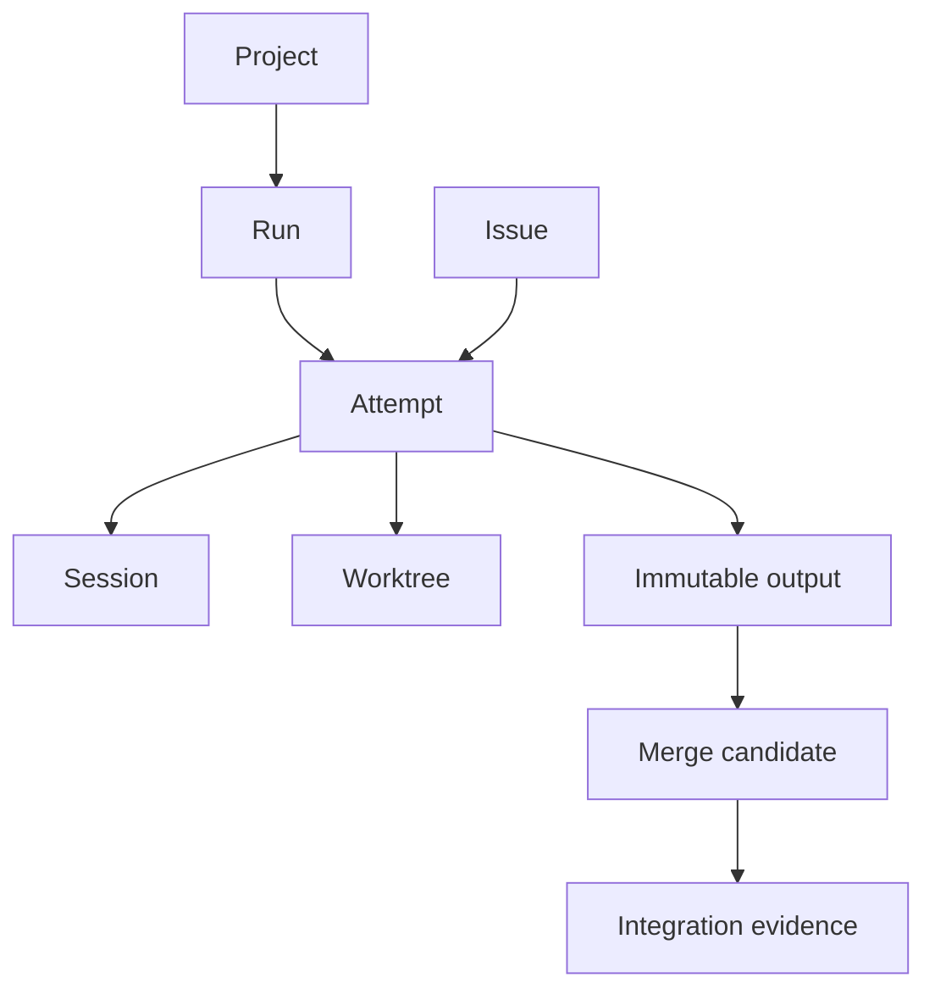

# 03. 공통 데이터 모델·IPC·HTTP API·이벤트 계약

- 문서 버전: 1.0
- 작성 기준일: 2026-10-28, Asia/Seoul
- 상태: **구현을 위한 제안 명세. 아직 구현·실행 검증된 API가 아니다.**
- 독자: Go 런타임, Hook Bridge, Git 통합, React UI 개발자
- 함께 읽기: [런타임](01-runtime-implementation-plan.md), [UI](02-ui-implementation-plan.md), [Git 통합](04-git-worktree-and-merge-plan.md), [검증·개발 순서](05-testing-and-delivery-plan.md)

> 이 문서가 식별자, enum, URL, 이벤트, 동시성 조건의 기준이다. 다른 문서의 화면 표시명·의사코드와 충돌하면 이 계약을 우선한다. 명세 변경은 이 문서와 생성할 OpenAPI/JSON Schema, 양쪽 계약 테스트를 함께 변경한다.

## 1. 계약의 목적과 경계

서로 다른 네 가지 사실을 한 상태 문자열에 합치지 않는다.

1. **업무 상태:** 어떤 이슈와 산출물을 완료해야 하는가.
2. **실행 권한:** 어떤 attempt가 지금 도구를 호출할 수 있는가.
3. **관찰 상태:** 해당 Claude 세션·프로세스·터미널이 현재 어떻게 보이는가.
4. **통합 증거:** 어떤 결과가 어떤 target에 어떤 검증과 승인을 거쳐 반영됐는가.

herdr의 `done`, Claude의 `Stop`, GitHub 이슈의 `closed`만으로 삼사라 이슈를 완료하지 않는다. UI도 이 사실을 자체 추론하지 않고 런타임이 계산한 상태와 이유를 표시한다.

MVP는 한 OS 사용자·한 호스트 안에서 실행한다. 서로 다른 프로젝트 사이 dependency, 원격 호스트의 worker lease, 다중 런타임 합의는 범위 밖이다. 같은 저장소를 가리키는 여러 프로젝트의 통합 권한은 저장소·target 단위로 공유한다.

### 1.1 표기 규칙

| 항목 | 규칙 |
|---|---|
| 도메인 enum | `UPPER_SNAKE_CASE` |
| JSON 필드 | `snake_case` |
| ID | 서버 생성 opaque string. 접두사는 가독성용이며 파싱 계약이 아니다 |
| int64 카운터 | JSON에서 10진수 문자열. JS Number 변환 금지 |
| 시각 | UTC RFC 3339 문자열. UI에서 사용자 시간대로 변환 |
| 시간 비교 | lease 판단은 서버가 수행. 브라우저 시간은 권한 판단에 사용하지 않음 |
| 누락·null | 선택 필드 누락은 미제공, `null`은 명시적으로 값 없음 |
| Git ref | 축약 `main` 대신 내부적으로 `refs/heads/main` |
| SHA | 저장소 object format에 따른 완전한 OID. 40자 고정 가정 금지 |
| 경로 | 런타임이 canonicalize한 경로. 표시용 이름과 식별자를 분리 |
| 오류 | 안정적인 `code`, 사람이 읽는 `message`, 구조화 `details` |
| 예시 | 아래 ID·시각·SHA 표현은 설명용이다. 실제 실행 결과가 아니다 |

## 2. 식별자와 수명

| 식별자 | 의미 | 바뀌는 경우 |
|---|---|---|
| `host_id` | 설치된 사용자 런타임의 호스트 식별자 | 재등록·명시적 설치 초기화 |
| `runtime_epoch` | 데몬 프로세스 세대 | 매 데몬 시작 |
| `database_generation` | 이벤트 저장소 계보 | 복원·데이터 초기화; 일반 데몬 재시작에는 유지 |
| `project_id` | 등록 프로젝트 | 프로젝트 삭제 후 명시적 재등록 |
| `canonical_repository_id` | 동일 Git 저장소 및 통합 권한 범위 | 사용자가 별도 저장소로 확정 |
| `issue_id` | 삼사라의 업무 항목 | 외부 이슈 번호와 독립 |
| `run_id` | 선택된 계획·그래프 세대의 실행 | 새 실행 계획 시작 |
| `run_generation` | 실행 계획의 유효성 세대 | dependency·완료 기준 등 실행 의미 변경 |
| `attempt_id` | 한 이슈의 단일 실행 시도 | 재시도·다른 worker 재할당·결과 수정 |
| `output_id` | 고정된 산출물 | source SHA·manifest 변경 |
| `session_id` | 삼사라 세션 등록 | 새로운 세션 생성 또는 검증된 새 등록 |
| `claude_session_id` | Claude가 제공한 세션 ID | Claude의 수명·resume 동작에 따름 |
| `backend_binding_id` | backend 위치와 generation의 결합 | 새로운 pane/terminal 또는 backend incarnation |
| `worktree_id` | 관리·등록한 checkout | 새로운 worktree 생성 |
| `lease_id` | 실행권 발급 건 | 재발급 |
| `fence` | 해당 자원의 단조 증가 권한 세대 | revoke·재발급 등 권한 변경 |
| `approval_id` | 특정 대상 digest에 대한 승인 요청 | 승인 대상·정책 변경 |
| `merge_candidate_id` | 고정된 source의 통합 시도 | source 변경; base 재검증은 후보 revision 증가 |
| `command_id` | 사용자의 명령 처리 건 | 새로운 멱등 키의 명령 |
| `operation_id` | 비동기 작업의 추적 ID | 새로운 외부 부수효과 |
| `event_id` | 영속 이벤트 | 도메인 transaction마다 생성 |

### 2.1 반드시 지켜야 할 관계

- `issue_id != attempt_id != session_id != claude_session_id != pane_id`다.
- 하나의 이슈는 여러 attempt를 가질 수 있다. 실행권을 가진 active attempt는 정책상 최대 하나다.
- 하나의 세션은 순차적으로 다른 attempt에 재사용할 수 있지만, MVP에서는 동시에 하나에만 bind한다.
- Claude subagent는 독립적인 삼사라 worker가 아니다. 명시적으로 등록한 경우를 제외하고 부모 attempt·권한 범위를 상속한다.
- `run_id`는 여러 이슈를 포함하고, `attempt_id`는 정확히 하나의 run·issue·worktree에 묶인다.
- worktree 경로가 같거나 pane 번호가 재사용됐다는 이유로 이전 session binding을 복구하지 않는다.
- 같은 Git remote URL만으로 두 clone을 동일한 publication authority로 합치지 않는다. Git common dir와 remote의 정규화 정보, 명시적 repository 등록을 함께 사용한다.



## 3. 상태 enum과 전이 원칙

### 3.1 프로젝트·실행 계획

| 모델 | 필드 | 값 | 주의 |
|---|---|---|---|
| Project | activation | UNCONFIGURED, ENABLED, DISABLED | 사용자 선택 |
| Project | registry_state | PRESENT, MISSING, ARCHIVED | 디스크 존재·보관 여부 |
| Project | drain_state | NONE, REQUESTED, DRAINING, COMPLETE, NEEDS_ATTENTION | 비활성화 처리 진행 |
| Run | state | PLANNED, ACTIVE, PAUSED, COMPLETED, FAILED, CANCELLED | 원하는 실행과 결과 집계 |
| Issue | lifecycle | OPEN, COMPLETED, CANCELLED | 세부 진행은 attempt·approval·integration projection |
| Backend | availability | AVAILABLE, DEGRADED, UNAVAILABLE | 신규 할당 판단 자료 |
| Operation | state | PENDING, RUNNING, SUCCEEDED, FAILED, UNKNOWN, CANCELLED | 외부 호출의 접수와 완료를 분리 |

`activation=DISABLED`로 바뀌어도 이미 관리 중인 session의 guard를 즉시 해제하지 않는다. 신규 할당을 중지하고 drain을 수행한다. `MISSING` 프로젝트도 이력은 유지하며 자동 경로 재생성을 하지 않는다.

### 3.2 실행 attempt

| 상태 | 의미 | 대표 다음 전이 |
|---|---|---|
| PENDING | 선행조건·자원·승인 대기 | STARTING, CANCELLED |
| STARTING | worktree·backend 세션 생성과 등록 대기 | RUNNING, FAILED, CANCEL_REQUESTED |
| RUNNING | 유효 lease로 실행 가능 | PAUSING, IMPLEMENTED, FAILED, CANCEL_REQUESTED |
| PAUSING | 권한 회수 완료 또는 진행 중; 현재 작업 정지 확인 전 | PAUSED, LOST, CANCEL_REQUESTED |
| PAUSED | 새 도구 실행 차단; 안전한 재개 조건 확인 대상 | STARTING, CANCEL_REQUESTED |
| IMPLEMENTED | worker가 불변 산출물 manifest를 제출 | VERIFYING, FAILED |
| VERIFYING | 산출물·요구 검증 수행 | VERIFIED, FAILED |
| VERIFIED | 고정된 산출물의 실행 검증 통과 | 실행 재개 없음 |
| FAILED | 이 시도 실패 | 새 attempt로 재시도 |
| CANCEL_REQUESTED | 취소 의도 기록, 생존·부수효과 확인 중 | CANCELLED, LOST |
| CANCELLED | 해당 시도의 실행 종료·권한 정리 확인 | 새 attempt로 재시도 가능 |
| LOST | 세션 소실 확인 후 이 시도를 더 진행하지 못함 | 새 attempt 판단 필요 |

`LOST`는 관찰 연결이 끊겼다는 뜻이 아니다. 관찰 연결만 끊기면 session.liveness를 `UNKNOWN`으로 바꾸며 attempt 결과는 확정하지 않는다.

`PAUSING → PAUSED`는 현재 도구가 끝났거나 관리 가능한 프로세스가 멈췄다는 증거가 필요하다. Hook deny 응답 하나만으로 프로세스 정지와 파일 쓰기 종료를 선언하지 않는다.

`IMPLEMENTED` 이후 산출물 수정은 기존 output을 변경하지 않고 새 attempt·output으로 취급한다. `VERIFIED`여도 최신 target 기준 merge 검증은 다시 필요할 수 있다.

### 3.3 세션 관찰·승인·lease

| 필드 | 값 |
|---|---|
| session.desired_state | ACTIVE, PAUSED, STOPPED |
| session.liveness | ALIVE, EXITED, UNKNOWN |
| session.input_state | READY, BUSY, NATIVE_PERMISSION, USER_OWNED, UNKNOWN |
| lease.state | ACTIVE, REVOKED, EXPIRED, RELEASED |
| approval.kind | PLAN, RESULT, MERGE, RECOVERY |
| approval.state | PENDING, APPROVED, REJECTED, INVALIDATED, CANCELLED |

세션은 `observed_at`, `last_hook_at`, `source`, `backend_raw_state`, `confidence`를 함께 보존한다. `READY`는 자동 입력 전송 허가와 같지 않다. 입력 소유권, 작업 세대, native permission 여부까지 확인해야 한다.

삼사라 승인과 Claude의 native tool permission은 별개다. `approval.kind=NATIVE_PERMISSION` 같은 항목을 만들지 않는다.

### 3.4 통합 후보

`WAITING → VALIDATING → READY → PUBLISHING → MERGED`는 삼사라 로컬 통합의 기본 경로다. GitHub native queue는 검증 group을 만들기 위해 먼저 enqueue하므로 RESULT 승인·source 적격성을 확인한 `WAITING → PUBLISHING` 경로도 허용한다. 이때 PUBLISHING은 provider 처리 중이며 최종 Merge 허가를 뜻하지 않는다.

| 상태 | 의미 |
|---|---|
| WAITING | dependency·승인·통합 slot 대기 |
| VALIDATING | 고정 source와 현재 base로 후보 생성·검증 |
| READY | 현재 후보·base·정책에 대한 검증이 유효 |
| PUBLISHING | publication 요청 또는 native queue에서 진행 중 |
| MERGED | 실제 target 반영 증거 확보 |
| STALE_BASE | base 또는 merge group 변경으로 재검증 필요 |
| CONFLICT | 자동 후보 구성 실패, 명시적 충돌 해결 필요 |
| FAILED | 테스트·정책·publication 실패 |
| CANCELLED | 후보의 통합 의도 취소 |

GitHub native queue 내부 단계는 별도 `native_queue_state`의 NONE, REQUESTED, QUEUED, VALIDATING, MERGED, REMOVED, UNKNOWN으로 기록한다. 여러 후보가 native queue에 있을 수 있으며, 실제 순서와 보호 규칙의 권위는 GitHub다. native candidate의 group 검증·MERGE 승인 대기는 별도 blocking_reasons와 provider_validation_id로 표시한다. `approval_gate`는 `{required, state, approval_ids, subject_digest}` projection이며 state는 기존 approval enum을 재사용하고 required=false이면 null이다. 실제 권한은 원본 approval·policy·provider check로 판단한다.

## 4. 의존성·승인·완료 판정

### 4.1 dependency edge

```json
{
  "dependency_id": "dep_A_B",
  "project_id": "prj_samsara",
  "predecessor_issue_id": "issue_A",
  "successor_issue_id": "issue_B",
  "required_milestone": "INTEGRATED",
  "downstream_phase": "EXECUTION",
  "required_run_generation": "3",
  "required_output_id": null,
  "version": "1"
}
```

| 필드 | 값·역할 |
|---|---|
| required_milestone | IMPLEMENTED, VERIFIED, RESULT_APPROVED, INTEGRATED |
| downstream_phase | EXECUTION 또는 INTEGRATION |
| required_run_generation | 이번 실행 계획에서 요구하는 결과 세대 |
| required_output_id | 특정 산출물을 요구하면 지정. 불특정 과거 결과 재사용 방지 |
| target_repository_id, target_ref | INTEGRATED 조건이면 필수. repositories의 canonical ID와 full ref |
| graph_version | 이 edge가 속한 그래프의 현재 구조 버전 |
| invalidation_policy | MVP 기본 PAUSE_DESCENDANTS. 영향받는 실행만 권한 재평가 |

기본값은 `INTEGRATED + EXECUTION`이다. 구현만 완료된 결과로 하위 작업을 먼저 실행하는 것은 명시적으로 opt-in한 계획에 한한다. 브랜치 적층·코드 전달 전략 없이 edge 값만 바꿔 실행시키지 않는다.

그래프 변경은 cycle 검사를 통과한 transaction에서만 가능하다. 실행 중 의미 있는 edge 변경은 `run_generation`과 `graph_version`을 증가시키고 영향받는 lease·approval·gate를 재평가한다.

### 4.2 gate는 projection

UI의 Integration Gate는 edge 집합을 시각화한 집계다. 별도 에이전트나 가짜 업무 이슈를 만들지 않는다.

`gate_id`는 project·run_generation·successor·downstream_phase·requirement 집합에서 안정적으로 생성한다. `membership_version`과 `membership_digest`가 바뀌면 과거의 open 상태를 재사용하지 않는다. 모든 멤버가 필요한 milestone을 만족해야 통과한다.

### 4.3 승인 바인딩

승인 대상은 자연어 제목이 아니라 아래 값의 정규화 digest다.

- project, run_generation, issue, output/source SHA
- 승인 종류, 대상 merge candidate와 candidate revision
- 정책 버전, 필수 검사 집합, target ref
- MERGE 승인에서는 검증된 candidate/base binding

MVP MERGE 승인은 base가 바뀌면 무효화한다. GitHub native mode에서는 merge-group head/base/멤버 집합과 policy digest에 연결된 필수 `samsara/integration-policy` 검사가 이 조건을 원격에서도 강제해야 한다. group 생성 전에는 source의 RESULT 승인으로 검증 Queue에만 진입한다. 정확한 group 식별·필수 검사·승인 바인딩을 실제 환경에서 검증하지 못하면 native 자동 통합을 제공하지 않는다. 상세 절차는 [Git 계획 §10](04-git-worktree-and-merge-plan.md)에 있다. 사용자가 반복 승인을 줄이는 정책을 선택하는 기능은 이후 별도 정책으로 추가한다. 승인 버튼을 눌렀다는 사실만으로 lease를 재발급하지 않고 dependency·capacity·backend·native permission을 다시 확인한다.

### 4.4 실행권과 통합권의 인계

worker의 결과 제출 시점에는 현재 execution lease와 fence를 검사한다. 제출을 승인해 불변 output으로 고정한 뒤에는 worker가 정상 종료하거나 lease를 반환해도 검증·Merge를 계속할 수 있다. publication에 살아 있는 worker lease를 요구하지 않는다.

통합 controller는 별도 repository+target 자원의 권한·fence와 accepted output의 출처, superseded 여부, run_generation, 최신 승인·검사·게이트를 검사한다. 오래된 worker의 새 제출은 거부하지만, 정상 수락된 과거 결과는 단순 lease 만료만으로 폐기하지 않는다. run 취소·결과 무효화는 별도 도메인 결정으로 후보를 중지시킨다.

### 4.5 이슈 완료 조건

MVP의 코드 변경 이슈는 다음을 모두 만족해야 `COMPLETED`다.

1. 현재 run_generation의 선택된 output이 VERIFIED다.
2. 요구된 RESULT·MERGE 승인이 현재 digest에서 유효하다.
3. target에 대한 integration_evidence가 존재한다.
4. 해당 결과가 현재 계획에서 superseded되지 않았다.
5. 완료 transaction에서 다시 읽은 버전과 정책이 유효하다.

문서 작성·조사처럼 Git 통합이 필요 없는 이슈는 초기 MVP에서 자동 완료 대상으로 제외하거나, 명시적 `delivery_kind=ARTIFACT`와 별도 검수 정책을 갖춘 후 지원한다. GitHub 이슈를 닫는 쓰기 동작은 추가 사용자 설정으로만 수행한다.

### 4.6 기존 Skills에서 실행 계획을 가져오는 계약

계획의 입력은 구조화한 JSON 문서다. 기존 Skills가 만드는 자연어 설명은 사람의 검토 자료이며, 그대로 SQL이나 shell command로 실행하지 않는다.

```json
{
  "spec_version": "1",
  "project_id": "prj_samsara",
  "expected_graph_version": "9",
  "issues": [
    {
      "client_key": "api-contract",
      "title": "공통 API 계약 구현",
      "acceptance_criteria": ["생성 타입과 계약 테스트가 일치한다"],
      "check_profile": "backend-standard",
      "required_capabilities": ["attach_session"]
    },
    {
      "client_key": "ui-binding",
      "title": "UI API 연결",
      "acceptance_criteria": ["승인 상태가 서버 version과 일치한다"],
      "check_profile": "frontend-standard",
      "required_capabilities": ["attach_session"]
    }
  ],
  "dependencies": [
    {
      "predecessor_key": "api-contract",
      "successor_key": "ui-binding",
      "required_milestone": "INTEGRATED",
      "downstream_phase": "EXECUTION",
      "target_repository_id": "repo_samsara",
      "target_ref": "refs/heads/main"
    }
  ]
}
```

`client_key`는 입력 문서의 참조 alias다. 서버 ID가 아니며 runtime이 project 범위에서 검증·해석하고 opaque issue_id를 배정한다. GitHub 이슈·PR 링크는 별도 external_links로 연결한다.

| 단계 | 명령·IPC | 결과 |
|---|---|---|
| 검증 | samsara plan validate / /ipc/v1/plans/validate | schema·중복 key·cycle·missing dependency·capability·check profile 검사, domain mutation 없음 |
| 적용 | samsara plan apply / /ipc/v1/plans/apply | expected graph version 재검사 후 issue·edge·PLANNED run·plan digest·event 저장 |
| 시작 | samsara run start / /ipc/v1/runs/start | PLAN 승인·activation·capacity·권한 확인 뒤 scheduler 실행 |
| 수정 | pause 이후 명시적 revise | 새 run_generation·graph_version, 영향받는 승인·lease·gate 재검사 |

apply는 worker 생성 동작이 아니다. 같은 idempotency key의 동일 apply는 같은 run_id와 alias→issue_id 매핑을 반환한다. 기존 issue에 대한 alias 충돌·제목 변경·삭제는 delta로 보여주고 조용히 다른 업무에 덮어쓰지 않는다.

실행 중 계획을 일반 apply로 덮어쓰면 409를 반환한다. revise는 영향 범위를 계산하고 이전 산출물과 이력을 보존한다. plan에 기록된 check_profile은 사용자가 trust한 프로젝트 설정의 검사 정의를 참조한다. 외부에서 가져온 계획의 임의 command 문자열을 자동 실행하지 않는다.

run에는 plan_schema_version, plan_digest, 정규화 plan snapshot, 생성한 issue mapping을 보존한다. dependency_edges는 run_id·run_generation에 묶어 과거 run 화면이 현재 그래프 변경으로 바뀌지 않게 한다.


## 5. SQLite 저장 모델

### 5.1 테이블 범위

아래는 신규 설계다. 앞선 대화의 '10개 테이블 생성 통과' 결과를 이 스키마의 검증으로 취급하지 않는다.

| 테이블 | 주요 컬럼·목적 | 핵심 제약 |
|---|---|---|
| schema_migrations | version, checksum, applied_at | version UNIQUE |
| runtime_metadata | database_generation, schema_version | singleton |
| projects | id, root_path, activation, drain_state, version | canonical registration |
| repositories | id, common_dir, object_format, remote_identity | 정규화 저장소 등록 |
| project_repositories | project_id, repository_id | composite PK |
| issues | id, project_id, title, lifecycle, version | project FK |
| runs | id, project_id, generation, graph_version, state, plan_digest, plan_snapshot | project FK |
| run_issues | run_id, issue_id, chosen_output_id | composite PK |
| dependency_edges | run_id, predecessor, successor, milestone, phase, generation | self-edge 금지, cycle은 서비스 검증 |
| execution_attempts | issue, run, worktree, state, output_id, version | project 범위 일치 |
| worktrees | repository, path, branch_ref, ownership, state | 등록 경로 UNIQUE |
| sessions | claude_session_id, desired/liveness/input, timestamps | external ID와 내부 ID 분리 |
| backend_bindings | session, kind, instance, opaque_ref, generation | backend 위치·세대 중복 방지 |
| session_assignments | session, attempt, attached_at, released_at | 활성 assignment partial UNIQUE |
| resource_generations | resource_key, current_fence | resource_key PK |
| leases | resource_key, owner_attempt, fence, state, deadline | ACTIVE partial UNIQUE |
| output_artifacts | source_sha, manifest_digest, provenance | immutable output |
| approvals | kind, subject_digest, state, decision_actor | 중복 active request 제한 |
| integration_targets | repository, target_ref, authority, policy_version | repository+target UNIQUE |
| merge_candidates | source, base, candidate_sha, revision, state | 후보 불변 source |
| provider_validation_groups | group head/base SHA, target, membership digest, policy version | immutable provider revision |
| provider_group_members | group_id, candidate_id, PR/source/output 참조 | group 멤버 provenance |
| check_runs | candidate_revision 또는 provider_group_id, check_name, checked_sha, source_actor, result | 검사 OID·정책·check 작성자 바인딩 |
| integration_evidence | candidate, target_before/after, provider_evidence | 증거 immutable |
| external_links | issue/PR/commit ref, provider, freshness | provider+external key |
| commands | principal, idempotency_key, request_hash, response | scope+key UNIQUE |
| operations | kind, state, resource, correlation | command 연결 |
| outbox | operation, payload_ref, retry_at, attempt_count, state | effect dedupe key UNIQUE |
| events | seq, event_id, project_version, payload | event_id UNIQUE, project+version UNIQUE |
| audit_entries | actor, action, subject, decision, before/after | append-only 애플리케이션 정책 |
| ui_auth_sessions | token_hash, principal, expires_at, revoked_at | 원문 token 저장 금지 |
| catalog_events | seq, catalog_version, project_summary_changes | catalog_version UNIQUE |

테이블 수를 목표로 삼지 않는다. 중복 데이터 축소와 invariant 보장을 우선하며, 위 logical table을 물리적으로 합칠 때는 마이그레이션 ADR에 근거를 기록한다.

catalog snapshot과 catalog_events는 project 등록·활성화·요약 변경 transaction에서 함께 갱신한다. catalog는 별도 version·cursor scope를 사용하며 project stream의 cursor와 교환하지 않는다. UI는 전 프로젝트 catalog stream 하나와 선택 프로젝트 stream 하나를 기본으로 유지한다.

### 5.2 데이터베이스 불변조건

- 프로젝트 외래 키와 연관 entity의 project_id가 일치해야 한다.
- 하나의 resource_key에 ACTIVE lease는 하나뿐이다.
- lease 상태·deadline과 fence 검증을 같은 transaction에서 한다.
- output·integration evidence를 UPDATE로 덮어쓰지 않는다. 정정은 새 row와 supersedes 관계다.
- 도메인 변경, project_version 증가, event, audit, outbox 삽입은 동일 transaction이다.
- 외부 네트워크·Git·프로세스 호출은 transaction 밖에서 한다.
- SQLite writer를 짧게 유지하며 대기시간 초과를 명시적 오류로 반환한다.
- 앱·Hook·브라우저가 DB 파일을 직접 공유해 쓰지 않는다. writer는 daemon이다.
- 성공한 이벤트 발행 여부와 외부 effect 성공 여부를 같은 뜻으로 저장하지 않는다.

### 5.3 중요 인덱스의 명세 예시

```sql
-- 전체 migration이 아니라 필요한 제약을 설명하는 예시다.
CREATE UNIQUE INDEX one_active_lease
  ON leases(resource_key)
  WHERE state = 'ACTIVE';

CREATE UNIQUE INDEX one_active_session_assignment
  ON session_assignments(session_id)
  WHERE released_at IS NULL;

CREATE UNIQUE INDEX one_project_version_event
  ON events(project_id, project_version);

CREATE INDEX project_event_replay
  ON events(project_id, seq);

CREATE INDEX pending_outbox
  ON outbox(state, retry_at);
```

`one_active_lease`에 시간 조건을 넣지 않는다. 만료 처리는 transaction에서 ACTIVE→EXPIRED로 전이한 뒤 새 lease를 발급한다. fence는 lease row 수가 아니라 영속 `resource_generations`에서 증가시킨다.

### 5.4 DB 운영 기준

SQLite는 한 번에 하나의 write transaction을 허용한다. 이를 전제로 단일 writer queue와 제한된 read pool을 설계한다. WAL은 로컬 디스크에만 두고 네트워크 파일시스템을 지원한다고 안내하지 않는다. 외래 키는 연결마다 활성화한다. [S1][S2][S3]

초기 설정 제안은 WAL, synchronous FULL, foreign_keys ON이다. busy timeout, checkpoint 주기, reader 수는 M0 benchmark로 결정한다. SQLite 3.51.3 이상의 검증된 빌드를 기본 후보로 삼고, 실제 Go driver에 포함된 `sqlite_version()`을 CI에서 확인한다. 공식 문서에 기록된 WAL-reset 수정 여부도 확인한다. [S1]

운영 중 백업은 Online Backup API 등 일관된 snapshot 방식으로 수행한다. 실행 중 DB 본체 파일만 복사하는 절차를 만들지 않는다. [S4]

## 6. 도메인 command 처리와 멱등성

### 6.1 공통 transaction 순서

1. 인증된 principal과 project scope를 확인한다.
2. `Idempotency-Key`가 이미 있으면 저장된 request hash와 비교한다.
3. 같으면 기존 command·operation 응답을 반환하고, 다르면 `IDEMPOTENCY_KEY_REUSED`다.
4. `If-Match`의 entity version과 현재 버전을 비교한다.
5. 활성화·lease·dependency·승인·capability·정책을 재검사한다.
6. 도메인 row, audit, outbox, project_version, event를 같은 transaction에 기록한다.
7. commit 뒤 API는 결과 또는 `202 + operation_id`를 반환한다.
8. dispatcher가 외부 effect를 실행하고, 결과를 새 transaction으로 반영한다.

UI의 `available_actions`는 설명·버튼 상태를 위한 snapshot이다. 서버 측 권한 재검사를 대체하지 않는다.

### 6.2 외부 부수효과의 전송 보장

Outbox는 '상태를 기록했는데 할 일을 잊는 문제'를 줄인다. 외부 API에 멱등 키가 없다면 exactly-once 실행을 보장하지 못한다. publication의 최종 인가 transaction 이후 전송된 효과는 즉시 취소를 보장하지 않는다. GitHub policy check 성공을 게시하는 인가와 실제 Merge 사이 revoke 경합도 동일하게 기록하며, 취소는 요청·확인·실제 통합 결과를 구분한다.

| 상황 | 처리 |
|---|---|
| 아직 외부 호출하지 않은 확실한 실패 | 제한된 backoff 재시도 |
| 외부 API의 명시적 거절 | FAILED, 분류된 원인 기록 |
| 호출 timeout·연결 종료·ACK 유실 | UNKNOWN, 관찰 후 판단 |
| worker 생성 결과 불명 | correlation label·등록 ticket으로 기존 생성물 탐색 |
| prompt 전송 결과 불명 | 동일 prompt 무조건 재전송 금지; dispatch ID와 Hook 수신 증거 대조 |
| Git publication 결과 불명 | target·provider evidence 재조회 후 성공·실패 판정 |
| 종료 요청 결과 불명 | 프로세스·backend 생존 확인, 동일 번호의 새 프로세스 오인 금지 |

자동 입력에는 `dispatch_id`와 `attempt_id`를 포함한다. 에이전트에게 표시되는 텍스트만으로 dedupe가 보장된다고 주장하지 않는다. worker wrapper·Hook acknowledgment를 사용할 수 없는 backend는 uncertain delivery에서 수동 확인으로 전환한다.

### 6.3 조건부 변경 예시

```http
POST /v1/approvals/apr_result_A/decisions
Authorization: Bearer <memory-only-session-token>
Content-Type: application/json
Idempotency-Key: <client-generated-unique-key>
If-Match: "apr_result_A:v7"

{
  "decision": "APPROVE",
  "subject_digest": "sha256:<current-subject-digest>",
  "comment": "검증 결과와 변경 범위를 확인함"
}
```

```json
{
  "command_id": "cmd_approval_A",
  "operation_id": "op_reconcile_A",
  "status": "ACCEPTED",
  "resource_version": "8",
  "project_version": "44"
}
```

승인 저장과 worker 재개는 다른 사실이다. 승인 반영 이벤트 이후에도 `resume_required`, `NATIVE_PERMISSION`, `UNKNOWN`이 남을 수 있다.

## 7. 공개 HTTP API

### 7.1 표준 endpoint 목록

이 목록은 구현할 API다. herdr 또는 Claude Code의 실제 endpoint 이름이 아니다.

| Method | Path | 목적 | 첫 제공 단계 |
|---|---|---|---|
| GET | /v1/health | 최소 생존 확인, 민감 정보 없음 | M1 |
| GET | /v1/runtime | 버전·epoch·schema·capability·상태 | M1 |
| POST | /v1/ui/sessions | 일회용 code 교환 | M4 |
| DELETE | /v1/ui/sessions/current | 현재 UI token 폐기 | M4 |
| GET | /v1/projects | 전체 등록 프로젝트, 이력·활성·보관 필터 | M1 |
| GET | /v1/catalog/snapshot | sidebar용 atomic 목록 snapshot | M4 |
| GET | /v1/catalog/events | project 목록 변경 알림 | M4 |
| GET | /v1/projects/{project_id} | 프로젝트 설정·상태 | M1 |
| GET | /v1/projects/{project_id}/snapshot | dashboard 기준 snapshot | M3 |
| GET | /v1/projects/{project_id}/events | cursor 기반 SSE | M3 |
| GET | /v1/projects/{project_id}/issues | 페이지화 업무 목록 | M3 |
| GET | /v1/issues/{issue_id} | 업무·의존성·결과 상세 | M3 |
| GET | /v1/projects/{project_id}/runs | 실행 이력 | M3 |
| GET | /v1/runs/{run_id} | 계획 세대·상태 | M3 |
| GET | /v1/runs/{run_id}/snapshot | 종료 run의 보관 그래프·최종 결과 | M4 |
| GET | /v1/attempts/{attempt_id} | 실행·검증·권한 상세 | M3 |
| GET | /v1/sessions/{session_id} | 세션 관찰·backend 위치 | M3 |
| GET | /v1/worktrees/{worktree_id} | checkout·branch·보존 상태 | M5 |
| GET | /v1/projects/{project_id}/approvals | 승인 대기·결정 목록 | M3 |
| GET | /v1/approvals/{approval_id} | 승인 대상·digest·결정 상세 | M3 |
| POST | /v1/approvals/{approval_id}/decisions | 승인·거절 | M6 |
| GET | /v1/projects/{project_id}/merge-queues | target별 queue 목록 | M5 |
| GET | /v1/merge-candidates/{candidate_id} | 후보·검사·승인·증거 | M5 |
| POST | /v1/merge-candidates/{candidate_id}/enqueue | 지정 authority에 통합 요청 | M6 |
| POST | /v1/merge-candidates/{candidate_id}/cancel | 대기 후보 취소 요청 | M6 |
| GET | /v1/projects/{project_id}/history | audit·GitHub 링크 통합 이력 | M4 |
| GET | /v1/projects/{project_id}/github-history | issue·PR·commit 관찰 목록 | M5 |
| POST | /v1/projects/{project_id}/refresh | 명시적 외부 상태 새로고침 | M5 |
| POST | /v1/runs/{run_id}/pause | 실행 의도 일시정지 | M6 |
| POST | /v1/runs/{run_id}/resume | 선행조건 재검사 후 재개 요청 | M6 |
| POST | /v1/runs/{run_id}/cancel | 실행 취소·정리 요청 | M6 |
| POST | /v1/sessions/{session_id}/focus | 지원되는 backend 위치 열기 | M6 |
| POST | /v1/sessions/{session_id}/release-input | 사용자 입력권 반환 | M6 |
| POST | /v1/projects/{project_id}/disable | 신규 작업 중단·drain | M6 |
| GET | /v1/operations/{operation_id} | 비동기 command 진행 | M3 |

프로젝트 최초 등록·trust 승인·backend 강제 선택은 초기에는 CLI에서만 제공한다. UI가 임의 로컬 경로를 POST해 프로젝트를 등록하는 기능은 MVP에 없다.

`history`는 영속 audit 검색이다. SSE retention이 지나도 업무 이력을 제공한다. 반대로 audit 목록 전체를 매 실시간 이벤트에 싣지 않는다.

### 7.2 목록·상세 응답 규칙

- 페이지화는 `cursor`와 `limit`을 사용한다. 기본 50, 최대 200은 초기 제안값이다.
- 정렬은 timestamp와 ID 등 결정적인 tie-breaker를 함께 사용한다.
- stable snapshot pagination이 필요하면 조회 generation을 cursor에 포함한다.
- 다른 프로젝트 접근을 URL만 바꿔 우회할 수 없어야 한다.
- resource version은 응답의 `version`과 strong `ETag`로 반환한다.
- 전체 transcript·tool 입력은 기본 응답에 포함하지 않는다.
- HTTP cache는 인증된 로컬 상태에 `Cache-Control: no-store`를 적용한다.

### 7.3 오류 계약

```json
{
  "error": {
    "code": "APPROVAL_SUBJECT_CHANGED",
    "message": "승인 요청 이후 대상 변경이 발생했습니다.",
    "retryable": false,
    "request_id": "req_decision_A",
    "details": {
      "expected_version": "7",
      "current_version": "8",
      "refresh_resource": "/v1/approvals/apr_result_A"
    }
  }
}
```

| HTTP | 대표 code | UI 동작 |
|---|---|---|
| 400 | INVALID_REQUEST | 필드별 안내 |
| 401 | SESSION_EXPIRED | stream 종료, 재연결 안내 |
| 403 | ACTION_FORBIDDEN | 권한·정책 이유 표시 |
| 404 | RESOURCE_NOT_FOUND | 오래된 링크 또는 범위 오류 |
| 409 | DEPENDENCY_UNMET, DELIVERY_UNKNOWN, IDEMPOTENCY_KEY_REUSED | 현재 사실 갱신, 자동 재명령 금지 |
| 412 | VERSION_MISMATCH, APPROVAL_SUBJECT_CHANGED | 최신 내용 재검토 |
| 422 | UNSUPPORTED_CAPABILITY | 지원 환경·수동 대안 표시 |
| 429 | RATE_LIMITED | Retry-After 기준 재조회 |
| 503 | RUNTIME_NOT_READY, STORAGE_UNAVAILABLE | 관리 명령 중단, 재시도 가능 여부 구분 |

외부 provider의 404·403·rate limit을 '프로젝트 없음'으로 그대로 변환하지 않는다. 연결 상태와 요청 오류를 분리한다.

## 8. Project snapshot 계약

### 8.1 원자적 읽기

snapshot은 SQLite의 **하나의 read transaction**에서 project projection과 replay boundary를 읽는다. commit되지 않은 domain row와 먼저 전송된 event를 섞지 않는다.

서버는 UI용 projection을 domain 변경과 같은 transaction에서 유지하는 방식을 MVP 기본으로 한다. 비동기 projection을 도입한다면 `projected_through_seq`를 별도로 관리하고, 도메인 최신 seq를 snapshot cursor로 내보내지 않는다.

```json
{
  "schema_version": "1",
  "project_id": "prj_samsara",
  "project_version": "43",
  "graph_version": "9",
  "runtime_epoch": "epoch_current",
  "database_generation": "db_generation_A",
  "snapshot_cursor": "<opaque-project-cursor>",
  "generated_at": "2026-10-27T15:30:00Z",
  "freshness": {
    "runtime": "LIVE",
    "backend_observation": "PARTIAL",
    "github": "STALE"
  },
  "entities": {
    "issues": [],
    "runs": [],
    "attempts": [],
    "sessions": [],
    "worktrees": [],
    "dependencies": [],
    "gates": [],
    "approvals": [],
    "merge_candidates": [],
    "integration_targets": []
  },
  "summary": {
    "running": 0,
    "blocked": 0,
    "approval_pending": 0,
    "integration_pending": 0
  }
}
```

snapshot은 전체 세션 transcript, 모든 과거 이력, Git 전체 commit graph를 담지 않는다. 현재 비종료 run·최근 관련 항목을 제공하고, 과거·로그는 별도 endpoint로 조회한다. 이벤트는 이 live projection 범위의 변경과 필요한 참조 entity를 함께 보내며, 숨겨진 과거 데이터 전체를 새 upsert로 끼워 넣지 않는다.

종료 run의 `/v1/runs/{run_id}/snapshot`은 `view_kind=HISTORICAL`, run_generation, ended_at, final_version, 당시 plan·선택 output·최종 상태·검증 evidence를 반환한다. run 종료 transaction에서 frozen summary를 저장한다. 현재 issue의 상태나 새 그래프 구조로 과거 run 화면을 덮어쓰지 않는다. 보관 snapshot에는 live SSE cursor를 넣지 않는다. 비종료 run은 live project snapshot을 사용하며, 역사 endpoint 요청에는 명시적 RUN_NOT_FINALIZED 오류를 반환한다. 최신 GitHub 상태는 당시 결과와 별도 조회·별도 시각으로 표시한다.

### 8.2 이슈 projection

```json
{
  "id": "issue_B",
  "version": "12",
  "lifecycle": "OPEN",
  "title": "후속 기능 구현",
  "current_attempt_id": "attempt_B_1",
  "execution_state": "PENDING",
  "integration_state": "WAITING",
  "display_status": "BLOCKED",
  "blocking_reasons": [
    {
      "code": "DEPENDENCY_APPROVAL_PENDING",
      "source_issue_id": "issue_A",
      "required_milestone": "RESULT_APPROVED",
      "approval_id": "apr_result_A",
      "message": "A의 결과 승인이 필요합니다."
    }
  ],
  "available_actions": [
    {
      "action": "OPEN_APPROVAL",
      "enabled": true,
      "resource_id": "apr_result_A"
    },
    {
      "action": "RESUME",
      "enabled": false,
      "reason_code": "DEPENDENCY_UNMET"
    }
  ],
  "resume_required": false
}
```

`display_status`는 화면 편의를 위한 서버 projection이며 DB의 유일한 업무 상태가 아니다. 여러 blocking reason을 보존한다. UI는 가장 중요한 하나를 카드에, 전체를 inspector에 표시한다.

## 9. SSE 이벤트 계약과 복구

### 9.1 이벤트 envelope

```json
{
  "schema_version": "1",
  "event_id": "evt_approval_A_accepted",
  "seq": "1742",
  "project_id": "prj_samsara",
  "previous_project_version": "43",
  "project_version": "44",
  "type": "approval.decided",
  "aggregate_type": "approval",
  "aggregate_id": "apr_result_A",
  "aggregate_version": "8",
  "occurred_at": "2026-10-27T15:30:02Z",
  "recorded_at": "2026-10-27T15:30:02.150Z",
  "payload": {
    "changes": {
      "upserts": {
        "approvals": [
          {
            "id": "apr_result_A",
            "version": "8",
            "kind": "RESULT",
            "state": "APPROVED",
            "subject_digest": "sha256:<subject>"
          }
        ],
        "issues": []
      },
      "deletes": {}
    }
  }
}
```

이 예시는 형식을 보여주는 최소 payload다. 실제 schema는 각 entity의 필수 필드를 포함한 완전한 upsert를 요구한다.

- 하나의 project 도메인 transaction당 하나의 atomic `changes` 이벤트를 기록한다.
- 동일 transaction에서 변경된 여러 entity를 하나의 store update로 적용한다.
- `seq`는 DB 전역 순번이라 프로젝트별로 **빈 번호가 생긴다**.
- 이벤트 누락 검사는 seq+1이 아니라 `previous_project_version`의 일치로 한다.
- 클라이언트가 `seq`나 `version`을 JS Number로 바꾸지 않게 generated type을 string으로 고정한다.
- `occurred_at`은 producer 시각일 수 있다. 순서는 영속 seq·project_version이 기준이다.
- heartbeat·connection 제어 이벤트는 domain version을 증가시키지 않는다.

### 9.2 전송 형식

```text
id: <opaque-cursor-after-this-event>
event: project.change
data: {"schema_version":"1","event_id":"evt_...","seq":"1742","project_id":"prj_samsara","previous_project_version":"43","project_version":"44","type":"approval.decided","payload":{"changes":{"upserts":{},"deletes":{}}}}

: heartbeat
```

전송은 UTF-8 `text/event-stream`이다. HTTP flush, proxy buffering, 연결 종료, 줄 경계 분할을 테스트한다. SSE의 event/id/data 및 재연결 표준을 따르되, 자동 재연결·cursor 저장 정책은 애플리케이션이 명시적으로 구현한다. [S5]

### 9.3 초기 연결과 재연결 순서

1. 인증 후 snapshot을 가져온다.
2. snapshot을 store에 원자적으로 적용하고 `snapshot_cursor`를 저장한다.
3. `GET .../events?after=<cursor>`를 열어 그 boundary 이후 이벤트를 replay한다.
4. 서버는 영속 events를 cursor 이후부터 읽는다. live 알림은 조회를 깨우는 최적화일 뿐이다.
5. backlog를 읽는 중 새 event가 생겨도 마지막 cursor 이후 DB를 다시 조회하므로 누락되지 않는다.
6. 클라이언트는 적용이 끝난 이벤트의 cursor만 보관한다.
7. 연결이 끊기면 backoff+jitter로 마지막 적용 cursor부터 재연결한다.

현재 인증 설계는 메모리 bearer를 쓰므로 **fetch streaming client**가 기본이다. native `EventSource`는 custom Authorization header를 받지 않으므로 직접 대체하지 않는다. parser는 표준의 CRLF·multiline data·UTF-8 분할을 처리해야 한다. [S5]

재연결 요청의 `after`와 `Last-Event-ID`는 모두 지원하되 둘이 다르면 400을 반환한다. 클라이언트는 한 방식만 사용한다. cursor는 인증 수단이 아니며 principal·project scope는 매 요청 확인한다.

### 9.4 중복·누락·과거 cursor

| 입력 | 처리 |
|---|---|
| 이미 적용한 event_id/version | 부수효과 없이 무시, cursor는 안전하게 전진 |
| previous_project_version = 로컬 version | 원자적 changes 적용 |
| project_version이 과거 | 무시 |
| previous_project_version이 맞지 않음 | 적용 중지, snapshot 재조회 |
| cursor가 retention보다 오래됨 | reset_required |
| 다른 project/database_generation cursor | reset_required |
| 알 수 없는 breaking schema | 업그레이드 필요 안내, 변경 명령 비활성 |
| 알 수 없는 additive event type | 공통 changes schema가 유효하면 적용, 아니면 재동기화 |

서버는 stream 안에서 `event: reset_required`와 이유를 보내고 닫는다. 클라이언트는 반복 연결을 멈추고 snapshot부터 다시 시작한다. 인증 실패는 HTTP 401로 반환하며 fetch client가 처리한다.

### 9.5 backend event와 UI event의 차이

herdr event stream은 삼사라의 영속 event log가 아니다. 공식 API에는 `events_lost`와 snapshot/event의 공통 sequence boundary 부재가 명시되어 있다. 따라서 backend event를 그대로 browser에 중계하지 않고, stale 처리·authoritative reread·reconcile 후 삼사라 transaction에서 새 projection event를 만든다. [S6]

### 9.6 retention·backpressure

초기 제안은 replay 이벤트 7일 또는 100만 건 중 먼저 도달하는 기준으로 보관하되, audit·integration evidence는 별도 보존한다. 확정값은 실제 event 발생량 측정 후 설정한다.

느린 client 때문에 writer가 대기하지 않도록 subscriber당 bounded queue를 둔다. queue 초과 시 조용히 event를 버리지 않고 reset을 요청하거나 연결을 닫아 영속 replay를 유도한다. UI용 status burst 병합은 transport 이후 렌더 단계에서만 수행하고 business event 자체를 삭제하지 않는다.

## 10. Hook Bridge IPC

### 10.1 transport와 역할

초기 Unix 계열 구현은 사용자 전용 Unix domain socket 위 HTTP/JSON을 사용한다. Windows native 지원을 도입할 때 named pipe transport를 별도 conformance 대상으로 만든다. 브라우저용 loopback HTTP와 Hook용 local IPC의 인증·권한 범위를 분리한다.

| IPC operation | 목적 | authority |
|---|---|---|
| /ipc/v1/plans/validate | 구조화 계획 검증, 변경 없음 | CLI·Skills의 등록된 사용자 |
| /ipc/v1/plans/apply | 계획 적용·PLANNED run 생성 | 조건부 command |
| /ipc/v1/runs/start | 승인된 계획 실행 요청 | scheduler 재검사 |
| /ipc/v1/sessions/register | SessionStart를 launch ticket·project에 연결 | 관리 세션 등록 |
| /ipc/v1/sessions/observe | Hook·backend 관찰 수집 | 권한 부여 불가 |
| /ipc/v1/tools/check | PreToolUse의 실행권 검사 | 현재 lease·정책 결정 |
| /ipc/v1/tools/result | PostToolUse·Failure 관찰 | 결과 기록, 완료 단정 불가 |
| /ipc/v1/leases/renew | wrapper heartbeat·유효 lease 연장 | lease generation 일치 필요 |
| /ipc/v1/outputs/submit | 구현 결과 manifest 제출 | current attempt만 가능 |
| /ipc/v1/sessions/finish | Stop·SessionEnd 관찰 | reconcile 요청 |
| /ipc/v1/dispatches/ack | 자동 입력을 인식한 worker acknowledgment | prompt 중복·불명 결과 조정 |

endpoint 이름은 삼사라 내부 제안이다. 모든 mutating IPC에 request_id·idempotency 처리를 적용한다. 단 `/tools/check`의 authorization 판정은 과거 PASS를 캐시 재생하지 않고 요청마다 최신 권한을 다시 평가한다. 같은 tool_use_id는 중복 audit 연결에만 사용한다.

### 10.2 SessionStart 등록의 두 경로

**신규 관리 worker**

1. 런타임이 attempt·worktree·launch intent를 먼저 영속화한다.
2. 일회용 ticket, process environment, 관리 범위의 guard 설정을 준비한다.
3. 선택 backend에서 worker를 생성한다.
4. SessionStart bridge가 ticket과 실제 Claude session ID·cwd를 제출한다.
5. runtime이 ticket의 project/worktree/attempt·사용 여부를 확인한다.
6. hook guard가 실제 적용됐는지 readiness 검증 후 lease를 발급한다.
7. 늦은 이전 세대 등록은 새 worker의 lease를 탈취할 수 없다.

**기존 Standalone 또는 사용자가 연 Claude 세션**

1. 활성 프로젝트 여부를 확인한다.
2. 사용자의 명시적 attach 의도를 확인한다.
3. 실제 현재 backend와 session을 등록한다.
4. hook 적용·workspace·기존 작업 상태를 확인한다.
5. 사용자가 선택한 assignment에 lease를 부여한다.

등록되지 않은 일반 Claude 세션을 자동 worker로 편입하지 않는다. 기존 대화 내용을 읽어 issue를 추측해서 lease를 주지 않는다.

### 10.3 PreToolUse request

```json
{
  "protocol_version": "1",
  "request_id": "hook_req_01",
  "event": "PreToolUse",
  "project_id": "prj_samsara",
  "attempt_id": "attempt_C_1",
  "session_id": "ses_C",
  "claude_session_id": "<external-session-id>",
  "lease_id": "lease_C_2",
  "fence": "18",
  "runtime_epoch": "epoch_current",
  "tool_use_id": "<claude-tool-use-id>",
  "tool_name": "Edit",
  "cwd": "<canonical-worktree-path>",
  "input_summary": {
    "affected_paths": ["src/feature.ts"],
    "payload_digest": "sha256:<canonical-input>"
  }
}
```

일반 감사 기록에는 raw tool input을 보관하지 않는다. 정책 검사에 원문이 필요한 경우 IPC 요청 중 메모리에서만 처리하고, 로그에는 digest와 제한된 요약을 남긴다. tool 입력은 실행 명령으로 평가하지 않는다.

### 10.4 결정 반환

```json
{
  "decision": "DENY",
  "reason_code": "DEPENDENCY_UNMET",
  "message": "A의 현재 결과 승인이 완료되어야 B를 계속 실행할 수 있습니다.",
  "project_version": "44",
  "current_fence": "19",
  "retry_after_ms": 1000
}
```

삼사라 내부 decision은 `PASS` 또는 `DENY`다.

- PASS: bridge는 Claude의 기존 permission flow를 유지한다. `permissionDecision:"allow"`로 바꾸지 않는다.
- DENY: 버전별 공식 Hook schema에 맞는 deny 또는 exit code 2를 사용한다.
- daemon 응답 없음·잘못된 응답: 관리 범위의 policy hook은 차단한다.
- 비활성·미관리 세션: inert hook이 daemon/probe 없이 통과한다.
- 실행 중 drain에 포함된 기존 managed session: 비활성 flag만 보고 통과시키지 않는다.

현재 공식 문서는 command/http hook의 `onFailure:"block"`에 Claude Code v2.1.295 이상을 요구한다. 누락 실행 파일·timeout·invalid output을 포함한 실제 동작 검증 전에는 '실패 시 차단' 지원을 선언하지 않는다. `Stop`의 실패 처리는 같은 권한 gate가 아니다. [S7]

### 10.5 검사와 도구 실행 사이 경합

허가 검사는 도구 호출 직전의 정책 판정이다. 검사 뒤에 승인이 취소되거나 lease가 revoke될 수 있고, 이미 시작한 shell subprocess는 계속 파일을 쓸 수 있다.

검사 시 lease·deadline·fence·attempt binding·dependency·approval·policy를 하나의 authoritative DB snapshot에서 읽는다. 판정의 선형화 시점 이후 revoke가 발생한 호출은 이미 허용된 in-flight 호출로 취급한다.

따라서 정책은 다음을 함께 요구한다.

- 후속 도구 검사에서 최신 fence 확인
- 기존 작업의 PAUSING·quiescence 관찰
- 동일 worktree의 조기 재할당 금지
- 불변 source commit을 대상으로 하는 후보 검증
- 런타임·GitHub 권위 외 경로의 publication을 줄이는 보호 설정

이 시스템은 같은 OS 사용자 권한을 가진 악의적 프로세스를 격리하는 보안 sandbox가 아니다. 강한 실행 격리가 필요하면 별도의 container/OS credential 경계를 설계한다.

### 10.6 daemon 재시작과 lease

`runtime_epoch`가 바뀌면 이전 lease 요청은 자동 연장하지 않는다. lease row는 기록을 유지하되 세션 재확인·새 binding 및 현재 정책 검증 전까지 실행을 차단한다.

새 fence를 발급해도 이전 subprocess가 사라지는 것은 아니다. 새 worker를 만들기 전에 기존 시도의 종료·quiescence 또는 충분한 격리와 publication 차단을 확인한다.

lease TTL·heartbeat는 설정 가능한 값으로 제공하고, 최초 제안은 TTL 30초·heartbeat 5초다. 장기 도구 실행 중에도 heartbeat가 가능하도록 wrapper를 사용하거나, 생존 확인이 불충분하면 자동 재할당을 중단한다. system clock 이동·sleep/wake·host suspend를 별도 테스트한다.

## 11. 브라우저 인증·로컬 보안

### 11.1 UI bootstrap

1. `samsara ui`는 daemon에 짧은 수명의 일회용 code를 요청한다.
2. 브라우저를 `http://127.0.0.1:<port>/#bootstrap=<one-time-code>`로 연다.
3. UI는 code를 `POST /v1/ui/sessions` 본문으로 교환한다.
4. 교환 성공 여부와 무관하게 `history.replaceState`로 fragment를 제거한다.
5. 서버가 발급한 bearer를 UI 메모리에만 저장한다.
6. API와 fetch SSE 요청에 Authorization header로 전송한다.

일회용 code의 초기 제안은 60초 만료·1회 사용이다. 장기 bearer를 URL query·fragment·localStorage에 넣지 않는다. 최초 code 역시 진단 로그·analytics·오류 report에 남기지 않는다.

token의 해시·principal·만료·폐기 상태는 별도 `ui_auth_sessions`에 저장할 수 있다. 이렇게 하면 daemon이 재시작되어도 열려 있는 브라우저의 유효 token을 재검증할 수 있다. 원문 token을 DB에 저장하지 않는다. 전체 page reload로 메모리를 잃으면 새 bootstrap을 안내한다.

### 11.2 endpoint 방어

- loopback address만 bind한다. 외부 interface listen은 MVP에 없다.
- Host·Origin은 실제 launch한 scheme/host/port의 allowlist로 검증한다.
- wildcard CORS, 임의 origin 반사, query bearer를 허용하지 않는다.
- CSP·Referrer-Policy를 설정하고 외부 script·폰트·analytics 없이 패키징한다.
- API에 body size, header size, timeout, rate limit을 둔다.
- 외부 issue·PR·branch·commit 문자열은 텍스트로 escape해 렌더링한다.
- Markdown 이력 렌더링이 필요하면 sanitize된 제한 요소만 허용한다.
- 사용자 입력 문자열을 shell command에 이어 붙이지 않는다.
- focus·open 동작도 등록된 backend ref와 허용된 URI만 사용한다.
- UI가 임의 shell command·경로 삭제·git reset을 호출하는 endpoint를 만들지 않는다.

## 12. 버전·migration·호환성

### 12.1 계약 버전

- URL의 `v1`은 API major다.
- `schema_version`은 snapshot/event payload major다.
- additive optional field는 minor 배포에 허용한다.
- enum 값 추가는 클라이언트의 unknown handling을 테스트한 뒤 배포한다.
- 필수 필드 삭제·의미 변경은 새로운 major 또는 명시적 migration이다.
- backend protocol version은 API version과 독립이다.

### 12.2 구현 시 생성할 산출물

| 산출물 | 목적 |
|---|---|
| OpenAPI 문서 | HTTP routes·요청·응답·오류·ETag 명세 |
| JSON Schema | IPC·snapshot·event·config payload 검증 |
| Go types | runtime handler·service 경계 |
| TypeScript types | UI의 enum·decimal string·entity 모델 |
| Contract fixtures | A/B/C, UNKNOWN, stale approval, merged history |
| Compatibility manifest | Go·SQLite·Claude·herdr·tmux·Git·UI library pin |
| Migration files | schema version·checksum·upgrade test |
| Golden protocol tests | 허용·차단·복구·SSE parser 형식 |

이번 결과물은 위 산출물을 만들 계획이며, 생성된 OpenAPI나 실행 가능한 migration 파일을 제공한 상태는 아니다.

### 12.3 migration 정책

정상 종료 후 백업→migration→무결성 확인→새 daemon 시작을 기본 경로로 한다. 이전 binary가 더 높은 DB schema를 만나면 쓰기를 중단한다. 자동 down migration 대신 검증된 백업 복원과 해당 binary의 조합으로 롤백한다.

DB 복원으로 event sequence가 과거로 돌아갈 수 있으므로 새 `database_generation`을 발급한다. 기존 cursor는 reset_required가 된다. 같은 파일을 복사했다고 동일 계보로 재사용하지 않는다.

## 13. 계약 수용 기준

- 모든 UI 변경 버튼은 서버 action availability와 조건부 command를 사용한다.
- A/B/C fixture에서 blocked 이유·승인·lease·그래프가 같은 version으로 보인다.
- 전역 seq에 빈 번호가 있어도 UI가 오동작하지 않는다.
- snapshot 취득 중 발생한 event가 재연결 후 정확히 반영된다.
- 중복 IPC·HTTP command가 worker·prompt·Merge를 두 번 만들지 않는다.
- 외부 결과 불명은 UNKNOWN으로 남고 자동 성공/실패로 변환되지 않는다.
- Hook PASS가 Claude native permission을 우회하지 않는다.
- base/source/정책 변경 뒤 과거 승인으로 Merge되지 않는다.
- 같은 repository+target의 프로젝트 간 통합 충돌을 막는다.
- 대시보드를 닫아도 runtime·worker·outbox가 계속 동작한다.
- UI가 SQLite 파일을 읽거나 비공개 lease secret을 받아야 하는 API가 없다.
- backward incompatible schema를 받은 UI는 명시적인 재동기화·업데이트 경로를 제공한다.

세부 테스트 ID·release gate는 [05. 테스트·개발 계획](05-testing-and-delivery-plan.md)에 둔다.

## 14. 공식 근거와 설계 제안의 구분

이 문서의 entity·endpoint·TTL·retention·작업 순서는 삼사라에 대한 **설계 제안**이다. 아래 출처는 기반 도구의 실제 동작과 제약을 확인하는 근거이며 삼사라 구현이 이미 검증됐다는 증거가 아니다. 확인일: 2026-10-28 KST.

| 번호 | 공식 출처 | 사용한 사실 |
|---|---|---|
| S1 | [SQLite WAL](https://www.sqlite.org/wal.html) | WAL 로컬 호스트 제약, WAL-reset 수정 |
| S2 | [SQLite transactions](https://www.sqlite.org/lang_transaction.html) | 단일 동시 writer, read transaction 일관성 |
| S3 | [SQLite foreign keys](https://www.sqlite.org/foreignkeys.html) | 연결별 FK 활성화와 제약 |
| S4 | [SQLite Online Backup API](https://www.sqlite.org/backup.html) | 일관된 online backup 방식 |
| S5 | [WHATWG Server-sent events](https://html.spec.whatwg.org/multipage/server-sent-events.html) | SSE 형식, EventSource interface, id·재연결 |
| S6 | [herdr Socket API](https://herdr.dev/docs/socket-api/) | events_lost, snapshot/event 경계 제약 |
| S7 | [Claude Code Hooks](https://code.claude.com/docs/en/hooks) | PreToolUse decision, hook 실패, onFailure 지원 |


