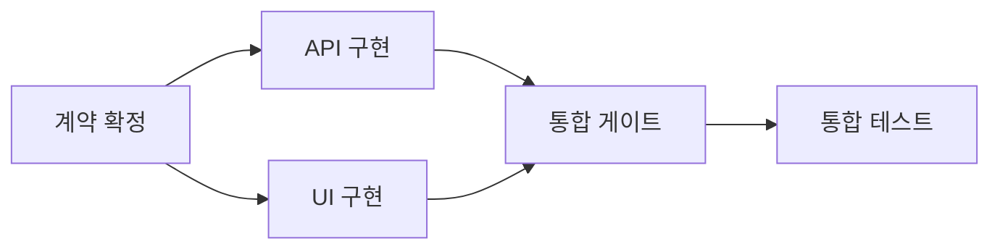

# 04. 삼사라 Git · Worktree · Merge Queue 상세 구현 계획

문서 버전: 1.0 초안  
작성 기준일: 2026-10-28, Asia/Seoul  
성격: 합의한 제품 요구를 구현 가능한 정책·자료구조·작업 단위로 정리한 설계 문서  
연결 문서: [런타임](01-runtime-implementation-plan.md) · [UI](02-ui-implementation-plan.md) · [공통 계약](03-contracts-and-data-model.md)

## 1. 이 문서가 결정하는 것

삼사라는 이슈별 Worktree에서 구현을 병렬로 진행하고, 같은 저장소의 같은 통합 브랜치에 대한 최종 반영은 하나의 권위 있는 Merge Queue가 관리한다.
작업 분기가 생겼다는 이유로 전체 프로젝트를 멈추지 않는다.
의존 조건이 충족되지 않은 작업만 기다리고, 독립 작업은 계속 실행한다.
후속 작업이 실제 코드를 필요로 한다면 선행 작업의 `구현 완료` 대신 `지정 통합 대상에 반영됨`을 선행 조건으로 사용한다.

이 문서는 다음을 포함한다.

- 이슈 DAG, Git 커밋 이력, Worktree, PR, 통합 게이트의 관계.
- 브랜치 생성·작업·검증·승인·통합·보존·정리의 전체 수명주기.
- 동일 대상 통합의 직렬화, 대상 변경 감지, 정확한 검증 대상 추적.
- GitHub Merge Queue를 사용하는 경우와 삼사라 로컬 Queue를 사용하는 경우의 구분.
- 충돌, 승인 변경, 프로세스 중단, 응답 유실, 수동 Merge의 복구 정책.
- UI가 어떤 근거로 `지금 통합 가능`, `대기`, `충돌`, `반영 완료`를 표시하는지.
- 구현 작업 목록과 단계별 완료 조건.

실제 저장소·과거 검증 산출물은 이번 작성 작업에 제공되지 않았다.
따라서 과거 대화의 SQLite 검증 결과나 실제 세션 실행 결과를 재검증한 문서가 아니다.
아래의 명령·상태·테스트는 구현 계획이며 이번 문서 작성 중 실행한 Git 변경 작업이 아니다.

## 2. 핵심 결정과 불변식

| ID | 결정 | 구현에서 지켜야 할 조건 |
| --- | --- | --- |
| GIT-01 | 짧은 수명의 작업 브랜치를 기본으로 한다 | `main` 또는 프로젝트가 지정한 통합 ref로 합류한다. 기존 `develop` 전략도 설정으로 지원한다 |
| GIT-02 | 작업 실행과 코드 통합을 분리한다 | 에이전트 종료·herdr `done`·PR 생성은 통합 완료의 근거가 아니다 |
| GIT-03 | 통합 권위는 대상마다 하나다 | `(canonical_repository_id, target_ref)`당 `github_queue` 또는 `samsara_local` 하나만 선택한다 |
| GIT-04 | 같은 대상의 최종 반영을 직렬화한다 | 로컬 MVP는 검증부터 반영까지 후보 한 개씩 처리한다. GitHub 내부 검증 병렬성은 GitHub가 소유한다 |
| GIT-05 | 검증한 결과와 반영한 결과를 연결한다 | source, base, candidate, 실제 integration commit 및 검증 실행을 모두 추적한다 |
| GIT-06 | 변경된 대상을 재검증한다 | source·base·정책·게이트 멤버가 바뀌면 관련 승인·검증의 유효성을 다시 계산한다 |
| GIT-07 | 오래된 Worker는 통합 권한이 없다 | 새 결과 제출에는 현재 execution lease·fence가 필요하다. 수락된 output의 publication은 별도 target controller 권한과 최신 승인·계획을 검사한다 |
| GIT-08 | Worktree는 보안 경계가 아니다 | 같은 OS 사용자 권한의 프로세스는 다른 디렉터리를 쓸 수 있다는 한계를 명시한다 |
| GIT-09 | 사용자의 작업 상태를 보존한다 | dirty Worktree의 reset, 강제 삭제, 임의 stash, force-push를 자동 복구 수단으로 쓰지 않는다 |
| GIT-10 | 관찰 불명은 완료나 실패로 추정하지 않는다 | 반영 응답 유실은 결과 조회로 해소하고, 확인 전 새 publication을 시작하지 않는다 |
| GIT-11 | 게이트는 버전 있는 조건 집합이다 | 새 선행 이슈가 추가되면 과거의 열린 게이트를 그대로 재사용하지 않는다 |
| GIT-12 | 저장소 간 통합은 원자적이지 않다 | 여러 저장소가 관련된 게이트는 각각의 통합 증거가 모인 뒤 열며 분산 Git 트랜잭션을 약속하지 않는다 |

## 3. 네 종류의 그래프를 구분한다

| 표현 | 노드 | 연결의 의미 | 최종 판단 주체 |
| --- | --- | --- | --- |
| 이슈 DAG | 이슈·작업 | 선행 조건 | 삼사라 정책 엔진 |
| Worktree 뷰 | 작업 시도에 연결된 Worktree | 같은 기반 또는 이슈 소속 | 삼사라의 작업·Git 매핑 |
| Git 커밋 그래프 | 불변 commit OID | 부모 커밋 관계 | Git 객체 저장소 |
| 통합 게이트 | 선행 조건 집합을 묶은 표시 | 특정 대상에 필요한 결과가 모였는지 | 삼사라 정책 엔진과 통합 증거 |

이슈 A→B가 Git 브랜치 A→B를 뜻하지 않는다.
Worktree가 둘이라고 Git 커밋 그래프에도 정확히 두 갈래가 생기는 것은 아니다.
기본 UI는 이슈 DAG를 표시하고 Worktree·브랜치·PR·Merge 결과를 상세 정보로 연결한다.
`Git 이력` 화면에서만 실제 commit parent 관계를 표시한다.



이 그림의 게이트는 독립적으로 실행하는 AI Worker가 아니다.
`API와 UI가 지정 target에 통합됨`이라는 조건의 UI 투영이다.
게이트를 실제 테스트 작업으로 모델링해야 한다면 별도의 이슈로 만들고, 조건 게이트와 테스트 작업을 구분한다.

## 4. 실행 조건과 통합 조건

### 4.1 의존 관계에 필요한 필드

실제 enum과 JSON 필드 정의의 기준은 [공통 계약](03-contracts-and-data-model.md)이다.
정책 엔진은 최소한 아래 정보를 해석할 수 있어야 한다.

| 필드 | 뜻 |
| --- | --- |
| `predecessor_issue_id`, `successor_issue_id` | 선행 이슈와 후행 이슈 |
| `required_milestone` | `IMPLEMENTED`, `VERIFIED`, `RESULT_APPROVED`, `INTEGRATED` 중 필요한 증거 |
| `downstream_phase` | `EXECUTION` 또는 `INTEGRATION`: 어느 단계에 적용하는 조건인지 |
| 산출물 세대·revision 참조 | 필요한 산출물·승인 대상 버전. 구체적 필드명은 공통 계약을 따른다 |
| `target_repository_id`, `target_ref` | `INTEGRATED` 조건의 정확한 통합 대상 |
| `graph_version` | 의존 그래프 변경을 검출하는 버전 |
| `reason` | 사용자가 이해할 수 있는 조건 설명 |

기본값은 코드 소비 관계에 대해 `INTEGRATED`와 `EXECUTION`을 요구하는 것이다.
문서·계약·스키마 합의처럼 코드 통합 없이 소비 가능한 산출물은 명시적으로 `RESULT_APPROVED`, `VERIFIED` 또는 `IMPLEMENTED`를 선택할 수 있다.
`IMPLEMENTED`를 사용한다면 immutable artifact 또는 source OID를 함께 기록한다.
단순히 에이전트가 “끝났다”고 말한 텍스트는 증거가 아니다.

### 4.2 언제 멈추는가

| 상황 | 선행 작업 | 직접 의존 작업 | 독립 작업 | Queue |
| --- | --- | --- | --- | --- |
| A의 최초 승인 대기, B는 A 승인 필요, C는 독립 | A 승인 대기 | B는 아직 시작하지 않고 대기 | C 계속 | 이미 적격인 다른 후보는 계속 |
| A의 이전 승인 취소 또는 필수 산출물 세대 변경 | A 재검토 | 이미 시작한 B의 다음 도구 권한 회수·재검증 | 독립 C 계속 | 영향받은 후보만 중지 |
| A·C 병렬 구현, D는 둘의 통합 필요 | A·C 계속 | D 대기 | 다른 독립 작업 계속 | 완성된 후보부터 통합 |
| A 통합 중 충돌 | A 수정 필요 | A에 의존하는 후속 작업 대기 | C 계속 | 정책에 따라 A를 보류하고 독립 후보 처리 |
| 대상 ref가 외부 변경됨 | source 구현은 보존 | 해당 결과를 기다리는 작업만 대기 | 독립 작업 계속 | 진행 후보 재검증 |
| 저장소 인증 장애 | 로컬 구현은 정책 범위에서 가능 | 원격 반영 증거를 요구하면 대기 | 다른 저장소 작업 계속 | 해당 원격 대상 Queue 중지 |
| Worker 생존 여부 불명 | 소유 Worktree 격리·보존 | 같은 자원 재사용 금지 | 다른 소유 자원은 계속 | 해당 attempt 제출물 publication 금지 |

이미 시작한 도구를 `PreToolUse`가 거슬러 취소할 수는 없다.
실행 지속 조건이 무효가 되면 다음 도구 요청을 막고, 별도 종료 가능한 프로세스만 안전하게 중단한다.
그 사이 생긴 변경은 격리된 attempt 산출물로 보존하고 통합 자격을 다시 심사한다.

### 4.3 합류 조건

기본 합류는 `ALL`이다.
같은 게이트의 모든 필수 선행 조건이 충족되어야 후속 작업이 실행 가능해진다.
MVP는 `ANY`, quorum, 복잡한 조건식, 자동 선택 분기를 제공하지 않는다.

게이트는 동일 run의 계획 세대와 연결한다.
`membership_version`은 필수 선행 조건 집합이 바뀔 때 증가하고 `membership_digest`로 정확한 멤버 집합을 묶는다.
평가 결과는 `(gate_id, run_generation, membership_version, target_ref, policy_version)`에 묶는다.
선행 이슈 추가·삭제·필수 조건 변경 후 이전 버전의 `OPEN` 결과는 사용할 수 없다.
이미 실행 중인 후속 작업은 무조건 삭제하지 않고, 입력 전제가 달라졌다는 이유로 일시 정지·재검증 대상으로 옮긴다.

## 5. 브랜치와 통합 대상 전략

### 5.1 기본 브랜치 규칙

예시 형식은 `samsara/<project-short>/<issue-short>/<attempt-short>`이다.
이름의 목적은 사람이 알아보는 것과 충돌 방지이고, 실제 식별자는 DB의 opaque ID다.
branch 문자열에서 `attempt_id`나 권한을 역으로 추론하지 않는다.
Git ref 문법과 길이를 검사하고 공백·제어문자·임의 옵션 주입을 차단한다.

기존 팀 규칙이 `feature/*`라면 prefix를 설정할 수 있다.
브랜치 생성 기반은 `base_sha`로 고정한다.
`main`이라는 가변 이름만 기록하지 않는다.

### 5.2 통합 대상별 정책

| 정책 | 권위 있는 대상 | 기본 사용 |
| --- | --- | --- |
| `github_queue` | GitHub 저장소의 보호된 target branch | 해당 저장소가 Merge Queue를 제공하고 사용하도록 설정된 경우 |
| `samsara_local` | 명시적으로 선택한 로컬 integration ref | 원격 서비스 없이 로컬 통합을 수행하는 경우 |
| 수동 통합 | 사용자 또는 기존 외부 통합 시스템 | 자동 통합 권한·기능이 없는 환경 |

`github_queue`에서는 삼사라가 후보의 실행·승인·대기 사유를 관리하되 GitHub가 최종 합류 순서를 소유한다.
`samsara_local`에서는 삼사라가 검증과 ref 변경을 소유한다.
수동 통합에서는 읽기·검증·대기열 제안·통합 결과 관찰만 수행하고 `자동 Merge 보장`을 표시하지 않는다.

### 5.3 로컬 대상의 제약

사용자가 checkout한 `main`을 `git update-ref`로 직접 이동시키면 index와 working tree가 그 이동을 따라가는 것이 아니다.
따라서 MVP의 로컬 자동 통합 대상은 다음 둘 중 하나로 제한한다.

1. 런타임이 통합 전용으로 관리하는 bare 저장소의 ref.
2. 런타임이 소유하고 어떤 Worktree에도 checkout되지 않은 명시적 integration branch.

사용자의 기본 Worktree에서 checkout한 ref, 소유권이 불명인 ref는 로컬 자동 통합 대상이 될 수 없다.
프로젝트 설정과 UI에는 실제 통합 저장소와 `refs/heads/...` 전체 target을 표시한다.
내부 통합 브랜치로 합류한 결과를 사용자 `main` 또는 원격 `main`에 반영한 것처럼 표시하지 않는다.
그 다음 반영 단계가 필요하면 별도 PR·수동 통합·원격 Queue 작업으로 모델링한다.

### 5.4 기존 Git Flow와의 공존

기존 프로젝트가 `develop`, release branch, hotfix branch를 쓰면 target policy를 각각 등록한다.
release 승인과 배포는 구현 통합과 별도 단계다.
MVP가 자동으로 develop을 만들거나 기존 브랜치 전략을 바꾸지 않는다.
여러 target을 허용하더라도 같은 commit의 두 target 반영을 하나의 완료 상태로 합치지 않는다.

## 6. Worktree 관리

### 6.1 소유권과 디렉터리

Worktree 레코드는 `project_id`, `canonical_repository_id`, `attempt_id`, `worktree_path`, `branch_ref`, `base_sha`, `ownership`, `created_at`를 가진다.
사용자가 만든 Worktree는 `external` 소유이며 기본적으로 자동 삭제 대상이 아니다.
삼사라가 만든 Worktree만 `managed`로 분류한다.
경로는 사용자 저장소와 구분되는 설정된 작업 루트 아래에 만든다.
프로젝트 이름을 그대로 경로로 사용할 때 생기는 충돌을 피하도록 opaque ID를 함께 사용한다.

Linked Worktree는 작업 디렉터리를 나누지만 저장소의 일부 메타데이터와 객체를 공유한다.
동일 branch의 중복 checkout도 일반적인 생성 흐름에서 제한된다.
이 사실을 기반으로 attempt마다 별도 branch를 배정하고 공유 Git 메타데이터 작업은 Repository Manager를 거친다. [Git worktree 공식 문서](https://git-scm.com/docs/git-worktree)

### 6.2 생성 순서

1. 프로젝트가 활성화되어 있고 등록된 저장소에 접근 가능한지 확인한다.
2. 현재 attempt에 Worktree가 이미 연결되었는지 조회한다.
3. canonical repository와 생성 기준 `base_sha`를 결정한다.
4. repository 작업 잠금을 획득한다.
5. 새 branch·경로가 사용 중이지 않은지 확인한다.
6. `worktree.create` 작업 intent를 영속화한다.
7. 명령 배열로 Worktree를 생성한다.
8. 실제 Git 목록에서 branch·HEAD·경로를 확인한다.
9. 레코드를 `READY`로 확정하고 이벤트를 기록한다.
10. 잠금을 해제하고 Worker 실행 권한을 부여한다.

DB 트랜잭션을 연 채로 Git 프로세스를 기다리지 않는다.
명령 성공 후 DB 기록 전에 중단되면 intent와 실제 Worktree를 비교하여 이미 생성된 항목을 채택한다.
이름만 같고 원래 소유권이 다른 경로는 채택하지 않고 `OWNERSHIP_CONFLICT`로 중지한다.

### 6.3 상태와 정리

| Worktree 상태 | 의미 | 허용 작업 |
| --- | --- | --- |
| `CREATING` | 생성 intent가 있고 결과 미확정 | 실제 경로·Git 메타데이터 재확인 |
| `READY` | 작업 배정 가능 | Worker 연결 |
| `IN_USE` | 현재 attempt가 사용 | 해당 소유자만 쓰기 요청 |
| `QUIESCING` | 새로운 도구 권한 회수 중 | 생존 확인·작업 중단·변경 보존 |
| `RETAINED` | 구현·검증·장애 증거 보존 | 읽기·재검증·명시적 재개 |
| `CLEANUP_ELIGIBLE` | 소유권·clean·생존 조건 확인 | 보존 기간 이후 정책에 따른 제거 |
| `REMOVED` | Git 목록과 경로에서 제거 확인 | 이력 조회 |
| `QUARANTINED` | 생존·소유·파일 상태 불명 | 자동 재사용·삭제 금지 |

위 상태는 Git 자원 관리용이다.
이슈 실행 상태나 Merge 후보 상태와 같은 컬럼으로 합치지 않는다.

정리 자격은 다음을 모두 만족해야 한다.

- 삼사라가 만든 Worktree다.
- 사용 중이거나 생존 불명인 세션·프로세스가 없다.
- 추적 파일 변경, staged 변경, 미추적 사용자 파일이 없다.
- 보존해야 할 미반영 commit과 검증 결과가 별도로 참조되어 있다.
- 활성 검증·publication·수정 요청이 연결되어 있지 않다.
- 프로젝트가 정한 보존 기간이 지났거나 사용자가 해당 정리를 요청했다.

Worktree 제거와 branch 제거는 서로 다른 작업이다.
하나가 성공했다는 이유로 다른 것을 무조건 실행하지 않는다.
일반 `git worktree remove`가 거절하면 근거를 표시하고 멈춘다.
`--force`, `git clean -fd`, `reset --hard`로 거절을 우회하지 않는다.

### 6.4 구현용 명령 예시

아래는 설계 예시이며 이 문서 작성 중 실행하지 않았다.
실제 Go 구현은 shell 문자열을 조립하지 않고 `exec.CommandContext`의 argv를 사용한다.
예시 변수는 사전에 검증한 절대 경로·ref·OID를 뜻한다.

```bash
git -C "$repo_path" worktree list --porcelain -z
git -C "$repo_path" worktree add -b "$branch_name" "$worktree_path" "$base_sha"
git -C "$worktree_path" status --porcelain=v2 -z --untracked-files=all
git -C "$worktree_path" rev-parse --verify HEAD
git -C "$repo_path" worktree remove "$worktree_path"
```

`--porcelain -z`를 사용하는 이유는 사람이 읽는 표의 공백이나 줄바꿈을 파일 경계로 오해하지 않기 위해서다.
파일명·경로 파서는 NUL 구분을 지원한다. [Git worktree 출력 형식](https://git-scm.com/docs/git-worktree#_porcelain_format)

## 7. 변경 제출과 승인 기준

### 7.1 구현 완료의 증거

Worker는 `attempt_id`와 현재 fence를 포함해 구현 완료를 제출한다.
런타임은 branch HEAD, clean 여부, source OID, 테스트 요약, 변경 목록, 연결 PR을 수집한다.
실제 도구 실행이 계속되거나 source 변경이 관찰되면 `구현 완료 제출`과 `동결된 통합 후보`를 구분한다.
제출 후 불변 output이 수락되면 Worker의 실행권을 반납하고 대기 또는 종료할 수 있다. 이후 source 수정은 새 attempt·output·candidate로 제출한다. 정상 제출한 Worker의 lease 만료는 수락된 output의 Merge를 막는 사유가 아니다. 통합은 별도의 target controller 권한으로 진행한다.

DB에는 최소한 다음을 남긴다.

- 제출자 session과 execution attempt.
- 제출 시점의 immutable `source_sha`.
- 생성 기준 `base_sha`와 현재 대상 관찰 SHA.
- 변경 파일 요약과 테스트 실행의 식별자.
- 제출 시점의 정책·의존 그래프 버전.
- source가 어떤 branch·PR에서 왔는지와 관찰 시각.

`dirty=false`만으로 구현 품질이 증명되지는 않는다.
반대로 dirty 파일이 있다는 이유로 버리거나 자동 commit하지 않는다.
후보에 들어갈 commit을 먼저 명확히 하고 미포함 변경은 별도로 보존한다.

### 7.2 승인 종류

| 승인 | 묶이는 대상 | 변경 시 처리 |
| --- | --- | --- |
| 구현 검토 승인 | source SHA·diff·정책 버전 | source 변경 시 무효 |
| 통합 승인 | 후보 SHA 또는 provider 검증 revision·base·target·정책 | 대상·후보가 변경되면 재평가 |
| 위험 작업 승인 | 구체적 작업 intent·scope·만료·요청자 | 다른 작업에 재사용 금지 |
| Claude 자체 권한 승인 | Claude permission 시스템 | 삼사라 승인과 교환·자동 대체하지 않음 |

source가 같고 base만 바뀌었을 때 구현 검토 승인을 유지할지는 정책으로 결정한다.
기본 정책은 source 승인 자체는 보존하되 `새 결합 결과의 검증`을 다시 요구한다.
통합 후보 자체를 승인한 경우에는 candidate/base가 달라졌으므로 다시 승인받는다.
UI는 보존된 승인과 무효가 된 승인을 함께 표시하여 대기 이유를 설명한다.
GitHub native Queue에서도 이 정책을 실제로 강제하려면 provider의 필수 검사와 연결해야 한다.
삼사라 DB에서만 승인을 무효화하는 것으로 이미 등록한 GitHub 작업을 막을 수는 없다.
구체적인 연동 경계는 10.7~10.10절을 따른다.

## 8. Merge 후보 모델

### 8.1 식별자와 증거

`merge_candidate_id`는 하나의 특정 제출물을 나타낸다.
동일 issue의 source 변경은 새 output과 새 candidate로 기록한다. source가 고정된 상태에서 base·검증 조건만 바뀌면 candidate revision을 증가시킨다.
기존 후보의 source SHA를 조용히 바꾸지 않는다.

| 그룹 | 주요 정보 |
| --- | --- |
| 소속 | project, issue, run, attempt, Worktree |
| 대상 | canonical repository, full target ref, merge authority |
| 소스 | source branch, source SHA, GitHub PR ID/number |
| 검증 | expected base SHA, candidate commit/tree, check run IDs, test policy digest |
| 승인 | 승인 record IDs와 승인 digest |
| 버전 | candidate version, graph version, gate membership version, policy version |
| 실행 권한 | 제출 시점 execution fence의 provenance와 현재 target controller의 publication 권한·fence |
| publication | operation ID, provider request ID, 실제 결과 SHA, 관찰 결과 |
| 상태 | 상태 값, 원인 코드, 재시도 가능 여부, timestamps |

OID는 Git object format에 맞춰 검증한다.
모든 저장소에서 SHA-1 40자로 고정된다고 가정하지 않는다.
source commit, candidate commit, candidate tree, 통합 후 실제 commit은 별도 필드다.

### 8.2 상태 전이

| 상태 | 의미 | 다음 전이 |
| --- | --- | --- |
| `WAITING` | 큐에 있으나 선행 조건·순서·승인 대기 | VALIDATING, CANCELLED |
| `VALIDATING` | 현재 base를 대상으로 결과 생성·검증 | READY, STALE_BASE, CONFLICT, FAILED |
| `READY` | 특정 revision에 대한 검증·승인이 유효 | PUBLISHING, STALE_BASE, CANCELLED |
| `PUBLISHING` | 외부/로컬 반영 intent가 시작됨 | MERGED, STALE_BASE, FAILED 또는 결과 확인 계속 |
| `MERGED` | 지정 target에 반영된 증거 확보 | 이력 보존; 되돌림은 새 작업 |
| `STALE_BASE` | 검증 기준과 대상이 달라짐 | 새 검증 revision으로 VALIDATING |
| `CONFLICT` | 자동 결합이 실패하고 해결 필요 | 새 source revision 제출 또는 CANCELLED |
| `FAILED` | 정책·검증·명확한 반영 실패 | 원인에 따른 재시도 또는 CANCELLED |
| `CANCELLED` | 후보 실행 취소, 코드와 기록 보존 | 새 후보로만 재제출 |

canonical enum은 공통 계약의 정의를 따른다.
`PUBLISHING`의 응답이 유실되면 `FAILED`로 즉시 바꾸지 않는다.
`publication_observation=UNKNOWN`과 대기 이유를 함께 표시하고 반영 결과를 먼저 조회한다.
GitHub에 `enqueued`된 후보는 provider progress를 별도로 보관하며, 그것만으로 `MERGED`가 되지 않는다.
별도 `native_queue_state`는 `NONE / REQUESTED / QUEUED / VALIDATING / MERGED / REMOVED / UNKNOWN`을 사용한다.
여러 후보가 GitHub Queue에 대기하면서 각각 `PUBLISHING`으로 관찰될 수 있다.
이 경우 실제 target 반영의 직렬화 권위는 GitHub이고, 삼사라의 로컬 `PUBLISHING 후보 한 개` 제한을 provider Queue 전체에 잘못 적용하지 않는다.
native 경로의 Queue 등록은 최종 통합 허가와 다르다.
RESULT 승인·source 적격성·필수 provider gate가 확인되면 `WAITING → PUBLISHING`으로 Queue 등록을 시작할 수 있다.
이 예외 경로에서는 `native_queue_state`와 `approval_gate`, `blocking_reasons`에 현재 group의 MERGE 승인 대기를 유지한다.
로컬 경로의 `READY`는 정확한 후보 검증·승인 완료를 의미하므로 native enqueue 가능 상태를 그와 같은 뜻으로 표시하지 않는다.
실제 target 변경을 허용하는 선형화 지점은 10.10절의 policy check 성공 게시 권한 확정이다.

### 8.3 Queue 순서

기본은 적격 후보 중 FIFO다.
우선순위를 지원하면 이유와 변경자를 기록하고 이미 진행 중인 publication을 선점하지 않는다.
의존 관계가 있는 후보의 순서를 사용자가 뒤집으려 하면 서버가 거부한다.
충돌 후보를 잠시 빼고 독립 후보를 처리할 수 있지만, 충돌 후보에 의존하는 후보는 같이 건너뛰지 않는다.
기아 방지를 위해 대기 시간과 재검증 횟수를 표시한다.

## 9. 로컬 Queue 알고리즘

### 9.1 잠금 범위

잠금 키는 `(canonical_repository_id, full_target_ref)`다.
프로젝트 ID만으로 잠그면 같은 저장소·브랜치를 공유하는 다른 프로젝트와 충돌할 수 있다.
원격 저장소 정체성은 호스트와 provider repository ID를 우선 사용한다.
SSH URL과 HTTPS URL이 다르다는 이유로 같은 원격 저장소의 잠금을 나누지 않는다.
로컬 저장소는 Git common directory와 영속 등록 ID를 함께 추적하고 이동·재등록을 명시적으로 처리한다.

MVP는 같은 target에서 후보 검증부터 publication까지 하나씩 처리한다.
Git 명령 중 DB write transaction을 유지하지는 않되, 영속 lock owner·generation과 프로세스 잠금으로 수행자를 식별한다.
잠금 시간이 만료되었다는 이유만으로 살아 있는 수행자의 publication 권한이 자동으로 사라졌다고 가정하지 않는다.
중복 daemon은 OS 수준 single-instance 잠금으로 막고 복구 시 기존 작업의 실제 종료 여부를 확인한다.
취소나 fence 회수 시 이미 전송한 publication을 되돌릴 수 있다고 가정하지 않는다.
진행 작업이 종료·관찰 확정되기 전 같은 target의 새 수행자에게 publication 권한을 넘기지 않는다.
프로젝트를 비활성화할 때도 이 배출 과정이 끝날 때까지 해당 attempt의 guard를 유지한다.

### 9.2 처리 순서

1. 후보의 현재 버전과 적격 조건을 재조회한다.
2. 현재 target OID를 `expected_base_sha`로 기록한다.
3. source OID가 승인 대상·시도 소유권과 일치하는지 검사한다.
4. immutable source와 base를 결합하여 candidate tree와 commit을 만든다.
5. candidate 전용 임시 Worktree에서 테스트한다.
6. 테스트 환경·명령 digest·candidate OID·결과를 저장한다.
7. 승인·게이트·source·target이 여전히 유효한지 다시 검사한다.
8. `publication_intent`와 outbox를 한 DB 트랜잭션에 기록한다.
9. target의 old OID가 예상값일 때만 candidate로 변경한다.
10. 실제 target을 읽어 결과를 확인한다.
11. 통합 증거와 후보 `MERGED`, 의존 조건 충족 이벤트를 함께 기록한다.
12. 다음 후보는 새 target을 기준으로 처음부터 검증한다.

### 9.3 결합 결과 생성

Git의 `merge-tree --write-tree`는 사용자 index와 working tree를 건드리지 않고 결합 결과를 계산할 수 있다.
일반적인 단건 실행에서는 종료 코드 0을 성공, 1을 충돌, 그 외를 실행 오류로 구분한다.
충돌 표시 문자열을 찾는 것만으로 성공·실패를 판정하지 않는다. [Git merge-tree 공식 문서](https://git-scm.com/docs/git-merge-tree)

```bash
git -C "$repo_path" merge-tree --write-tree "$base_sha" "$source_sha"
```

위 stdout의 첫 줄을 무조건 tree OID로 받아서는 안 된다.
지원 버전의 기계 판독 형식과 exit status를 함께 해석한다.
충돌 유형에는 rename, binary, file/directory 충돌 등이 있으므로 `<<<<<<<`의 존재 여부만 확인하지 않는다.
MVP는 단건 호출만 사용하여 `--stdin` 배치의 별도 종료 코드 의미를 혼용하지 않는다.

candidate commit의 작성자·부모·메시지·서명 정책은 통합 전략에 맞춰 결정한다.
commit metadata 때문에 생성되는 OID까지 테스트 식별자로 기록한다.
테스트가 실행된 commit을 publication 직전에 다른 metadata로 다시 만들지 않는다.
서명 정책을 충족하지 못하면 통합 자격 없음으로 표시한다.

### 9.4 로컬 CAS publication

아래 명령은 명시적으로 소유권을 확인한 로컬 target에서만 사용한다.

```bash
git -C "$integration_repo_path" update-ref \
  "$target_ref" "$candidate_sha" "$expected_base_sha"
```

`update-ref`의 세 번째 OID는 ref의 현재값이 예상값과 일치할 때만 갱신하도록 한다.
이것은 로컬 ref에 대한 비교 후 갱신이며 GitHub PR merge endpoint의 기능이 아니다. [Git update-ref 공식 문서](https://git-scm.com/docs/git-update-ref)

candidate는 expected base의 자손이어야 한다.
CAS가 실패하면 force update를 하지 않고 `STALE_BASE`로 돌아간다.
target이 삭제되었거나 다른 종류의 객체를 가리키면 정책 오류로 정지한다.
동일 target에 대한 외부 쓰기를 완전히 차단할 수 없는 환경에서는 claim한 single writer 조건을 주기적으로 점검한다.

## 10. GitHub Merge Queue 연동

### 10.1 권위의 구분

GitHub Merge Queue는 선행 Queue 항목과 최신 target을 결합한 결과에 필수 검사를 요구한다.
삼사라는 해당 Queue에 후보를 전달하고 상태를 관찰한다.
같은 target에서 삼사라 로컬 Queue가 별도로 direct merge하거나 push하지 않는다. [GitHub Merge Queue 관리 문서](https://docs.github.com/en/repositories/configuring-branches-and-merges-in-your-repository/configuring-pull-request-merges/managing-a-merge-queue)

provider가 제공하는 Queue 순서와 삼사라의 `대기 후보 목록`은 다를 수 있다.
UI는 `삼사라 준비 대기`와 `GitHub 통합 대기`를 구분한다.
GitHub에서 순서 변경 권한·기능을 제공하지 않는 경우 삼사라 UI도 해당 변경을 지원하는 것처럼 표시하지 않는다.

### 10.2 호환성 탐색

프로젝트 등록 또는 설정 변경 시 아래를 확인한다.

- GitHub.com인지 Enterprise Server인지와 API 호스트.
- repository ID와 target branch.
- Merge Queue 사용 가능 여부 및 실제 활성화 상태.
- branch protection/ruleset의 필수 checks·reviews·서명·선형 이력 조건.
- 통합 방식과 Queue 설정.
- 현재 인증 주체가 할 수 있는 읽기·후보 등록·통합 동작.
- API 버전 및 비동기 Merge endpoint 지원 여부.
- `samsara/integration-policy` 필수 검사, 예상 GitHub App source, group별 검사 재생성·동일 SHA 재사용 의미.
- merge-group metadata·현재 QueueEntry를 읽고 정확한 base/head/PR 집합을 대조할 수 있는지.

서비스 요금제나 저장소 유형에 따라 기능이 없을 수 있으므로 설치만으로 지원을 추정하지 않는다.
지원되지 않으면 명시적으로 수동 통합 또는 허용된 로컬 통합 모드로 안내한다.
branch protection을 우회하는 token을 더 받아서 해결하는 흐름을 기본으로 삼지 않는다.

### 10.3 후보 전달 프로토콜

2026-10-28 확인 기준 GitHub 문서는 비동기 PR Merge endpoint를 제공한다.
`sha`는 PR HEAD 조건이며 target base SHA에 대한 CAS 필드가 아니다.
`merge_action=merge_queue`로 명시하여 설정 변경 시 direct merge로 전환되는 암묵적 동작을 피한다.
`bypass_rules`는 false로 유지한다. [GitHub PR REST API](https://docs.github.com/en/rest/pulls/pulls#merge-a-pull-request-asynchronously)

설계상 요청 payload는 다음과 같다.

```json
{
  "sha": "<approved-source-oid>",
  "merge_action": "merge_queue",
  "bypass_rules": false
}
```

이 예시는 API 계약 검토용이며 실제 요청을 보내지 않았다.
지원 여부를 확인하지 않은 Enterprise Server에 동일 endpoint를 가정하지 않는다.
대체 API를 구현하면 별도 capability와 계약 테스트를 둔다.
최종 group이 만들어지기 전에는 exact MERGE 승인을 받을 수 없으므로, 이 요청은 RESULT 승인된 source를 검증 Queue에 넣는 단계다.
10.7절의 필수 policy gate가 provider에서 실제로 차단한다는 증거가 없으면 자동 enqueue도 활성화하지 않는다.

응답 해석은 다음과 같다.

| 관찰 | 삼사라 해석 |
| --- | --- |
| 요청 접수 | provider operation ID 저장, 최종 결과 확인 계속 |
| `enqueued` | GitHub Queue에 들어감, 아직 통합 전 |
| `merged` | 반환 SHA와 PR·target 관찰을 대조하여 통합 증거 확정 |
| 이미 진행 중 요청 | 기존 operation에 연결, 중복 후보 만들지 않음 |
| 정책·상태 실패 | 오류 원인 분류 후 후보 대기·실패 표시 |
| timeout·연결 종료 | 결과 불명; PR·Queue·요청 결과를 먼저 조회 |

비동기 요청이 `enqueued`로 끝난 뒤에도 실제 PR 통합까지 관찰을 계속한다.
요청 결과 조회 자료에는 보존 제한이 있으므로 장기 복구는 현재 PR·target 상태와 저장한 증거를 사용한다.

### 10.4 CI 설정

PR source 검사와 Queue의 결합 결과 검사를 구분한다.
GitHub Actions를 사용하는 경우 필요한 검사 Workflow가 `merge_group`에 반응해야 한다.
`merge_group`의 `GITHUB_SHA`는 merge group의 SHA다. [GitHub Actions 이벤트 문서](https://docs.github.com/en/actions/reference/workflows-and-actions/events-that-trigger-workflows#merge_group)

```yaml
on:
  pull_request:
    branches: [main]
  merge_group:
    types: [checks_requested]
    branches: [main]
```

이는 trigger 구조 예시다.
실제 required job, checkout 설정, 테스트 명령, 권한, dependency 설치 방식은 프로젝트 CI에 맞춰 검토한다.
필수 check의 이름·provider·head SHA를 저장하여 무관한 초록색 check를 잘못 재사용하지 않는다.
경로 필터 때문에 필수 check가 아예 생성되지 않아 Queue가 멈추는 경우도 진단 대상으로 둔다.

### 10.5 candidate와 최종 commit의 관계

GitHub가 생성한 merge-group commit과 최종 target commit이 항상 같은 OID라고 요구하지 않는다.
merge 방식에 따라 최종 commit의 부모·작성 정보·형태가 달라질 수 있다.
삼사라는 `provider 검증 revision → 포함 PR/source revision → 최종 Merge 결과`의 연결을 증거로 보관한다.
provider가 실제로 보장하는 검사 규칙과 branch protection을 신뢰하는 모드라고 표시한다.
로컬에서 만든 candidate를 GitHub가 그대로 publish했다고 주장하지 않는다.

### 10.6 일반 원격 Merge의 한계

GitHub의 일반 PR merge API에 source `sha`를 전달해도 target의 예상 SHA를 원자적으로 비교하는 기능이 추가되는 것은 아니다.
직전에 target을 조회하고 즉시 merge 호출해도 그 사이의 외부 변경은 가능하다.
또한 일반 fast-forward push는 `target이 지정 expected base와 정확히 같음`이라는 모든 조건을 표현하지 않는다. [Git push 공식 문서](https://git-scm.com/docs/git-push)

따라서 MVP는 arbitrary remote direct merge를 강한 exact-candidate 통합 모드로 제공하지 않는다.
추후 지원하려면 서버가 강제하는 Queue·expected-old-ref 검증·필수 checks 등의 보장을 별도로 설계해야 한다.
서버 정책 없는 로컬 mutex를 원격 저장소 전체의 전역 lock이라고 설명하지 않는다.

### 10.7 삼사라 MERGE 승인을 강제하는 provider 검사

일반 CI가 성공했다는 사실만으로 삼사라의 최신 MERGE 승인이 존재하는 것은 아니다.
GitHub Queue가 base 또는 구성원을 바꾸어 새 group을 만들면 원래 삼사라 승인 digest는 무효다.
이 조건을 원격에서도 지키기 위해 `samsara/integration-policy`를 target의 필수 check로 등록한다.
예상 check source는 검증한 Samsara GitHub App으로 고정하고 다른 actor가 같은 이름으로 작성한 성공을 수용하지 않는다.
필수 check의 `neutral`·`skipped`가 통과로 간주될 수 있으므로 승인 미완료는 `queued/in_progress` 또는 실패로 표현한다. [GitHub 필수 상태 검사](https://docs.github.com/en/repositories/configuring-branches-and-merges-in-your-repository/managing-protected-branches/about-protected-branches#require-status-checks-before-merging)

PR HEAD에서의 해당 검사는 RESULT 승인과 source 적격성만 확인하는 `enqueue 사전검사`다.
merge-group HEAD에서의 동명 검사는 아래 tuple에 대한 `최종 통합 허가`다.
두 검사의 SHA와 check-run ID를 별도로 기록하고 PR HEAD의 성공을 group 승인으로 복사하지 않는다.

| 바인딩 | 포함 값 |
| --- | --- |
| target | provider repository ID, full target ref, integration policy version |
| provider revision | group head SHA, group base SHA, 실제 QueueEntry IDs, 검증 Workflow/run identity |
| source 집합 | 포함 PR ID·각 source SHA·output ID·candidate revision |
| 계획·승인 | 관련 run_generation, membership digest, RESULT·MERGE approval digests |
| 외부 검사 | `samsara/integration-policy` check-run ID, expected App ID, publication operation ID |

source SHA는 바꾸지 않고 provider group 변경 시 candidate revision과 MERGE 승인 바인딩을 바꾼다.
포함 PR·source·base·head·정책을 확인할 수 없으면 check를 성공시키지 않는다.
MVP native 자동 모드는 Queue build 동시성·최대 Merge 그룹 크기를 1로 제한한 검증 구성을 먼저 지원한다.
여러 PR 그룹을 지원하려면 모든 멤버의 승인·의존 조건을 평가해야 하며, 일부 멤버만 확인한 group 성공을 허용하지 않는다.
HEADGREEN처럼 다른 멤버의 실패를 덮을 수 있는 구성은 전체 group 정책을 증명하기 전에는 지원하지 않는다.

### 10.8 공개 webhook 없이 로컬 daemon에서 연결하는 경로

로컬 dashboard를 인터넷에 노출하지 않는다.
MVP 후보 경로는 GitHub Actions의 `merge_group` Workflow가 검증 metadata artifact를 생성하고, 로컬 daemon이 GitHub API를 주기적으로 조회하는 방식이다.
아래는 공식 API를 조합한 **설계 제안**이며 이 문서 작성에서 end-to-end 지원을 검증하지 않았다.

1. 신뢰된 CI Workflow가 merge-group event의 head/base/ref와 repository·Workflow run 정보를 작은 manifest로 기록한다. source 코드를 실행한 결과를 정책 metadata로 신뢰하지 않는다.
2. daemon은 Actions workflow-run 목록을 `event=merge_group`·시간 범위·head SHA로 조회하고 해당 run의 artifacts를 가져온다. 페이지·재실행·만료를 처리한다. [Workflow runs API](https://docs.github.com/en/rest/actions/workflow-runs#list-workflow-runs-for-a-repository) · [Artifacts API](https://docs.github.com/en/rest/actions/artifacts#list-workflow-run-artifacts)
3. manifest의 repository·run·head SHA를 API 응답과 대조하고, 고정된 Workflow identity와 실제 collector 정의 revision/digest·artifact digest·허용 크기를 확인한다. PR에서 같은 이름의 Workflow 내용을 바꾸어 만든 artifact는 신뢰하지 않는다. artifact 안의 경로·스크립트는 실행하지 않는다.
4. 현재 QueueEntry의 base/head/PR와 target을 다시 읽는다. GitHub GraphQL은 `MergeQueueEntry`의 baseCommit·headCommit·pullRequest를 제공하지만, 정확한 group 매핑과 지원 버전은 별도 contract test로 확정한다. 확인되지 않은 추측으로 멤버를 채우지 않는다. [GraphQL QueueEntry](https://docs.github.com/en/graphql/reference/pulls#mergequeueentry)
5. 현재 group의 check-run을 `in_progress`로 유지하고 UI에 기존 RESULT 승인과 현재 MERGE 승인 대기를 구분해 표시한다.
6. group 결과·검사·조건을 검토한 사용자가 정확한 digest를 승인하면, daemon이 현재 권위와 group을 다시 검사한 뒤 성공 게시 intent를 영속화한다.
7. GitHub App의 Checks API로 해당 head SHA의 check-run 결과를 게시한다. `head_sha`, `external_id`, status/conclusion, check-run ID를 기록하고 응답 유실은 조회로 복구한다. MVP는 검증된 App installation 자격증명을 사용한다. [Checks REST API](https://docs.github.com/en/rest/checks/runs)
8. check 성공 이후에도 실제 PR Merge와 target 반영을 관찰하여 `MERGED`를 확정한다.

daemon이 꺼져 있거나 poll·artifact·권한 확인이 실패하면 새로운 group의 필수 check가 성공하지 않아야 한다.
대기 시간이 provider Queue timeout을 넘으면 해당 후보는 제거·실패 상태를 관찰하고 새로운 group으로 다시 검증한다.
UI나 CI가 시간 초과를 피하려고 자동 성공·neutral·skipped를 게시하지 않는다.
Check 쓰기 권한을 Claude worker에게 전달하지 않고 target controller만 보관한다.

### 10.9 group 재생성·동일 SHA 재사용·미지원 처리

새 group head가 생기면 과거 head의 성공으로 새 group을 허용하지 않는지 실제 시험 저장소에서 확인한다.
동일 SHA의 dequeue→re-enqueue, CI 재실행, Queue 재구성이 과거 성공 check를 재사용할 수 있는지도 별도 검사한다.
GitHub가 이해하는 권한 조건은 check의 source·name·SHA·상태이며, 삼사라의 `external_id`나 approval digest가 원격에서 자동 해석되는 것은 아니다.
따라서 동일 SHA에 과거 성공이 있으면 새 평가 전에 해당 check를 비성공 상태로 재설정하고 provider가 실제로 다시 대기하는지 확인해야 한다.
검증하지 못한 동일 SHA 재사용 조합에는 자동 재등록을 허용하지 않는다.
이 경계를 원자적으로 닫지 못하는 provider 구성은 `native exact MERGE approval 미지원`으로 분류한다.

필수 gate 설정·expected App source·group 식별·fresh check 재생성·권한·timeout 행렬 중 하나라도 미검증이면 native 자동 통합을 비활성화한다.
읽기 전용 Queue 관찰과 수동 통합 안내는 유지할 수 있다.
source-only 승인을 사용하는 별도 정책은 사용자가 명시적으로 선택한 경우에만 추가하며, exact group 승인과 같은 보장을 표시하지 않는다.
삼사라 DB의 approval invalidation만으로 원격 Merge를 막았다고 보고하지 않는다.

### 10.10 통합 허가의 선형화와 취소 한계

현재 target controller 권한, 최신 group tuple, 유효한 MERGE 승인, 필수 검사를 한 transaction에서 재확인한 뒤 `policy-check success 게시 허가`와 outbox를 기록한다.
이 transaction을 해당 immutable group에 대한 publication authorization의 선형화 지점으로 정한다.
그 전에 도착한 revoke·정책 변경은 허가를 막는다.
그 뒤 도착한 revoke는 아직 전송하지 않은 intent를 취소할 수 있지만, 전송되었거나 결과 불명인 check 성공을 즉시 철회한다고 보장하지 않는다.
GitHub에 성공이 보이면 나머지 checks 충족 시 별도 삼사라 호출 없이 Merge가 진행될 수 있다.

취소 요청은 check 비성공 갱신·Queue 제거를 가능한 범위에서 시도하고 실제 결과를 관찰한다.
확인 전에는 `취소 요청 중` 또는 `통합 진행 여부 확인 중`으로 표시한다.
이미 승인되어 provider에 전달된 특정 group의 통합과, 승인 없이 재생성된 새 group의 통합을 구분한다.
새 group에는 새 MERGE 승인과 새 policy check가 필요하다.
취소와 Merge가 경쟁해 실제 반영되었다면 통합 사실을 보존하고 이후 되돌림은 새 작업으로 처리한다.
원격 GitHub 동작과 로컬 SQLite 변경을 하나의 원자 transaction이라고 설명하지 않는다.

## 11. Merge 가능 여부 결정표

서버는 판정 결과에 boolean만 반환하지 않고 충족된 근거와 미충족 이유 목록을 함께 반환한다.
최종 필드명과 오류 코드는 공통 계약을 따른다.

| 검사 | 실패 시 이유 예시 | 처리 |
| --- | --- | --- |
| 프로젝트 활성화·정책 | `PROJECT_DISABLED` | 새 후보 수행 중지 |
| 유효한 산출물·계획 | `STALE_ATTEMPT` | 수락되지 않았거나 superseded된 결과를 거절; 정상 종료 attempt의 결과는 유지 |
| 유효한 통합 fence | `STALE_FENCE` | 오래된 target controller의 publication 거절. 제출 검사는 별도의 execution fence 사용 |
| source revision 일치 | `SOURCE_CHANGED` | 승인·후보 재생성 |
| 선행 조건 | `DEPENDENCY_UNSATISFIED` | 해당 후보만 대기 |
| gate membership | `GATE_VERSION_CHANGED` | 조건 재평가 |
| 승인 | `APPROVAL_REQUIRED`, `APPROVAL_STALE` | 승인 요청 표시 |
| target authority | `MERGE_AUTHORITY_UNAVAILABLE` | 권위 복구 또는 수동 전환 필요 |
| target revision | `BASE_CHANGED` | 새 base로 재검증 |
| 충돌 | `MERGE_CONFLICT` | 충돌 수정 작업 생성/연결 |
| 필수 테스트 | `CHECK_FAILED`, `CHECK_PENDING` | 결과 대기 또는 수정 |
| 보호 규칙 | `BRANCH_POLICY_UNSATISFIED` | GitHub 설정과 실제 요구 표시 |
| publication 진행 | `PUBLICATION_IN_PROGRESS` | 기존 작업 결과 확인 |
| 응답 유실 | `PUBLICATION_UNKNOWN` | 관찰 복구; 중복 Merge 금지 |
| 로컬 ref 소유 | `TARGET_REF_NOT_MANAGED` | 자동 로컬 publication 거절 |

`Merge 가능` 배지는 관찰 시각과 candidate version에 대한 판단이다.
사용자가 클릭한 뒤에도 서버는 전체 조건을 재검사한다.
UI가 활성화한 버튼 자체를 승인 또는 실행권으로 신뢰하지 않는다.

## 12. 충돌 처리

### 12.1 충돌의 분류

텍스트 충돌, rename 충돌, binary 충돌, 디렉터리 구조 충돌을 구분해 보관한다.
파일 겹침은 위험 신호일 뿐 실제 충돌의 증거가 아니다.
서로 다른 파일을 수정해도 API·스키마·동작이 충돌할 수 있어 통합 테스트가 필요하다.
UI의 `충돌 예상`과 `Git에서 확인한 충돌`을 다른 표시로 구분한다.

### 12.2 수정 수행

충돌을 해결하는 Worker는 별도 승인된 작업 또는 해당 issue의 새 attempt로 배정한다.
기존 source와 target은 그대로 보존하고 resolution branch 또는 새 revision에서 수정한다.
수정 후 새로운 source SHA를 제출하고 검토·테스트·통합 조건을 다시 적용한다.
이미 승인받은 source SHA의 승인 결과를 변경된 코드에 자동 승계하지 않는다.

### 12.3 재시도 정책

네트워크 일시 오류는 제한된 exponential backoff와 jitter로 재시도한다.
실패한 테스트는 코드나 환경의 변화 근거 없이 무한 재실행하지 않는다.
같은 source/base 조합의 결정적 충돌을 계속 계산하지 않는다.
반복 base 변경은 기아 위험으로 표시하고 순서 조정 또는 사용자 검토 대상으로 올린다.
후보 재시도와 원격 Merge 재전송은 별도 정책이다.

## 13. 장애·재시작·수동 변경 복구

### 13.1 publication 응답 유실

모든 publication은 고유한 operation ID와 사전 저장된 intent를 가진다.
외부 동작은 exactly-once로 가정하지 않는다.
outbox는 전달 재시도를 지원하되 해당 provider가 멱등성을 보장하지 않으면 재전송 전에 실제 상태를 조회한다.

로컬 CAS의 결과가 불명이면 다음 순서로 판단한다.

1. target이 candidate와 같으면 성공이다.
2. target이 candidate의 자손이며 해당 candidate 반영을 확인할 수 있으면 성공 증거를 보완한다.
3. target이 expected base와 같으면 미반영 가능성이 높지만 lock·process·intent를 확인한 뒤 재시도한다.
4. 다른 이력으로 이동했다면 자동 추정하지 않고 target 변경 또는 수동 검토로 분류한다.

원격 Queue는 PR merged 상태, 실제 merge commit, base branch, 저장한 source와 provider operation을 대조한다.
요청 API의 성공 응답만으로 이슈를 완료하지 않는다.

### 13.2 squash·rebase 복구

source가 target의 조상인지 확인하는 방법은 merge 전략에 따라 의미가 달라진다.
squash와 rebase는 원래 source commit이 target 조상에 그대로 남지 않을 수 있다.
그러므로 PR의 통합 기록·최종 commit·원래 승인된 source revision의 매핑을 저장한다.
메시지에 issue 번호가 포함되었다는 이유만으로 해당 후보가 통합되었다고 판단하지 않는다.
patch 유사도는 복구 보조 자료이며 자동 완료의 단독 근거로 쓰지 않는다.

### 13.3 사용자가 수동 Merge한 경우

원격 관찰 또는 명시적 동기화에서 수동 Merge를 발견한다.
삼사라는 현재 저장소의 사실을 부정하지 않고 실제 반영을 기록한다.
다만 계획한 source·승인·정책을 거쳤는지 별도로 확인한다.
정책 밖의 반영은 `외부 반영 확인 / 삼사라 검증 미확인`으로 표시한다.
후속 작업을 자동 해제하려면 해당 통합 증거가 의존 조건에 맞는지 재평가해야 한다.
사용자가 반영한 commit을 자동 revert하지 않는다.

### 13.4 daemon 재시작

재시작 후 가장 먼저 unfinished intents, target locks, VALIDATING/PUBLISHING 후보를 로드한다.
새 후보를 dispatch하기 전에 실제 프로세스·Worktree·ref·provider 상태를 확인한다.
검증 프로세스가 여전히 살아 있으면 그 소유권과 출력 회수 가능성을 판단한다.
이미 죽었고 결과가 완전하지 않으면 해당 검증 실행을 실패/중단으로 남기고 새 검증을 시작한다.
과거 check 결과를 현재 candidate에 임의로 붙이지 않는다.

### 13.5 되돌림

이미 통합된 변경의 취소는 과거 상태를 삭제하는 작업이 아니다.
revert 변경을 새 issue·branch·candidate로 만들고 동일 Queue를 통과시킨다.
통합 후 후속 작업이 이미 실행되었으면 영향을 받는 의존 경로를 표시한다.
Git 이력 변경이나 강제 push를 자동 되돌림 전략으로 제공하지 않는다.

## 14. 시나리오별 기대 동작

### 시나리오 A: 승인 대기가 일부 작업만 막음

`A=계약 변경`, `B=계약을 소비하는 API`, `C=독립 문서 정리`라고 가정한다.
A의 최초 계약 revision 승인이 필요하면 B는 아직 시작하지 않고 대기한다.
C는 자체 실행권이 유효하므로 계속 진행한다.
C가 완성되면 A·B와 무관한 적격성을 확인한 뒤 통합할 수 있다.
A 승인이 확정되면 B의 입력 revision을 고정하고 실행권을 발급한다.
이때 B를 재개할 실제 backend가 입력 가능해야 하며 Standalone은 사용자에게 계속 입력을 요청한다.

별도 변형 시나리오에서는 B가 A의 기존 승인된 revision을 기반으로 이미 실행 중이다.
그 승인이 취소되거나 필수 산출물 세대가 변경되면 B의 다음 도구 권한을 회수하고 재검증한다.
이 두 경우를 구분하여 “처음부터 선행 조건이 없었는데 B가 실행 중이었다”라는 모순된 테스트를 만들지 않는다.

### 시나리오 B: 두 Worktree가 한 target으로 합류

API와 UI가 같은 base `T0`에서 병렬로 작업한다.
API 후보를 `T0`와 결합·검증하여 `T1`로 반영한다.
UI의 예전 `T0+UI` 검사 결과는 현재 target에 대한 통합 검사를 대신하지 못한다.
UI는 `T1+UI`를 다시 검증한 결과 `T2`로 반영한다.
통합 게이트는 두 통합 증거를 확인한 후 E2E 작업을 해제한다.
UI 구현 Worker가 API publication 동안 반드시 멈춰야 하는 것은 아니다.

### 시나리오 C: 서로 다른 저장소 또는 target

저장소 X의 `main`과 저장소 Y의 `main`은 서로 다른 Queue다.
X의 `main`과 X의 `release/v2`도 target별 Queue지만 공유 Git 메타데이터 작업은 Repository Manager가 조정한다.
두 Queue의 publication을 병렬로 실행할 수 있다.
둘의 결과를 요구하는 배포 게이트는 모두 충족될 때까지 대기한다.
한쪽만 반영된 상태를 전역 rollback으로 자동 해소하지 않는다.

### 시나리오 D: herdr 연결 손실과 오래된 Worker

herdr 연결이 끊겼어도 Worktree를 쓰는 Claude 프로세스가 살아 있을 수 있다.
소유권 확인 전 같은 Worktree에 새 tmux Worker를 시작하지 않는다.
기존 attempt의 fence를 폐기하면 새 제출·publication 요청을 거절한다.
하지만 그 fence가 이미 실행 중인 shell의 파일 쓰기를 중단하는 것은 아니다.
Worktree는 격리 상태로 남기고 실제 프로세스 생존을 확인한다.
복구 가능한 원래 세션에 다시 연결하거나, 종료 확인 뒤 새 attempt로 재개한다.

## 15. UI에 제공할 읽기 모델

UI가 Git 명령을 직접 실행하거나 branch 이름만으로 Merge 조건을 계산하지 않는다.
런타임은 아래 읽기 모델을 API와 이벤트로 제공한다.

| 영역 | 필수 표시 |
| --- | --- |
| 이슈 노드 | 구현 상태, 통합 상태, 대기 사유, source revision |
| Worktree 그룹 | 실제 경로의 표시명, branch, attempt, backend, 소유·보존 상태 |
| 게이트 | 필요한 멤버 수, 충족 수, membership version, 실패한 조건 |
| Merge Queue | 대상 저장소/ref, authority, 현재 후보, 준비 순서, provider 순서 |
| 후보 상세 | base/source/candidate/실제 결과, 승인, 필수 checks, 충돌 |
| GitHub 이력 | issue/PR/commit 링크, 이벤트 종류, 관찰 시각, stale 여부 |
| 장애 표시 | UNKNOWN, 마지막 관찰 시간, 재조회 상태, 가능한 사용자 조치 |

Merge 버튼 설명에는 “이 작업을 누르면 즉시 반영된다”와 “Queue에 등록된다”를 구분한다.
GitHub Queue 등록은 최종 통합 완료를 뜻하지 않는다.
read-only MVP에서는 이 버튼 대신 적격 조건과 대기 사유를 제공한다.
자세한 화면·컴포넌트·SSE 정책은 [UI 계획](02-ui-implementation-plan.md)에서 정의한다.

## 16. 패키지와 책임 분리

아래는 제안 패키지 경계다. 실제 최종 경로는 런타임 계획의 구조에 맞춘다.

| 모듈 | 책임 | 금지 |
| --- | --- | --- |
| `gitexec` | 검증된 argv 실행, 취소·timeout, 출력 파싱 | shell 문자열 조립, 암묵적 cwd |
| `repository` | canonical identity, 공통 metadata 작업 잠금 | UI가 직접 ref 변경 |
| `worktree` | 생성·소유권·상태·보존·정리 | 사용자 Worktree 강제 정리 |
| `candidate` | immutable 제출 revision과 증거 | source SHA 덮어쓰기 |
| `mergepolicy` | 의존성·승인·검증 적격성 계산 | provider 상태를 무조건 신뢰 |
| `mergequeue` | 대상별 순서·lock·reconcile | 다른 authority와 중복 publication |
| `publication` | intent·CAS·provider 요청·결과 복구 | 네트워크 오류를 미반영으로 추정 |
| `github` | PR·Queue·checks·ruleset 관찰 | native permission 우회 |
| `gitprojection` | UI용 DAG·Queue·이력 읽기 모델 | 읽기 경로에서 Git 변경 |

외부 GitHub 호출과 Git 프로세스는 인터페이스 뒤에 둔다.
테스트는 FakeGit, FakeProvider, FakeClock으로 결정적 경쟁 조건을 재현한다.
실제 Git 저장소 테스트는 작은 임시 저장소에서 수행한다.

## 17. 구현 작업 목록과 수용 기준

| 작업 ID | 구현 내용 | 선행 | 완료 조건 |
| --- | --- | --- | --- |
| G-01 | repository identity와 full target ref 모델 | 공통 ID 모델 | SSH/HTTPS alias가 같은 저장소 잠금을 공유하며 fork는 구분 |
| G-02 | Git argv 실행기·상태 파서 | G-01 | 공백·한글·줄바꿈 파일명, 오류·timeout을 안전하게 처리 |
| G-03 | managed Worktree 생성·채택 | G-02, attempt/intent | 생성 직후 crash에서 중복 생성 없이 복구 |
| G-04 | 소유·dirty·생존 확인과 보존 | G-03 | 외부/dirty/생존불명 Worktree를 자동 삭제하지 않음 |
| G-05 | source 제출·revision 동결 | attempt, lease/fence | stale attempt·변경된 source 제출이 거절/재심사됨 |
| G-06 | 승인 digest와 의존 조건 연결 | G-05, approval | source 변경 시 잘못된 승인 재사용 없음 |
| G-07 | 게이트 membership version | 의존 그래프 | 열린 게이트에 새 필수 선행 조건 추가 시 재평가 |
| G-08 | 로컬 target 권위·소유 검사 | G-01 | checkout된 사용자 main을 자동 CAS 대상으로 선택할 수 없음 |
| G-09 | merge-tree candidate 생성 | G-02, G-05 | 텍스트·rename·binary 충돌을 결과 코드와 함께 분류 |
| G-10 | candidate 검증 실행·증거 | G-09 | 실제 검사 OID·환경·명령 digest와 결과가 연결됨 |
| G-11 | 대상별 Queue와 CAS publication | G-06~G-10, outbox | 경쟁 target 변경 시 stale 처리, force update 없음 |
| G-12 | publication 응답 유실 복구 | G-11 | 반영 직후 crash가 중복 반영을 만들지 않음 |
| G-13 | GitHub read-only PR/check/history | provider auth | 외부 상태와 마지막 관찰 시각 표시, rate-limit 복구 |
| G-14 | GitHub authority capability | G-13 | 지원되지 않는 저장소에서 자동 Queue 등록을 광고하지 않음 |
| G-15 | native Queue 등록·관찰 | G-06, G-14 | enqueue와 merge를 분리하고 merge_group 검사에 연결 |
| G-16 | 수동 Merge·squash·rebase reconcile | G-12, G-15 | source ancestor 여부만으로 완료를 잘못 판단하지 않음 |
| G-17 | UI 읽기 모델·reason codes | G-07, G-11, G-13 | UI가 모든 대기를 서버 근거로 설명 |
| G-18 | 정리·보존 정책 | G-04, G-16 | commit/이력 증거를 보존하며 정책대로 managed clean 자원만 정리 |
| G-19 | native group policy check·App source 고정 | G-14, approval digest | 새 group이 현재 MERGE 승인 없이 필수 check를 통과하지 못함 |
| G-20 | CI metadata·polling·group 재구성 | G-13, G-19 | head/base/member mapping, 동일 SHA 재등록, timeout·응답 유실 검증 |

### 단계별 도입

**단계 1 — 관찰과 작업 격리:** repository·Worktree 등록, branch/source 추적, read-only GitHub 이력, 의존·게이트 표시까지 제공한다.
자동 publication은 아직 열지 않는다.

**단계 2 — 로컬 통합 검증:** 작은 임시 저장소로 candidate 생성, 테스트, CAS, crash 복구를 검증한다.
지원 조건을 만족하는 명시적 로컬 integration target만 자동 반영한다.

**단계 3 — GitHub Queue:** 실제 테스트 저장소에 보호 규칙, merge_group CI, Samsara 필수 policy check를 구성하고 후보 등록부터 최종 통합까지 검증한다.
기존 저장소 보호 규칙 변경은 사용자가 선택한 설정 범위에서 수행한다.
정확한 group 승인 연동이 미검증이면 Queue 관찰만 제공하고 자동 등록·통합은 비활성화한다.

**단계 4 — 운영 보완:** 장기 대기, 많은 후보, 수동 통합, 저장소 이동, credentials 만료, 보존 정책을 강화한다.
추측 기반 병렬 검증·복수 source 묶음 최적화는 이 단계 이후의 선택 기능이다.

## 18. 반드시 통과할 테스트

| 테스트 | 입력/실패 주입 | 기대 결과 |
| --- | --- | --- |
| 부분 차단 | A 승인 대기, B→A, 독립 C | B만 차단, C 실행·적격 통합 지속 |
| 최신 base | A·B가 T0 출발, A 먼저 반영 | B는 T1 기준 재검증 |
| 같은 target 경합 | 두 프로젝트가 같은 repo/ref 사용 | publication 한 개만 활성 |
| 다른 target 병렬 | 서로 다른 repo/ref | 독립 Queue 진행, 불필요한 전역 정지 없음 |
| CAS 경쟁 | 테스트 후 외부 ref 변경 | stale 처리, 결과 강제 덮어쓰기 없음 |
| source 변경 | 승인 뒤 branch HEAD 이동 | 이전 승인으로 새 source를 통합하지 않음 |
| gate 변경 | 게이트 OPEN 뒤 필수 멤버 추가 | 새 membership version에서 다시 닫힘 |
| stale Worker | fence 회수 뒤 완료 제출 | 후보·publication 거절, 파일 변경 한계는 별도 표시 |
| 생존 불명 | backend disconnect, 프로세스 생존 | 같은 Worktree에 두 번째 Worker 없음 |
| dirty 보존 | 정리 시 미추적 파일 있음 | 보존, 자동 clean/force remove 없음 |
| 생성 crash | Git 성공 후 DB 확정 전 종료 | 소유 intent에 맞는 Worktree 채택 |
| 반영 crash | ref 변경 후 DB 확정 전 종료 | 실제 ref로 성공 복구, 중복 변경 없음 |
| provider timeout | GitHub 요청 뒤 응답 유실 | 상태 조회 후 판단, 즉시 재전송 없음 |
| enqueue 오해 | provider 결과 enqueued | 통합 완료 아님, 후속 integrated gate 대기 |
| check SHA 불일치 | 이전 source의 성공 check | 현재 후보 검증으로 사용하지 않음 |
| squash | source가 target ancestor 아님 | PR 통합 매핑으로 확인 |
| 수동 Merge | 사용자 GitHub merge | 사실과 정책 검증 여부를 분리 표시 |
| 체크아웃된 target | 사용자 main을 로컬 대상으로 지정 | 자동 update-ref 경로 거절 |
| 보호 규칙 거절 | 리뷰·서명·check 미충족 | reason 표시, bypass 요청 없음 |
| 취소 경합 | Queue 취소와 publication 동시 | 이미 반영된 사실을 CANCELLED로 덮어쓰지 않음 |
| native 승인 무효 | group/base 변경 후 일반 CI만 성공 | 새 MERGE 승인과 policy check 없이는 통합되지 않음 |
| policy check source | 다른 App이 같은 이름으로 성공 게시 | expected App source 규칙으로 통과하지 못함 |
| native check 재사용 | 동일 SHA dequeue→re-enqueue | 이전 승인/check를 새 정책으로 조용히 재사용하지 않음 |
| daemon offline | Queue 등록 후 daemon 종료 | 미허가 group은 필수 policy check 대기·timeout, 자동 성공 없음 |
| 허가 후 취소 | 성공 게시 intent 확정 후 revoke | best-effort 취소와 실제 반영 결과 구분, 즉시철회 성공 주장 없음 |

검증 통과 보고에는 Fake 기반인지 실제 Git인지 GitHub 테스트 저장소인지 적는다.
실제 herdr·tmux·Claude Code 세션 검증과 Git 통합 검증을 한 번에 통과한 것처럼 합쳐 보고하지 않는다.

## 19. MVP 제외 범위와 후속 확장

MVP에서 제외하는 것은 다음과 같다.

- 서로 다른 저장소를 한 트랜잭션처럼 commit/rollback하는 기능.
- 모든 원격 Git 서버에 대한 동일한 강도의 target CAS 보장.
- GitHub Merge Queue와 별도 로컬 Queue의 이중 publication.
- 승인 없이 충돌을 해결해 원래 source branch를 덮어쓰는 기능.
- 여러 후보를 추측적으로 묶어 검증하는 고급 Queue 최적화.
- checkout된 사용자 통합 브랜치를 뒤에서 강제로 이동시키는 기능.
- shell 문자열 분석만으로 임의의 push와 파일 쓰기를 완전히 차단한다는 보장.

후속 확장은 먼저 publication 보장과 복구 증거를 유지하는지 검토한다.
성능 최적화 때문에 정확한 base/source/검증 연결을 생략하지 않는다.

## 20. 공식 근거와 버전 고정 절차

문서의 정책·수치·상태 이름은 삼사라 설계 제안이다.
Git·GitHub의 실제 동작 설명은 아래 공식 문서를 기준으로 확인했다.
구현 착수 시 지원 최소 Git 버전, GitHub API 버전, GitHub Enterprise 호환 범위를 lock/compatibility 문서에 기록한다.
이번 계획서만으로 모든 배포판·과거 버전 지원을 확정하지 않는다.

| 출처 | 확인한 범위 |
| --- | --- |
| [Git worktree](https://git-scm.com/docs/git-worktree) | linked Worktree, 생성·제거·목록, porcelain 형식 |
| [Git merge-tree](https://git-scm.com/docs/git-merge-tree) | working tree/index를 변경하지 않는 결과 계산, 충돌 판정 |
| [Git update-ref](https://git-scm.com/docs/git-update-ref) | expected old OID로 로컬 ref 조건부 갱신 |
| [Git push](https://git-scm.com/docs/git-push) | fast-forward·서버 거절·전송 실패의 의미 |
| [GitHub Merge Queue 관리](https://docs.github.com/en/repositories/configuring-branches-and-merges-in-your-repository/configuring-pull-request-merges/managing-a-merge-queue) | 최신 target과 Queue 항목을 포함한 검사, provider Queue 권위 |
| [GitHub Actions merge_group](https://docs.github.com/en/actions/reference/workflows-and-actions/events-that-trigger-workflows#merge_group) | merge-group 검사 trigger와 SHA |
| [GitHub PR REST API](https://docs.github.com/en/rest/pulls/pulls) | 동기·비동기 Merge, PR HEAD 조건, 요청과 최종 결과 구분 |
| [GitHub 보호 브랜치](https://docs.github.com/en/repositories/configuring-branches-and-merges-in-your-repository/managing-protected-branches/about-protected-branches) | reviews·checks·서명·이력·push 관련 정책 |
| [GitHub Checks API](https://docs.github.com/en/rest/checks/runs) | 특정 head SHA의 check 생성·갱신·관찰, App 권한 |
| [GitHub Actions workflow-run API](https://docs.github.com/en/rest/actions/workflow-runs) | merge_group 이벤트·head SHA 기반 실행 목록 조회 |
| [GitHub Actions artifact API](https://docs.github.com/en/rest/actions/artifacts) | run별 metadata artifact 조회·다운로드 |
| [GitHub GraphQL Pull requests](https://docs.github.com/en/graphql/reference/pulls#mergequeueentry) | QueueEntry base/head/PR, Queue 설정·제거 동작의 검증 출발점 |

지원 버전별 계약 테스트가 통과해야 adapter capability를 활성화한다.
공식 문서가 업데이트되더라도 이미 설치한 버전의 실제 지원 여부는 probe와 테스트로 확인한다.
