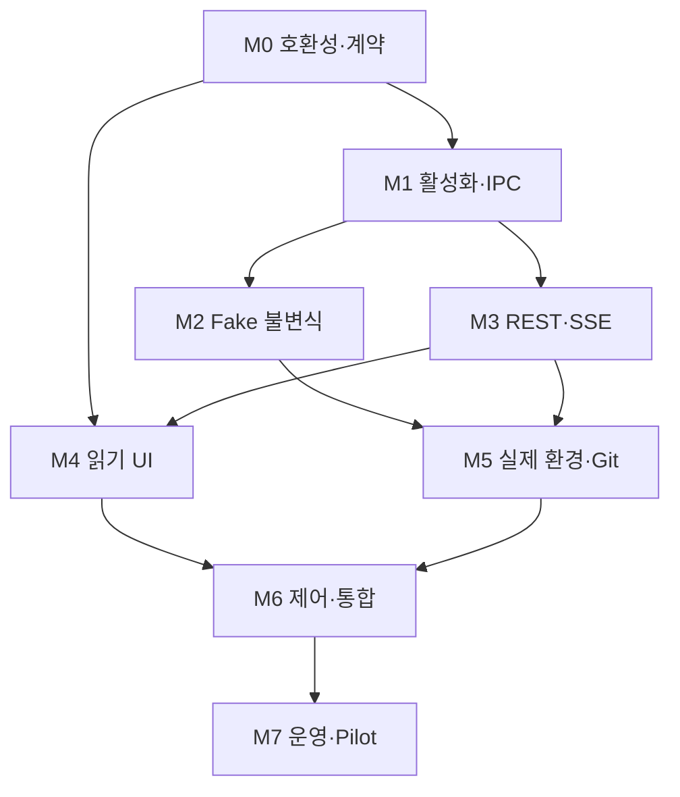

# 05. 삼사라 검증·구현 순서·출시 계획

- 문서 버전: 1.0
- 작성 기준일: 2026-10-28, Asia/Seoul
- 상태: **구현 전 검증 계획. 이 문서에 열거된 테스트를 실행했다는 뜻이 아니다.**
- 기준 계약: [공통 데이터·IPC·API·이벤트](03-contracts-and-data-model.md)
- 연결 설계: [Go 런타임](01-runtime-implementation-plan.md) · [React UI](02-ui-implementation-plan.md) · [Git 통합](04-git-worktree-and-merge-plan.md)

## 1. 검증 목표와 현재 증거 수준

검증 목표는 “화면에서 에이전트가 움직여 보인다”가 아니다.
프로젝트 활성화, 작업 실행권, 의존성, 승인, 코드 통합, 장애 복구가 하나의 일관된 정책으로 동작하는지를 확인한다.
브라우저가 닫혀도 런타임은 계속 동작하고, 다시 열면 영속된 사실에 맞게 화면이 복구되어야 한다.

이번 문서 작성에서 수행한 것은 요구사항 정리와 공식 문서 대조다.
기존 코드·이전 SQLite 마이그레이션 파일·이전 검증 보고서는 제공되지 않았으므로 재실행하지 않았다.
이전에 언급된 “10개 테이블 생성”을 신규 스키마의 통과 증거로 옮기지 않는다.
실제 개발 환경의 herdr·tmux·Claude Code 설치 여부도 착수 시 다시 확인한다.

| 항목 | 이번 계획 작성 시점의 상태 |
| --- | --- |
| 요구사항·설계 문서 | 작성 및 문서 간 정합성 검토 대상 |
| 공식 API 지원 범위 | 관련 공식 문서 확인, 설치 버전 호환성은 별도 검증 필요 |
| Go 런타임 구현 | 이 문서에서 구현하지 않음 |
| Fake Backend 테스트 | 작성·실행 예정 |
| 실제 herdr·tmux·Claude 세션 | 통합 환경에서 실행 예정 |
| 실제 Git publication | 폐기 가능한 시험 저장소에서 실행 예정 |
| UI 성능·접근성 | 기준 장비·빌드·데이터를 고정한 뒤 측정 예정 |

## 2. 출시를 막는 핵심 불변조건

다음은 구현 순서보다 우선하는 P0 기준이다.
하나라도 깨지면 해당 기능의 자동 실행을 제공하지 않는다.

| ID | 불변조건 | 대표 검증 방법 |
| --- | --- | --- |
| INV-01 | 비활성·미설정 프로젝트는 daemon 연결·backend 탐색·worker 생성으로 이어지지 않는다 | 부수효과 spy, 실패하도록 만든 실행 파일 |
| INV-02 | 같은 resource에 동시에 유효한 ACTIVE lease는 하나다 | 병렬 transaction·재시작·만료 경쟁 |
| INV-03 | stale 실행권은 새 도구·산출물 제출에, stale publication 권위는 통합에 사용할 수 없다 | 권한 종류별 과거 요청 replay |
| INV-04 | UNKNOWN 세션을 DEAD로 간주해 같은 Worktree에 재할당하지 않는다 | backend 단절, 프로세스 생존 유지 |
| INV-05 | 삼사라 승인은 Claude 자체 권한을 대체하지 않는다 | 실제 permission prompt·Hook 출력 확인 |
| INV-06 | A에 의존하는 B만 대기하며 독립 C는 계속 실행한다 | 결정적 Fake 시나리오와 실제 adapter 수직 테스트 |
| INV-07 | 도메인 변경·event·audit·outbox는 일관되게 commit된다 | transaction 경계 crash 주입 |
| INV-08 | 외부 호출 결과 불명일 때 무조건 중복 전송하지 않는다 | prompt·create·publish ACK 유실 |
| INV-09 | 정확한 산출물·대상·정책 버전에 맞는 승인과 검증만 사용한다 | SHA·generation·policy 변경 |
| INV-10 | 같은 저장소·target의 최종 통합 권위는 하나다 | 서로 다른 프로젝트·daemon·provider 경쟁 |
| INV-11 | SSE 단절·중복·복원 이후 UI가 잘못된 완료를 만들지 않는다 | snapshot/replay·cursor·schema 테스트 |
| INV-12 | 사용자 dirty Worktree와 작업 이력을 자동 복구로 파괴하지 않는다 | dirty·untracked·ownership fixture |

Hook과 Lease는 OS 격리를 대신하지 않는다.
이미 실행 중인 shell 프로세스가 쓸 수 있는 파일을 fence만으로 봉쇄했다는 주장을 검증 결과에 넣지 않는다.
강한 격리가 필요한 별도 배포 모드는 sandbox와 자격증명 분리까지 검증해야 한다.

## 3. 전체 구현 단계

이 문서의 M0~M7이 전체 통합 일정의 기준이다.
각 설계 문서의 R·UI-W·G 작업 ID는 이 단계에 배치한다.

| 단계 | 목적 | 주요 산출물 | 다음 단계 진입 조건 |
| --- | --- | --- | --- |
| M0 | 호환성 spike와 계약 고정 | capability 표, 지원 버전, ADR, 생성할 schema 초안 | Hook 실패 차단과 backend 제어 경로를 실제 버전으로 설명 가능 |
| M1 | 프로젝트 활성화·SQLite·IPC·Standalone 수직 구현 | CLI, trust registry, daemon, migration, SessionStart·PreToolUse 연결 | opt-in 외 부수효과 없음, 관리 세션 등록·차단 동작 |
| M2 | Fake 기반 권한·의존성·승인·복구 | Fake adapter, clock, scheduler, invariant·crash 테스트 | A/B/C 부분 차단과 stale owner·재시작 불변식 통과 |
| M3 | 관찰 REST·영속 SSE | snapshot, event replay, catalog feed, API 계약 테스트 | snapshot/stream 경계·복원·gap 처리 통과 |
| M4 | 읽기 전용 React 대시보드 | 전체 프로젝트·LR DAG·Worktree·게이트·이력 fixture | 서버 정책을 추론하지 않고 정확히 표시, 대규모 탐색 가능 |
| M5 | 실제 backend·Git 관찰·후보 검증 | herdr/tmux 통합, candidate 검사, GitHub read history | 실제 세션과 Fake 의미 일치, Git 검증 OID 추적 |
| M6 | 승인·재개·통합 제어 | 조건부 명령 UI, idempotency, 실제 시험 publication | 오류·중복·권한·응답 유실에도 P0 조건 유지 |
| M7 | 패키징·운영·pilot | 설치·업그레이드·백업·성능·pilot 보고 | 필수 지원 조합의 출시 기준과 복구 drill 통과 |

### 3.1 의존 관계

M2와 M3의 일부는 병렬 진행할 수 있다.
다만 backend 담당이 한 명이면 실제 작업 시간을 동시에 두 번 계산하지 않는다.
M4는 M0에서 고정한 생성 타입과 fixture로 먼저 시작하고 M3 endpoint가 준비되면 연결한다.
M5의 외부 관찰과 UI fixture 구현도 겹칠 수 있다.
M6의 실제 제어는 읽기 화면과 명령 계약이 검증된 뒤에 활성화한다.

### 3.2 단계별 작업 범위

**M0**에서는 실제 설치 버전의 herdr schema, tmux 명령, Claude Hook 실패 동작을 조사한다.
코드 생성에 필요한 OpenAPI·JSON Schema, enum, cursor·version 규칙을 고정한다.
입증하지 못한 capability는 false 또는 unsupported로 둔다.

**M1**에서는 Standalone의 제한된 수직 경로를 먼저 완성한다.
이미 열린 Claude 세션을 등록하고 Hook으로 실행권을 확인한다.
자동 worker 생성·외부 prompt 주입은 이 단계의 Standalone 기능이 아니다.

**M2**에서는 운영 기능을 더 늘리기 전에 정책 엔진의 결정성을 검증한다.
같은 입력과 같은 logical time에서 같은 상태·outbox·이벤트가 나와야 한다.
실제 herdr 설치가 없어도 실행권·승인·의존성·부분 장애를 재현할 수 있게 만든다.

**M3**에서는 상태 조회를 요청 순간의 임의 조합으로 만들지 않는다.
read transaction snapshot과 영속 이벤트 경계를 하나로 정의하고 복원 시나리오까지 검증한다.

**M4**에서는 쓰기 버튼이 없어도 프로젝트 전체를 관리 가능한 수준으로 관찰할 수 있게 한다.
이력 프로젝트 선택, LR DAG, Worktree 그룹, 게이트·Queue 표시, 세션·GitHub 이력 fixture가 포함된다.

**M5**에서는 실제 환경의 의미가 Fake와 같은지 확인한다.
herdr 상태를 업무 완료로 오인하거나 tmux prompt 상태를 과도하게 추측하지 않는지 검증한다.
실제 Git 후보 생성·테스트까지 구현하되 운영 저장소 publication은 열지 않는다.

**M6**에서는 서버가 명령마다 version·승인 digest·권한·capability를 재검사한다.
시험 저장소에서 승인·재개·Queue 등록·통합·취소 경합을 수행한다.

**M7**에서는 설치된 프로그램으로 처음부터 다시 같은 흐름을 수행한다.
개발 서버에서만 동작하는 경로·CORS·asset·환경 변수 의존성을 제거한다.

## 4. 공수 가설과 일정 사용법

아래는 기존 구현을 재사용하지 못하는 상황을 가정한 계획 추정이다.
확정 일정이나 현재 진행률이 아니다.
M0에서 저장소 구조·재사용 가능한 코드·실제 API 호환성을 확인한 뒤 다시 산정한다.

가정은 backend 개발자 1명, frontend 개발자 1명이다.
두 사람 모두 자신의 영역 테스트·문서·리뷰·버그 수정에 참여한다.
별도의 전담 QA·디자이너·보안 엔지니어가 포함되어 있지 않다.
기존 로그인·배포·CI 기반을 새로 만들어야 한다면 추가 공수가 든다.

| 단계 | Backend 인일 | Frontend 인일 | 주요 변동 요인 |
| --- | ---: | ---: | --- |
| M0 | 3~5 | 1~3 | herdr schema·Claude 버전·디자인 토큰 확정 |
| M1 | 6~10 | 2~3 | daemon lifecycle, 설정·trust·IPC |
| M2 | 8~12 | 3~5 | lease·crash·outbox·정책 경쟁 조건 |
| M3 | 5~8 | 3~5 | 원자 snapshot·replay·인증·타입 생성 |
| M4 | 2~4 | 10~16 | 그래프 배치·많은 Worktree·반응형·접근성 |
| M5 | 10~16 | 4~6 | 실제 terminal 환경·GitHub 권한·CI |
| M6 | 6~10 | 7~12 | 조건부 제어·통합·실패 UX |
| M7 | 5~8 | 4~7 | OS 패키징·백업·pilot 수정 |
| 합계 | **45~73** | **34~57** | **총 79~130 인일** |

주당 실제 구현·검증에 쓸 수 있는 시간을 1인당 4일로 가정하면 전체는 대략 **11~19주** 범위의 계획 가설이다.
이는 두 열을 단순히 더한 인일을 2로 나눈 확정 납기가 아니다.
backend의 M1→M2→M5→M6→M7과 frontend의 M3→M4→M6이 주요 경로다.
지원 OS 확대, 기존 Hook 충돌, GitHub Queue 미지원, publication 보장 변경은 일정 재산정 사유다.
읽기 전용 milestone을 먼저 배포할 수 있지만 M6 완료 제품과 같은 기능 범위로 설명하지 않는다.

## 5. 테스트 계층과 역할

| 계층 | 대상 | 대체할 수 있는 것 | 대체할 수 없는 것 |
| --- | --- | --- | --- |
| 순수 도메인 | 상태 전이·적격성·승인 digest·DAG | 외부 시간·네트워크·파일 | 실제 클라이언트 Hook 의미 |
| 저장소 통합 | SQLite migration·transaction·outbox | 외부 provider | 실제 디스크 crash·OS permission 일부 |
| Fake adapter 계약 | capability·생성·관찰·입력·종료 | herdr/tmux 프로세스 | 실제 terminal 동작 |
| 로컬 프로세스 | Unix socket·Hook binary·CLI·Git | 원격 GitHub | GitHub branch protection |
| 실제 adapter 통합 | herdr/tmux/Standalone+Claude | 운영 사용자 프로젝트 | 다른 미검증 버전 |
| API·UI 계약 | snapshot·SSE·명령·읽기 모델 | 완성되지 않은 backend 일부 | 실제 서버와의 최종 연결 |
| UI 흐름 | 탐색·필터·상태·제어·접근성 | 제한적인 화면 데이터 | 대규모·장시간 실제 부하 |
| 시험 저장소 E2E | PR·CI·Queue·실제 Merge | 운영 코드베이스 | 모든 조직 정책 조합 |

로직 테스트의 개수나 코드 커버리지 숫자를 출시 증거로 삼지 않는다.
불변조건을 깨뜨리는 입력과 경합을 실제로 재현했는지가 중요하다.
구현과 같은 계산을 복사한 expected result 대신 독립적인 모델·명시적 시나리오를 사용한다.

## 6. 공통 Fixture와 결정적 실행

### 6.1 기본 Fixture

| Fixture | 구성 | 검증 목적 |
| --- | --- | --- |
| F-ACT | UNCONFIGURED·ENABLED·DISABLED·MISSING·ARCHIVED 프로젝트 | 활성화와 이력 구분 |
| F-ABC | A 결과 승인 필요, B→A, 독립 C | 최초 실행 부분 차단 |
| F-REVOKE | B가 A의 승인된 output으로 실행 중 | 승인 취소·세대 변경 후 PAUSING |
| F-JOIN | A 이후 B·C 병렬, D가 둘의 INTEGRATED 필요 | 합류·게이트·통합 순서 |
| F-SHARED | 다른 project가 같은 repo/ref 사용 | publication 권위 공유 |
| F-UNKNOWN | backend 관찰 끊김, 프로세스는 생존 | 잘못된 failover 방지 |
| F-CRASH | outbox·Git·생성 작업의 단계별 중단 지점 | intent·실제 상태 재조정 |
| F-STREAM | 두 프로젝트의 전역 seq가 교차하는 이벤트 | seq 공백과 실제 누락 구분 |
| F-GIT | clean, dirty, untracked, rename, binary, squash 저장소 | 비파괴 Git 정책 |
| F-GRAPH | seed가 고정된 3·50·500·2,000 노드 DAG | 그래프 기능·규모·성능 |

### 6.2 FakeClock

만료·재시도·backoff·관찰 freshness를 실제 sleep에 의존하지 않게 한다.
wall clock과 monotonic elapsed time을 구분하여 시간을 앞뒤로 이동시키는 테스트를 제공한다.
테스트는 `Advance` 또는 명시적 tick으로만 진행한다.
재시도 jitter는 seed를 기록한다.
runtime 재시작은 새 epoch를 주고 이전 lease가 자동 부활하지 않는지 확인한다.

### 6.3 FakeBackend

FakeBackend는 성공 응답만 반환하는 stub보다 넓어야 한다.
각 호출에 `operation_id`, 입력 revision, 호출 시각, 결과, 관찰 시각을 남긴다.
테스트가 다음 조건을 설정할 수 있어야 한다.

- 응답 전 실패, 작업 수행 후 ACK 유실, 지연, 중복 응답.
- 세션 생성 성공 후 등록 지연.
- 상태 이벤트 순서 역전, 이벤트 유실, 오래된 snapshot.
- native permission 대기, 사용자 입력 소유, BUSY, UNKNOWN.
- backend 재시작으로 같은 pane 번호가 다른 세션에 재사용됨.
- capability 일부만 제공, 실행 시 capability 거절.
- 종료 요청 접수 후 프로세스가 계속 살아 있음.

FakeBackend는 모든 adapter가 제공하지 않는 기능을 자동으로 성공시키지 않는다.
예를 들어 Standalone의 send prompt 요청은 unsupported여야 한다.

### 6.4 모델 기반 검사

작은 issue 그래프에서 가능한 승인·lease·session·candidate 전이를 무작위 순서로 실행한다.
매 단계마다 INV 조건을 검사한다.
실패한 seed와 최소 재현 이벤트 목록을 저장한다.
무작위 테스트만 두지 않고 중요한 경합을 고정 회귀 테스트로 남긴다.

## 7. 프로젝트 활성화·설치 테스트

P0는 자동 관리 실행 출시 전에 반드시 통과해야 한다.
P1은 해당 화면·보조 기능 출시 전에 통과해야 한다.

| ID | 우선 | 조건 | 기대 결과 |
| --- | --- | --- | --- |
| ACT-01 | P0 | 설정 없는 프로젝트에서 SessionStart | no-op; daemon·socket·backend probe 호출 0회 |
| ACT-02 | P0 | DISABLED 프로젝트, herdr/tmux 없음 | 기존 Claude 흐름 유지, 설치 오류 안내 없음 |
| ACT-03 | P0 | 저장소 config에 enabled=true, 로컬 trust 없음 | 실행 승인된 프로젝트로 자동 등록하지 않음 |
| ACT-04 | P0 | ENABLED, autostart=true, daemon 없음 | 사용자 범위 daemon 하나만 시작 |
| ACT-05 | P0 | 두 SessionStart가 동시에 autostart | single-instance 보장, 각각 session 등록 |
| ACT-06 | P0 | ENABLED, autostart=false, daemon 없음 | 자동 시작 없음; managed 작업은 명시적 연결 오류·차단 |
| ACT-07 | P0 | 활성 Worker 중 disable | 신규 할당 중지, drain 완료 전 기존 guard 유지 |
| ACT-08 | P0 | disable 중 장기 도구 생존 | COMPLETE 오표시 없음; DRAINING/NEEDS_ATTENTION |
| ACT-09 | P1 | 과거 MISSING 프로젝트 선택 | 이력 표시, 경로 자동 생성·세션 시작 없음 |
| ACT-10 | P1 | ARCHIVED 프로젝트 선택·검색 | 관찰 가능, 자동 활성화 없음 |
| ACT-11 | P0 | 기존 사용자 Hook이 설정됨 | 관리 항목만 추가, 기존 설정 보존 |
| ACT-12 | P0 | 제거·업그레이드 중 활성 세션 존재 | 관리 세션 정리 전 guard binary를 지우지 않음 |
| ACT-13 | P0 | 다른 OS 사용자의 socket·state path | 잘못된 runtime에 등록·제어하지 않음 |
| ACT-14 | P1 | 프로젝트 경로 이동·symlink 변경 | 명시적 relink, 기존 ID·이력 보존 여부 확인 |

설치되지 않은 binary를 “호출하면 실패하는 stub”으로 대체해 ACT-01~03에서 정말 호출하지 않았는지 검사한다.
출력만 조용한 것과 부수효과가 없는 것을 구분한다.

### 7.1 Skills·구조화 계획 접수

| ID | 우선순위 | 입력·경합 | 기대 결과 |
| --- | --- | --- | --- |
| PLN-01 | P0 | plan validate, 잘못된 schema·중복 key·cycle | 오류를 설명하고 DB·worker·backend 부수효과 없음 |
| PLN-02 | P0 | 동일 key·본문의 plan apply 재전송 | 같은 PLANNED run과 alias→issue 매핑, 중복 launch 없음 |
| PLN-03 | P0 | apply 직전 graph version 변경 | 조건부 변경 거절, 기존 그래프 보존 |
| PLN-04 | P0 | ACTIVE run의 일반 apply 덮어쓰기 | 409, 명시적 pause·revise에서만 generation 변경 |
| PLN-05 | P0 | plan에 미등록 check_profile·임의 shell 문자열 | trust한 검사 정의 외 실행 금지 |
| PLN-06 | P0 | apply 직후 PLAN 승인 없이 run start | PLANNED 보존, scheduler는 승인·정책 확인 전 할당하지 않음 |

## 8. Hook Bridge 검증

### 8.1 호환성 출발 조건

공식 Claude Code 문서상 command/http Hook의 `onFailure: "block"`은 v2.1.295 이상이 필요하다.
문서에 그 버전이 적혀 있다는 사실만으로 설치된 클라이언트가 지원한다고 간주하지 않는다.
버전 검사와 실제 실패 주입을 함께 통과한 조합만 managed execution을 허용한다. [Claude Code Hooks 공식 문서](https://code.claude.com/docs/en/hooks#block-the-action-when-a-hook-fails)

지원하지 않는 버전은 관찰 모드 또는 명시적 미지원 상태다.
고장 난 Hook이 무시되는 환경을 “fail-closed”로 표시하지 않는다.
사용자가 Hook을 끄거나 설정을 우회할 수 있는 일반 OS 환경은 신뢰된 참여자를 전제로 한다.

### 8.2 실패 주입 행렬

| ID | 우선 | 주입 | 기대 결과 |
| --- | --- | --- | --- |
| HK-01 | P0 | 유효 lease, 정상 PreToolUse | 삼사라의 명시적 allow 없이 native permission flow 진행 |
| HK-02 | P0 | revoked·expired·stale fence | JSON deny로 다음 도구 차단 |
| HK-03 | P0 | daemon 연결 거절 | bridge가 deadline 안에 명시적 deny |
| HK-04 | P0 | Hook binary 누락 | 실제 Claude가 도구를 실행하지 않음 |
| HK-05 | P0 | binary 실행 permission 없음 | 실제 Claude가 도구를 실행하지 않음 |
| HK-06 | P0 | Hook timeout | onFailure block 동작, 의도한 도구 미실행 |
| HK-07 | P0 | malformed JSON·잘못된 schema | 잘못된 제어 응답이 도구 허용으로 이어지지 않음 |
| HK-08 | P0 | log와 JSON이 섞인 stdout | 계약 오류 탐지; 실패 차단 검증 |
| HK-09 | P0 | async/background Hook 설정 | 실행 gate로 허용하지 않음; doctor가 오류 표시 |
| HK-10 | P0 | SessionStart 실패·미등록 | 다음 관리 PreToolUse에서 미등록 요청 차단 |
| HK-11 | P0 | native permission prompt | 삼사라 승인 후에도 native permission 필요 |
| HK-12 | P0 | 프로젝트 cwd 변경·다른 worktree | 기존 authority로 다른 resource 권한 획득 불가 |
| HK-13 | P0 | Claude subagent tool | 부모 attempt와 scope 적용, 숨은 독립 worker 생성 없음 |
| HK-14 | P0 | Stop·SessionEnd 누락/중복/순서 역전 | 이슈 완료나 생존 종료를 독단 확정하지 않음 |
| HK-15 | P0 | 이미 실행 중인 긴 shell 이후 revoke | 다음 도구 차단, 기존 shell 생존은 별도 관찰 |
| HK-16 | P1 | 한글·공백·특수문자 설치 경로 | exec-form argv에서 경로 손상·shell 해석 없음 |

실제 Hook 검증에서는 harmless marker 파일 생성 도구를 사용해 실행 여부를 확인한다.
Hook 메시지에 `deny`가 보였다는 것만으로 차단을 판정하지 않는다.
반대로 일반 plain-text stdout이 항상 parser 실패인 것은 아니므로 구체적인 invalid JSON·schema fixture를 사용한다.
실행이 거절된 경우 marker가 생성되지 않아야 한다.
장기 shell 테스트는 전용 시험 디렉터리에 제한하고 종료·정리 증거를 남긴다.

## 9. Adapter 공통 계약과 실제 환경

### 9.1 동일하게 지켜야 하는 의미

| 계약 | herdr | tmux | Standalone |
| --- | --- | --- | --- |
| 기존 세션 등록·권한 검증 | 필수 | 필수 | 필수 |
| 세션 위치와 generation 구분 | 필수 | 필수 | process/Claude session 수준에서 필수 |
| 새 Worker 생성 | capability가 있을 때 | capability가 있을 때 | MVP unsupported |
| 자동 prompt 전달 | 입력권·상태·지원 확인 후 | 제한된 driver 검증 후 | MVP unsupported |
| 생존 불명 처리 | UNKNOWN | UNKNOWN | Hook·process 관찰 불명은 UNKNOWN |
| native permission 존중 | 필수 | 필수 | 필수 |
| 수동 계속 요청 | fallback으로 제공 | fallback으로 제공 | 기본 재개 방식 |

동일 contract suite는 지원 기능에만 성공 테스트를 적용한다.
지원하지 않는 기능은 `UNSUPPORTED_CAPABILITY`를 정확히 반환하는 것이 통과다.
skip 목록에는 기능·이유·버전·대체 사용자 동작을 기록한다.

### 9.2 선택과 복구 테스트

| ID | 우선 | 조건 | 기대 결과 |
| --- | --- | --- | --- |
| BE-01 | P0 | herdr·tmux 모두 사용 가능, 신규 Worker | 자동 선택 herdr |
| BE-02 | P0 | herdr 설치됨, 연결 불가, tmux 사용 가능 | 신규 Worker는 tmux, 실패 근거 기록 |
| BE-03 | P0 | 둘 다 없음 | Standalone 제한 모드, 생성·입력 capability 거짓 |
| BE-04 | P0 | 사용자가 tmux를 명시 | herdr가 있어도 명시 설정 존중 |
| BE-05 | P0 | 현재 세션은 tmux, herdr 신규 가능 | 현재 세션을 herdr로 오인해 rebind하지 않음 |
| BE-06 | P0 | herdr 연결 끊김, Worker 생존 | UNKNOWN, 같은 작업 즉시 tmux 이주 금지 |
| BE-07 | P0 | pane ID 재사용·backend 재시작 | generation·등록 ticket 불일치면 이전 세션으로 복구 안 함 |
| BE-08 | P0 | 입력 전 READY, 전송 직전 사용자 입력 소유 | 충돌 방지, 자동 입력 보류 |
| BE-09 | P0 | prompt 수행 후 ACK 유실 | UNKNOWN; 무조건 재전송하지 않음 |
| BE-10 | P0 | 생성 후 ACK 유실 | correlation으로 기존 세션 확인, 중복 생성 방지 |
| BE-11 | P0 | herdr events_lost·오래된 snapshot | stale 표시·authoritative reread·reconcile |
| BE-12 | P0 | tmux pane에 다른 프로세스 | 단순 prompt 텍스트로 Claude READY 단정 금지 |
| BE-13 | P0 | Standalone 승인 완료 | 실행권 재평가, 사용자 계속 입력 필요 표시 |
| BE-14 | P1 | focus 미지원·현재 창 없음 | unsupported/안내, 임의 key injection 없음 |

## 10. Lease·의존성·승인 시나리오

| ID | 우선 | 상황 | 기대 결과 |
| --- | --- | --- | --- |
| POL-01 | P0 | F-ABC, A 최초 승인 대기 | B는 PENDING, C는 RUNNING 가능 |
| POL-02 | P0 | F-REVOKE, 이전 승인 무효 | B는 PAUSING, 실제 정지 확인 후 PAUSED, C 계속 |
| POL-03 | P0 | A 결과 승인 완료 | B의 모든 조건 재검사, native permission/입력 불명은 재개 보류 |
| POL-04 | P0 | A VERIFIED, B는 INTEGRATED 필요 | B는 계속 대기 |
| POL-05 | P0 | 게이트가 열리고 필수 멤버 추가 | run_generation·membership 변화로 재평가 |
| POL-06 | P0 | cycle을 만드는 edge 추가 | transaction 거절, 기존 그래프·권한 유지 |
| POL-07 | P0 | 승인 후 source 또는 정책 변경 | 기존 digest 승인 재사용 금지 |
| POL-08 | P0 | 같은 승인 이중 클릭·재전송 | 같은 key는 같은 command, 한 결정만 기록 |
| POL-09 | P0 | 같은 key에 다른 payload | IDEMPOTENCY_KEY_REUSED |
| POL-10 | P0 | 동시에 approve·reject | If-Match 경합으로 하나만 유효 |
| POL-11 | P0 | lease 만료·갱신·재발급 경쟁 | ACTIVE 한 개, fence 단조 증가 |
| POL-12 | P0 | runtime 재시작 | epoch 변경, 과거 실행권은 재확인 없이 수용 안 함 |
| POL-13 | P0 | wall clock이 뒤로 이동 | 만료된 권한 부활 없음 |
| POL-14 | P0 | Stop 또는 herdr done만 수신 | IMPLEMENTED·VERIFIED·COMPLETED 자동 전이 없음 |
| POL-15 | P0 | result output을 구현 후 수정 | 기존 output 불변, 새 attempt/output 필요 |
| POL-16 | P0 | 다른 프로젝트 entity ID 혼합 | project scope 검사로 거절 |
| POL-17 | P0 | 같은 request_id/tool_use_id로 권한 검사 재전송 | 과거 PASS를 replay하지 않고 현재 lease·fence·정책 재평가 |

실제 A/B/C 테스트에서는 C가 단지 “차단되지 않음”뿐 아니라 작업 진행 이벤트를 계속 남기는지 확인한다.
B가 미시작인 경우와 이미 실행 중인 경우를 섞지 않는다.
승인 저장·Lease 재발급·입력 전달·실제 작업 재개는 각각 다른 관찰점으로 검증한다.
`tools/check`는 일반 상태 변경 command의 멱등 응답 재사용과 다르다.
같은 도구 식별자라도 권한이 회수된 뒤 다시 요청하면 현재 사실로 차단해야 한다.

## 11. SQLite·Outbox·재시작 검사

| ID | 우선 | 장애 또는 입력 | 기대 결과 |
| --- | --- | --- | --- |
| DB-01 | P0 | 빈 DB migration | 정의된 schema와 제약 생성, checksum 기록 |
| DB-02 | P0 | 이미 적용된 migration 재실행 | idempotent 결과 또는 명시적 이미 적용 처리 |
| DB-03 | P0 | migration 중단 | 부분 schema를 정상 상태로 열지 않음 |
| DB-04 | P0 | 잘못된 project FK·중복 ACTIVE lease | DB/서비스 제약으로 거절 |
| DB-05 | P0 | state commit 전 crash | state·event·outbox 중 일부만 보이지 않음 |
| DB-06 | P0 | commit 후 dispatcher 전 crash | outbox를 복구하여 잊힌 작업 없음 |
| DB-07 | P0 | 외부 effect 후 기록 전 crash | UNKNOWN 후 관찰, 중복 effect 금지 |
| DB-08 | P0 | SQLite busy·disk full·read-only | 명시적 저장 실패, 성공 응답·권한 발급 없음 |
| DB-09 | P0 | 장시간 reader·checkpoint | writer가 무제한 대기하지 않음, 상태 진단 가능 |
| DB-10 | P0 | runtime 재시작·stale socket | 새 daemon 하나, socket 소유권 검증 |
| DB-11 | P0 | 실행 중 일관된 backup 생성 | restore 후 FK·event boundary·intent 정합성 |
| DB-12 | P0 | 과거 backup 복원 | database_generation 변경, 과거 UI cursor reset |
| DB-13 | P0 | 복원 직후 과거 PUBLISHING 행 | 실제 target 먼저 확인, 미반영으로 추정 재전송 금지 |
| DB-14 | P1 | 로그·event retention | audit·integration evidence와 replay 보존을 구분 |

실제 Go driver에 포함된 SQLite 버전을 기록한다.
개발 머신의 별도 `sqlite3` 실행 파일 버전으로 대체하지 않는다.
마이그레이션과 백업 방식의 근거는 [공통 계약의 DB 운영 기준](03-contracts-and-data-model.md)을 따른다.

## 12. HTTP·SSE 계약 검증

### 12.1 snapshot과 stream

| ID | 우선 | 입력·경합 | 기대 결과 |
| --- | --- | --- | --- |
| EVT-01 | P0 | snapshot read 중 domain commit | 하나의 일관된 projection와 cursor 반환 |
| EVT-02 | P0 | snapshot 반환 후 SSE 연결 전 이벤트 | replay로 누락 없이 적용 |
| EVT-03 | P0 | backlog replay 중 live 이벤트 | 영속 DB에서 계속 읽어 누락 없음 |
| EVT-04 | P0 | 동일 event 재전송 | 상태·카운터·알림 중복 적용 없음 |
| EVT-05 | P0 | 프로젝트별 seq 100 다음 104 | 다른 프로젝트 삽입으로 인한 공백은 정상 |
| EVT-06 | P0 | previous_project_version 불일치 | 적용 중지·snapshot 재조회 |
| EVT-07 | P0 | 하나의 transaction에서 여러 entity 변경 | store 한 번에 atomic 적용, 중간 모순 화면 없음 |
| EVT-08 | P0 | 과거 aggregate version 이벤트 | 최신 entity를 덮지 않음 |
| EVT-09 | P0 | int64 범위 큰 seq/version | JS Number 변환 없이 정밀도 유지 |
| EVT-10 | P0 | cursor retention 만료 | reset_required 후 snapshot부터 재시작 |
| EVT-11 | P0 | DB 복원으로 generation 변경 | 기존 cursor 폐기·새 snapshot 적용 |
| EVT-12 | P0 | daemon epoch만 변경, DB 동일 | epoch에 따른 UI 상태 갱신; 불필요한 이력 손실 없음 |
| EVT-13 | P0 | 다른 project cursor | scope 검증·reset, 다른 프로젝트 이벤트 누출 없음 |
| EVT-14 | P0 | after와 Last-Event-ID 불일치 | 400, 임의 우선순위 추정 없음 |
| EVT-15 | P0 | breaking schema 변경 | stream 적용 중지·업그레이드 안내·제어 비활성 |
| EVT-16 | P1 | 알 수 없는 additive type, changes 유효 | 공통 changes 계약대로 반영 |
| EVT-17 | P0 | bounded queue 초과 | 조용한 이벤트 유실 없음, replay/reset 유도 |
| EVT-18 | P1 | 프로젝트 빠른 전환 | 이전 fetch·layout·SSE 결과가 새 화면에 섞이지 않음 |

### 12.2 전송과 인증

| ID | 우선 | 입력 | 기대 결과 |
| --- | --- | --- | --- |
| NET-01 | P0 | token 없음·만료·폐기 | 401, SSE 종료·새 인증 안내 |
| NET-02 | P0 | Authorization을 지원하지 않는 client 방식 | token을 URL에 붙이는 우회 없음 |
| NET-03 | P1 | UTF-8 문자가 byte 경계에서 분할 | 깨짐 없이 JSON/event 파싱 |
| NET-04 | P1 | CRLF·multiline data·comment heartbeat | 표준 framing대로 처리 |
| NET-05 | P1 | proxy buffer·flush 지연 | 실제 지원 경로에서 지연 측정·진단 |
| NET-06 | P0 | response 202 후 command 실패 | UI가 최종 성공으로 표시하지 않음 |
| NET-07 | P0 | browser 새로고침·tab 중복 | credential memory 정책·명령 중복 방지 |
| NET-08 | P1 | 연결 장기 단절·다수 탭 | 제한된 backoff, daemon writer 보호 |

SSE parser는 snapshot fixture를 흉내 내는 것만으로 검증하지 않는다.
실제 HTTP stream의 byte chunk 경계를 다양하게 바꿔 검사한다.
catalog stream과 선택 project stream을 별도로 테스트하며 catalog에는 다른 프로젝트의 민감한 상세를 싣지 않는다.

## 13. Git·Worktree·통합 검증

상세 Git 시나리오는 [Git 통합 계획](04-git-worktree-and-merge-plan.md)에 있다.
여기서는 전체 출시 gate와 연결되는 회귀 ID를 정의한다.

| ID | 우선 | 상황 | 기대 결과 |
| --- | --- | --- | --- |
| GIT-T01 | P0 | 같은 repo/ref에 다른 project 두 개 | publication 권위와 lock 공유 |
| GIT-T02 | P0 | 다른 repo/ref | 불필요한 전역 직렬화 없음 |
| GIT-T03 | P0 | source 변경 후 과거 승인 | 후보 재심사, 이전 승인을 새 코드에 사용 안 함 |
| GIT-T04 | P0 | candidate 검사 후 target 변경 | STALE_BASE, 새 결합 결과 재검증 |
| GIT-T05 | P0 | 사용자 checkout main을 local CAS 지정 | 자동 변경 거절 |
| GIT-T06 | P0 | 관리 bare/nonchecked-out ref CAS 경합 | 예상 base 일치 시만 반영 |
| GIT-T07 | P0 | dirty·untracked·external Worktree 정리 | 데이터 보존, 강제 제거 없음 |
| GIT-T08 | P0 | Git 생성 성공 후 DB 확정 전 crash | 소유 intent에 맞는 자원만 채택 |
| GIT-T09 | P0 | Git ref 반영 직후 ACK/DB 기록 유실 | 실제 target에서 결과 복구 |
| GIT-T10 | P0 | GitHub native Queue와 local writer 동시에 설정 | 설정 거절 또는 한 authority로 명시적 전환 |
| GIT-T11 | P0 | GitHub enqueued 응답 | MERGED 아님, 후속 integrated gate 대기 |
| GIT-T12 | P0 | PR check 성공, merge_group check 없음 | 실제 Queue 통합 불가를 정확히 표시 |
| GIT-T13 | P0 | 다른 SHA의 성공 check | 현재 candidate 검증으로 재사용 안 함 |
| GIT-T14 | P0 | squash·rebase·수동 Merge | provider evidence와 source mapping으로 판정 |
| GIT-T15 | P0 | 후보 취소와 실제 Merge 경합 | 이미 반영된 사실을 CANCELLED로 덮지 않음 |
| GIT-T16 | P0 | stale Worker가 직접 후보 제출 | fence·attempt 검사로 publication 거절 |
| GIT-T17 | P1 | rename·binary·file/directory 충돌 | 단순 conflict marker 검색에 의존하지 않음 |
| GIT-T18 | P0 | branch protection 미충족 | bypass·force push 없이 명확한 이유 표시 |
| GIT-T19 | P0 | VERIFIED 불변 output 제출 후 Worker 정상 종료·실행 lease 반납 | 유효한 별도 publication 권위로 통합 진행 가능 |
| GIT-T20 | P0 | Worker 실행권은 유효하지만 repository/target publication fence가 stale | 통합 차단, 실행권을 통합권으로 대체하지 않음 |
| GIT-T21 | P0 | native enqueue 뒤 group/base 재생성, 일반 CI만 성공 | 새 MERGE 승인과 필수 integration-policy check 없이는 통합 안 됨 |
| GIT-T22 | P0 | daemon offline·metadata artifact 만료·poll 실패 | group check 비성공 유지·timeout, fail-open 없음 |
| GIT-T23 | P0 | 다른 App의 동명 성공 check | expected App source 조건으로 거절 |
| GIT-T24 | P0 | 승인 대기를 neutral/skipped로 출력하려는 경로 | 차단; 미승인을 필수검사 통과로 표현하지 않음 |
| GIT-T25 | P0 | 동일 SHA로 dequeue→re-enqueue·CI rerun | stale success 재사용 방지 입증; 미입증 조합 자동등록 비활성 |
| GIT-T26 | P0 | group mapping의 head/base/member 불일치·unknown member | 성공 check 게시 없음, 정확한 metadata 재조회 |
| GIT-T27 | P0 | publication 허가 선형화 전 revoke | 성공 게시 intent 생성 거절 |
| GIT-T28 | P0 | 허가 선형화 후 success ACK 유실·동시 revoke | 결과 관찰·best-effort 취소, 이미 반영된 사실 보존 |

실제 원격 통합 테스트는 시험용 저장소·전용 target에서 수행한다.
필수 checks, 승인, Merge Queue 정책을 테스트 명세에 기록한다.
조직·요금제·서버 버전 때문에 Queue가 없으면 해당 모드 미지원으로 보고한다.
일반 PR merge 호출을 native Queue 통과로 위장하지 않는다.
산출물 제출 순간에는 현재 execution lease·fence를 검사한다.
이미 수락된 immutable output의 통합에서는 provenance·superseded 여부·run_generation·승인을 검사하고 repository/target controller의 별도 publication 권위를 사용한다.
통합을 기다리는 동안 Worker 실행 lease를 계속 ACTIVE로 유지해야 한다는 조건을 넣지 않는다.
그 조건은 정상 종료된 Worker의 완료된 결과가 영원히 Merge되지 않는 교착을 만들 수 있다.
native Queue의 exact MERGE 승인 강제는 GitHub App의 필수 policy check를 통해 검증한다.
로컬 DB 승인만 무효화하고 원격 group이 CI 통과 후 Merge되는 구현은 P0 실패다.
공개 webhook을 사용하지 않는 MVP는 CI metadata artifact와 workflow-run·QueueEntry poll 경로를 시험한다.
이 조합의 check freshness·expected App·권한·group 매핑을 증명하지 못하면 native 자동 enqueue/merge capability를 제공하지 않는다.

## 14. UI 기능·접근성·대규모 그래프

### 14.1 기능 수용 검사

| ID | 우선 | 사용자 흐름 | 기대 결과 |
| --- | --- | --- | --- |
| UI-T01 | P0 | 전체 프로젝트에서 과거 프로젝트 선택 | 해당 프로젝트 이력 표시, 실행은 시작하지 않음 |
| UI-T02 | P1 | 이슈 DAG 첫 화면 | 왼쪽→오른쪽 진행, 분기·합류 식별 가능 |
| UI-T03 | P1 | Worktree 그룹으로 전환 | 같은 issue/attempt 선택 유지, Git commit graph와 구분 |
| UI-T04 | P0 | A pending, B blocked, C running | 이유와 독립 진행이 정확히 보임 |
| UI-T05 | P0 | backend UNKNOWN, issue 실행 중 | 완료/실패로 임의 변환하지 않음 |
| UI-T06 | P0 | 구현 완료, 통합 대기 | 하나의 녹색 완료로 합치지 않음 |
| UI-T07 | P1 | node 선택·검색·필터·zoom | inspector와 선택 경로가 일관되며 맥락 유지 |
| UI-T08 | P0 | 승인 상세를 연 뒤 source 변경 | 버튼 실행 전 412 처리, 최신 변경 재검토 |
| UI-T09 | P0 | native permission 대기 | 삼사라 승인 버튼으로 해결된다는 설명 없음 |
| UI-T10 | P0 | Standalone 재개 요청 | 수동 계속 필요 표시, 자동 입력 성공으로 표시 안 함 |
| UI-T11 | P1 | 이력 PR/commit 링크 클릭 | 허용된 provider URL로 이동, 임의 로컬 명령 실행 없음 |
| UI-T12 | P0 | UI를 닫았다 다시 열기 | runtime 계속, snapshot+replay로 현재 사실 복구 |
| UI-T13 | P1 | 작은 화면·긴 한글 제목·긴 branch | 가려진 중요 상태·조작 없는 반응형 표시 |
| UI-T14 | P0 | API가 action 금지 또는 unsupported 반환 | optimistic success 없음, 근거와 가능한 대안 표시 |

### 14.2 그래프 규모 fixture

| 규모 | 구성 | 통과 기준 |
| --- | --- | --- |
| 3 노드 | A/B/C 핵심 예 | 상태·edge·이유가 정확하고 최초 설명 가능 |
| 50 노드 | 다수 Worktree·3개 합류·독립 실행 | 확대·축소·검색·상세 이동이 자연스럽고 선택 유지 |
| 500 노드 | 깊은 의존성·폭넓은 분기·혼합 상태 | 집약·필터·viewport rendering으로 탐색 가능 |
| 2,000 노드 | 많은 종료 이슈·일부 활성 run | 전체 상세 DOM 생성을 요구하지 않으며 목록·집약·경로 탐색 제공 |

2,000 노드를 모든 카드 상세와 함께 한 화면에 그리는 것이 출시 기준은 아니다.
이 규모에서는 활성 subset, 그룹 접기, 선택 주변 경로, 목록 대안이 기준이다.
UI 문서의 200 노드 baseline·1,000 노드 탐색 목표는 유지하고 위 500·2,000을 스트레스 fixture로 추가한다.
레이아웃이 늦게 끝났을 때 이전 프로젝트 좌표가 새 프로젝트에 적용되는 race도 검사한다.

### 14.3 접근성

주요 흐름은 WCAG 2.2 AA를 목표로 한다.
자동 검사 결과만으로 접근성 통과를 선언하지 않는다.
키보드·스크린 리더·확대·reduced motion을 수동으로 검증한다.
기준과 UI 구현 근거는 [UI 계획의 접근성 장](02-ui-implementation-plan.md)을 따른다.

- canvas 조작이 어려워도 같은 issue·의존성·대기 이유를 목록에서 조회할 수 있어야 한다.
- Tab 이동 순서, inspector 진입·닫기, 원래 선택 요소로 focus 복귀를 검사한다.
- 상태는 색 외에 텍스트·아이콘·이름으로 전달한다.
- live update가 focus를 빼앗거나 화면 읽기를 반복 중단하지 않아야 한다.
- 승인·취소·재개 작업의 결과를 읽을 수 있는 상태 메시지로 제공한다.
- 도구 설명·menu·dialog를 키보드로 열고 닫을 수 있어야 한다.
- zoom 확대 상태에서 중요한 조작을 잃지 않아야 한다.

### 14.4 과거 실행 결과의 불변성

| ID | 우선순위 | 입력·경합 | 기대 결과 |
| --- | --- | --- | --- |
| HIST-01 | P0 | 종료 run 조회 중 현재 계획·issue 상태 변경 | HISTORICAL snapshot의 DAG·최종 output·결과는 변하지 않음 |
| HIST-02 | P1 | 과거 run의 PR에 새 GitHub 상태 관찰 | 당시 통합 증거와 현재 관찰 시각을 분리 표시 |
| HIST-03 | P1 | 비활성·경로가 없는 프로젝트의 과거 run 선택 | 조회만 수행, daemon worker·backend·프로젝트 활성화 부수효과 없음 |

## 15. 로컬 API와 데이터 노출 검사

| ID | 우선 | 입력·환경 | 기대 결과 |
| --- | --- | --- | --- |
| SEC-01 | P0 | daemon 기본 시작 | loopback만 listen, 외부 interface 공개 없음 |
| SEC-02 | P0 | 예상하지 않은 Host·Origin | 요청 거절, 로컬 API 악용 방지 |
| SEC-03 | P0 | token을 URL·로그·localStorage에서 검색 | credential 없음 |
| SEC-04 | P0 | 만료·재사용된 UI bootstrap code | session token 재발급 불가 |
| SEC-05 | P0 | 다른 project ID로 URL 변조 | principal scope 강제 |
| SEC-06 | P0 | issue title·terminal output의 HTML/script/ANSI | 실행·제어문자 주입 없이 안전하게 표시 |
| SEC-07 | P0 | `file:`, `javascript:`, 임의 scheme 링크 | 탐색 거절, 검증된 link만 제공 |
| SEC-08 | P0 | 경로 traversal·symlink escape | 등록된 project/resource 범위 밖 명령 거절 |
| SEC-09 | P0 | 임의 shell 인자를 포함한 branch·project 이름 | 검증·argv 처리, shell 실행 없음 |
| SEC-10 | P1 | 진단 bundle 생성 | token·환경 secret·전체 transcript 기본 제외 |

백업과 로그에도 민감한 작업 내용이 들어갈 수 있으므로 보존 범위와 파일 권한을 검증한다.
첫 버전에서 원격 공개 dashboard를 지원하지 않는다면 원격 접속 관련 설정을 조용히 열어두지 않는다.
이 장은 제품의 실제 제어 경계 검증이며 일반적인 보안 인증을 획득했다는 선언이 아니다.

## 16. 성능·부하·장시간 동작

아래 수치는 **아직 측정하지 않은 초기 예산**이다.
CPU·메모리·OS·브라우저·빌드 모드·데이터 seed를 기록한 기준 장비에서 검증한다.
예산을 바꾸면 변경 이유와 지원 데이터 크기를 함께 남긴다.

| 대상 | 초기 예산 | 조건 |
| --- | --- | --- |
| local PreToolUse | p95 100ms 이하 | warm daemon, 작은 payload, backend 네트워크 호출 없음 |
| domain event→화면 반영 | p95 1초 이하 | 정상 local 연결, 지원 baseline 크기 |
| UI event 수신→렌더 | p95 250ms 이하 | 초당 50개 상태 이벤트 |
| 최초 유용 화면 | local 응답 후 2초 이내 | 200 issue·400 edge·20 session |
| graph layout | 200 노드 p95 1초 이내 | 교차 의존·분기·합류 포함 |
| stream 복구 | 정상 전송 복구 후 3초 이내 반영 | retention 안의 짧은 단절 |
| 긴 이력 | 10,000개 이벤트 탐색 가능 | 커서 페이지·목록 가상화 |
| 메모리 | 2시간 soak에서 무제한 증가 없음 | 상태 이벤트·탭 전환·재연결 반복 |

단위가 다른 지표를 합치지 않는다.
Hook 처리 시간에는 실제 도구 실행 시간을 포함하지 않는다.
이벤트 수신→렌더와 runtime commit→렌더의 시간을 각각 측정한다.
검증 결과는 p50/p95/p99와 timeout·error 수를 같이 남긴다.
성능 때문에 승인·감사·도메인 이벤트를 조용히 버리는 최적화를 허용하지 않는다.

## 17. 설치·업그레이드·백업·롤백

### 17.1 설치 smoke

새 OS 사용자 또는 깨끗한 시험 profile에서 패키지만으로 설치한다.
개발용 PATH·소스 저장소·Vite 서버·전역 node module 없이 실행한다.
정적 UI asset·layout Worker·schema·migration이 올바른 버전으로 포함되는지 확인한다.
`doctor`는 읽기 중심으로 버전·Hook·socket·권한·capability를 진단한다.
실제 세션 생성·종료는 사용자가 선택한 `doctor --exercise` 범위에서만 수행한다.

### 17.2 업그레이드

업그레이드 전에 지원 schema 범위·daemon 버전·Hook binary 경로를 확인한다.
관리 세션을 배출하거나 안전하게 일시 정지한 뒤 일관된 DB backup을 만든다.
migration은 checksum과 현재 버전을 확인하고 적용한다.
API schema와 UI build가 호환되지 않으면 제어 기능을 열지 않는다.
이전 프로세스가 새 binary와 오래된 DB를 동시에 쓰는 상황을 방지한다.

### 17.3 롤백

이전 binary가 새 schema를 읽을 수 있는지 먼저 판단한다.
지원하지 않으면 무작정 binary만 되돌리지 않는다.
검증한 restore 절차로 DB를 복원하고 `database_generation`을 변경한다.
복원 시점 이후 외부에서 생성·종료·통합된 사실은 사라지지 않는다.
따라서 새 작업을 시작하기 전에 backend·Git·GitHub를 reconcile한다.
DB 복원은 원격 Merge의 취소가 아니며 과거 outbox를 즉시 재전송하지 않는다.

### 17.4 운영 시나리오

| 시나리오 | 확인 내용 |
| --- | --- |
| 노트북 sleep/wake | lease·관찰 freshness·네트워크 복구, 과거 권한 재사용 없음 |
| OS 로그인 재시작 | opt-in·autostart 정책, 불필요한 프로젝트 시작 없음 |
| 포트 사용 중 | 검증된 임의 포트/상태파일 갱신, 잘못된 서비스에 token 전송 없음 |
| 디스크 부족 | 쓰기 실패를 성공으로 표시하지 않음, guard 동작 유지 |
| GitHub 자격증명 만료 | 로컬 작업과 원격 통합 장애를 분리 |
| herdr/tmux 업그레이드 | capability 재확인, 지원 불명 상태에서 자동 입력 보류 |
| 프로젝트 디렉터리 제거 | MISSING 이력 보존, 자동 복원·삭제 없음 |

## 18. 기능 활성화와 사용자 작업

아래는 제품 기능 단계이며 최종 CLI·config 이름은 런타임 계획에서 고정한다.
숨겨진 실험 flag로 지원하지 않는 실행 경계를 통과시키지 않는다.

| 기능 | 기본 제공 시점 | 사용자에게 보이는 동작 |
| --- | --- | --- |
| 프로젝트 opt-in | M1 | init·enable 이후에만 관리 시작 |
| Standalone attach | M1 | 현재 세션 등록·수동 계속 |
| Fake demo/fixture | M2/M4 개발 전용 | 실제 작업과 혼동하지 않는 sample 표시 |
| 읽기 dashboard | M4 | 프로젝트·DAG·이력·대기 이유 관찰 |
| herdr/tmux 자동 관리 | M5 검증 조합 | 지원 capability에 맞춰 생성·관찰·입력 |
| 승인·재개·중지 UI | M6 | server 재검사와 command 상태 표시 |
| GitHub Queue 등록 | M6 지원 저장소 | enqueue와 실제 merge 진행 구분 |
| 로컬 자동 통합 | M6 지원 target | 관리 target CAS만 실행 |
| pilot 기본 배포 | M7 | 설치·진단·backup·복구 문서 제공 |

프로젝트를 클릭해 관찰하는 행위는 프로젝트를 활성화하거나 실행하는 행위가 아니다.
사용자가 새 실행을 요청할 때만 현재 활성화·trust·capability를 확인한다.
관찰 화면에서 생긴 오류 때문에 멀쩡한 worker를 자동 종료하지 않는다.

## 19. CI와 테스트 실행 빈도

| 실행 시점 | 검사 | 산출물 |
| --- | --- | --- |
| 각 변경 PR | lint·type·순수 도메인·빠른 SQLite·schema 호환 | machine-readable 결과와 실패 재현 seed |
| backend 변경 PR | Fake contract·IPC·idempotency·선별 crash·Git 임시 저장소 | 불변조건 결과 |
| UI 변경 PR | component·stream parser·fixture 흐름·접근성 자동 검사 | UI trace·실패 화면 |
| 매일 또는 통합 branch | 전체 모델 기반·soak 일부·지원 OS smoke | 버전별 회귀 표 |
| adapter 릴리스 후보 | 실제 herdr/tmux/Standalone+Claude | version·schema hash·marker 증거 |
| 통합 릴리스 후보 | 시험 GitHub 저장소 CI·Queue·publication·복구 | PR·check·commit·operation evidence |
| pilot 전 | install/upgrade/restore·키보드/스크린 리더·성능 | 출시 판정 보고서 |

“매일” 실행은 실제 CI 운영 계획이며 이번 문서 작성에서 예약 작업을 생성하지 않는다.
필수 gate가 아닌 긴 검사를 모든 작은 변경에 반복하지 않는다.
실패 위험과 변경 범위에 따라 suite를 선택하되 P0 변경은 관련 regression을 반드시 실행한다.

## 20. 출시 판정과 Definition of Done

### 20.1 P0 gate

다음 모두가 필요하다.

- INV-01~12에 대응하는 테스트가 지원 조합에서 통과한다.
- managed execution을 지원하는 Claude 버전에서 Hook 실패 주입이 실제 도구를 막는다.
- Fake 통과와 실제 adapter 통과를 구분한 결과가 있다.
- UNKNOWN·ACK 유실·복원 후 중복 생성·입력·publication이 없다.
- source/base/generation/policy가 달라졌을 때 오래된 승인이 통과하지 않는다.
- 실제 통합은 지원되는 authority와 시험 target에서 검증했다.
- native Queue는 새 group·동일 SHA 재등록에서 현재 MERGE 승인을 필수 provider check가 강제하며, 미검증 조합은 자동 통합을 제공하지 않는다.
- policy check 성공 게시 허가 이후의 취소가 best-effort라는 경계를 UI·audit·회귀 테스트에 반영했다.
- 프로젝트 비활성화·업그레이드·제거 때 관리 guard가 먼저 사라지지 않는다.
- DB restore 후 external reconcile과 UI reset을 검증했다.
- 제어 API의 인증·version·idempotency 검사가 통과한다.

P0 실패는 known issue로 남기고 기능을 켜는 방식으로 우회하지 않는다.
해당 capability를 미지원으로 낮추는 것은 가능하지만 UI·CLI·문서에 동일하게 표시해야 한다.

### 20.2 P1 gate

핵심 사용자 흐름의 접근성, 반응형, 검색·필터·대규모 탐색, 읽기 이력, 운영 진단이 통과해야 한다.
성능 예산 미달은 실제 데이터 규모·영향·제한을 기록하고 지원 범위를 조정할 수 있다.
예를 들어 2,000 노드의 전체 펼침이 느리면 기본 집약 상태를 제공할 수 있다.
정확성 오류를 성능 예외로 취급할 수는 없다.

### 20.3 기능별 완료 정의

기능은 코드가 merge되었다고 완료로 보지 않는다.
설계·계약·구현·회귀·진단·사용자 흐름까지 연결되어야 한다.

| 체크 항목 | 완료 근거 |
| --- | --- |
| 요구 연결 | 요구 ID와 WBS·테스트 ID 연결 |
| 계약 | JSON Schema/OpenAPI·enum·오류·event 문서 일치 |
| 구현 | adapter 경계·transaction·권한 불변조건 준수 |
| 검증 | 관련 P0/P1 및 실제 지원 조합 결과 |
| 관찰 | 로그·reason code·operation·freshness 제공 |
| 사용자 흐름 | 성공·대기·오류·미지원·수동 대안 표현 |
| 운영 | 설정·업그레이드·복구·진단 절차 |

## 21. 반드시 남길 검증 산출물

| 산출물 | 포함 내용 |
| --- | --- |
| compatibility matrix | OS·architecture·Go·SQLite driver·Git·Claude·herdr·tmux·브라우저 버전 |
| protocol fixtures | 실제 버전에서 수집해 민감정보를 제거한 Hook/backend payload |
| contract schemas | OpenAPI·JSON Schema·생성 타입·schema hash |
| test report | case ID, PASS/FAIL/SKIP/NOT_RUN, 실행 환경, 증거 경로 |
| crash reproduction | seed, 중단 지점, 이전/이후 state·intent·실제 자원 |
| publication evidence | source/base/candidate/result OID, provider request/check/PR 연결 |
| performance report | 기준 장비·fixture seed·percentile·오류·메모리 곡선 |
| accessibility report | 자동 검사와 수동 키보드·스크린 리더 결과 |
| release manifest | binary·UI build·schema·migration·dependency lock·checksum |
| recovery drill | backup 생성·복원·generation 전환·external reconcile 결과 |

시험 결과 상태의 의미를 고정한다.
`PASS`는 실제 실행했고 기대 결과를 확인한 경우다.
`SKIP`은 지원하지 않거나 실행 조건이 없어 의도적으로 수행하지 않은 경우이며 이유가 필요하다.
`NOT_RUN`은 아직 실행하지 않은 경우다.
공식 문서 확인은 `PASS` 실행 테스트가 아니라 별도 `DOC_VERIFIED` 증거다.

## 22. Pilot 운영과 완료 조건

첫 pilot은 민감도가 낮고 복구 가능한 시험 프로젝트에서 시작한다.
Standalone·tmux·herdr을 각각 쓰는 환경을 확보하면 환경별 차이를 일찍 발견할 수 있다.
지원 조합이 준비되지 않으면 준비된 환경만 지원한다고 표시한다.

pilot에서 관찰할 항목은 작업 수보다 잘못된 차단·잘못된 재개·오래된 화면·중복 side effect다.
사용자가 왜 B가 멈췄는지, C가 왜 계속 가는지, 어느 Merge를 기다리는지 화면만으로 설명할 수 있어야 한다.
과거 프로젝트를 선택해도 새로운 세션이 생기지 않아야 한다.
문제가 발생하면 operation ID와 reason code로 재현할 수 있어야 한다.

pilot 종료 조건은 다음과 같다.

- 필수 사용 흐름을 설치 패키지로 수행했다.
- 재시작·backend 단절·SSE 단절·승인 무효·target 변경을 의도적으로 재현했다.
- 사용자 데이터 손실·중복 publication·권한 우회가 없다.
- 관찰과 실제 상태의 불일치가 해소되거나 명확한 UNKNOWN으로 표시된다.
- 남은 제한은 capability·지원 버전·사용자 문서에 반영됐다.
- 후속 개선 목록에 재현·영향·우선순위·소유자를 기록했다.

## 23. 검증 범위 변경 규칙

기능 추가가 상태·권한·외부 부수효과·영속 이벤트를 바꾸면 공통 계약부터 갱신한다.
새 adapter는 기존 contract suite와 실제 client 검증을 모두 통과해야 한다.
새 Git provider는 publication 보장과 응답 유실 복구를 명세해야 한다.
새 UI 표현은 canonical state를 바꾸지 않는 한 화면 테스트로 검증할 수 있다.
지원 OS·원격 접속·다중 호스트가 추가되면 기존 단일 사용자·단일 호스트 가정을 재검토한다.

이번 문서의 전체 범위는 구현 전 계획이다.
실행 보고서를 만들 때 이 계획서의 표에 임의로 통과 표시를 채우지 않고, 실제 명령·환경·관찰 결과를 별도 결과물로 남긴다.
